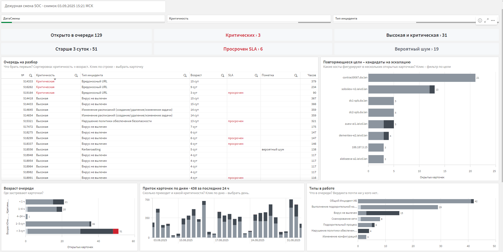
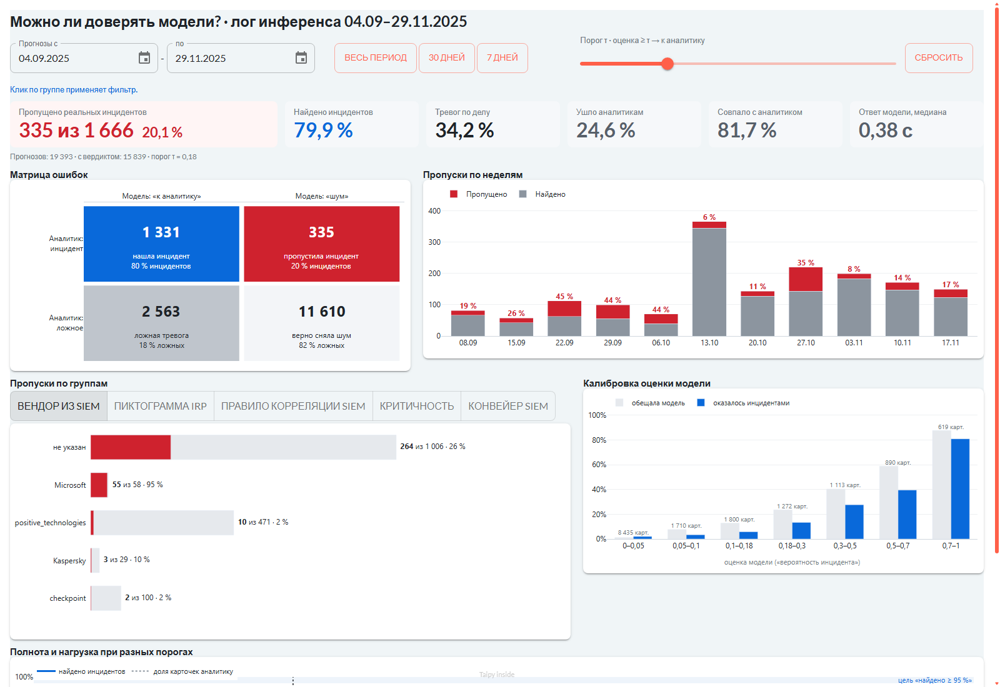
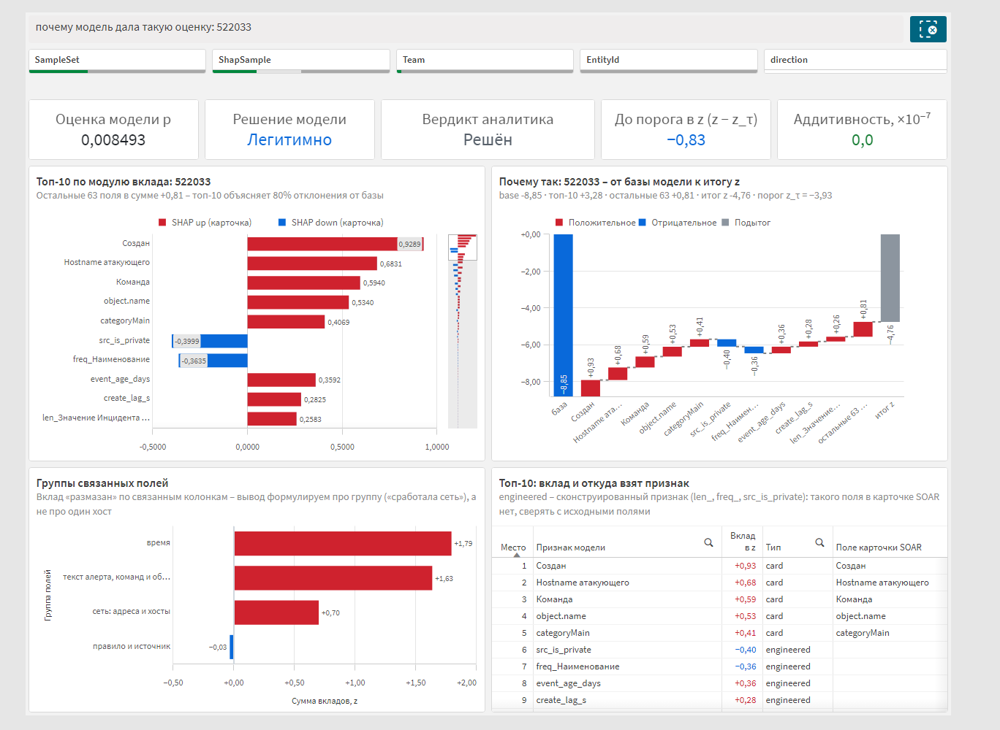

# Интеллектуальный анализ и визуализация данных

Проект и самостоятельные работы (СРС) по курсу «Интеллектуальный анализ и визуализация данных»: модуль 2 «Информационный дизайн и дескриптивная аналитика» и модуль 3 «Объяснимый ИИ (XAI) и оценка моделей».

**Команда:** Бабич Д.С., Синикова Д.Д., Сычева А.К.
**Группа:** 5130201/40101

## Данные

Датасет SOC-карточек `iavd_incidents_raw`: 240 295 карточек × 97 полей (критичность, вердикт, правило корреляции SIEM, число алертов, время создания и взятия в работу, SLA и др.), период 12.04.2024 – 03.09.2025.

- В СРС 2.1–2.3 разбирается самая нагруженная смена – **14.06.2024 (МСК)**: 4 689 карточек, 94 % без вердикта, 261 053 алерта.
- В СРС 2.4 и в проекте расчёты сделаны на **всём датасете**.
- В СРС 3.1 и 3.2 – на расширенном наборе `iavd_ml_dataset` (259 218 карточек по 20.11.2025): обучение до 04.09.2025, проверка 04.09–20.11.2025 – тот же период, что у лога инференса модели преподавателей. В СРС 3.3 и 3.4 – артефакты XAI модели курса `lgbm_gate1` (PDP, ICE, ALE, ablation, SHAP) и комплект практики 3.7: набор карточек команды – **№ 37**.

## Проект

| Часть | Дашборд | Зритель | Статус |
|---|---|---|---|
| 1 · карточки SOC | [Дежурная смена SOC](proekt-dashbord-soc/) – Taipy и Qlik | дежурный аналитик, старший смены | готово |
| 2 · инференс модели | [Можно ли доверять модели?](proekt-dashbord-model/) – Taipy и Qlik | руководство SOC | готово |
| 3 · SHAP | объяснения на уровне карточки, группы и потока | аналитики SOC | в работе |

### Часть 1 – дашборд дежурной смены SOC

Папка [`proekt-dashbord-soc/`](proekt-dashbord-soc/) содержит две реализации одного дашборда: **Qlik Sense** и **Taipy + Plotly**.

**Пользователь:** дежурный аналитик L1 или старший смены. Дашборд отвечает на вопросы текущей смены: сколько открыто, что горит, что брать первым, где застревают карточки. Снимок – 03.09.2025 15:21 МСК, по умолчанию показаны последние 30 дней.



| Блок | На какой вопрос отвечает |
|---|---|
| 6 кликабельных KPI: открыто, критических, высокая и критическая, старше 3 суток, просрочен SLA, вероятный шум | Сколько открыто и что горит? Клик фильтрует весь дашборд |
| Очередь на разбор | Что брать первым? Сортировка: критичность → просрочка SLA → возраст |
| Повторяющиеся цели | Какие хосты атакуют повторно – кандидаты на эскалацию |
| Возраст очереди | Где застревают карточки? |
| Приток по дням | Сколько приходит и какой критичности? |
| Типы в работе | Что сейчас в очереди? |
| 24 ч к среднесуточному | Что выросло сегодня? |
| Вероятный шум (гипотеза 1 СРС 2.4) | Что можно разобрать пачкой? |
| Поток по часам (гипотеза 2 СРС 2.4) | Когда смене нужно подкрепление? |

Учтены замечания с практик 2.5 и 2.6:

- красный цвет только у критических;
- легенда под заголовком;
- фильтр по дате;
- связанные графики;
- кликабельные KPI;
- карточка инцидента со ссылкой в NAD (в Taipy).

Подробности, скриншоты Taipy и контрольные цифры – в [README проекта](proekt-dashbord-soc/README.md). Как собрать лист в Qlik – в [`qlik/README.md`](proekt-dashbord-soc/qlik/README.md).

### Часть 2 – можно ли доверять модели?

Папка [`proekt-dashbord-model/`](proekt-dashbord-model/): лог инференса модели `wlarf-dec-jun-v3` из комплекта практики 3.6 – 19 393 прогноза по карточкам `iavd_ml_dataset` за 04.09–29.11.2025, метрики по 15 839 размеченным. Пять вопросов руководителя SOC, у каждого графика – «почему именно он».



- **Модель пропускает 20 % реальных инцидентов** (335 из 1 666 при пороге 0,18); порогом это не исправить – даже при τ = 0,02 найдено только 91 %.
- **Ошибки системные:** `Microsoft` – пропущено 55 из 58, «Управление УЗ» – 47 из 50, без конвейера SIEM – 89 из 95; сетевые (`positive_technologies`) – только 10 из 471.
- **Оценка – хороший рейтинг, но завышенная вероятность:** при оценке 0,3–0,5 инцидентами оказываются 28 %, а не 40 %.

## Практика 3.7 · «Почему так?»

Папка [`praktika-3.7-pochemu-tak/`](praktika-3.7-pochemu-tak/): набор карточек **№ 37**, модель курса `lgbm_gate1`. Три листа в приложении Qlik курса (карточка и решение → почему так → важность) и вкладка «Почему так?» в Taipy; [`note.md`](praktika-3.7-pochemu-tak/note.md) – вывод по 8 карточкам и два SHAP-кейса, [`checks.md`](praktika-3.7-pochemu-tak/checks.md) – контрольные числа.



## Самостоятельные работы

| № | Тема | Что сделано | Отчёт | Срок |
|---|------|-------------|-------|------|
| 2.1 | [Обзор карточек алертов](srs-2.1-obzor-kartochek/) | DIKW, ключевые поля, кодировки Критичности / Вердикта / алертов, эскиз обзора; дашборд в Qlik и Taipy | [PDF](srs-2.1-obzor-kartochek/report/srs-2.1_report.pdf) | 03.10.2026 |
| 2.2 | [«До → после»](srs-2.2-do-posle/) | Тезисы по квартету Анскомба; перегруженный и исправленный график «карточки по правилам SIEM» в Qlik, Taipy + Plotly и matplotlib | [PDF](srs-2.2-do-posle/report/srs-2.2_report.pdf) | 10.10.2026 |
| 2.3 | [Траектория взгляда](srs-2.3-traektoriya-vzglyada/) | F-паттерн чтения дашборда, правило 8 секунд, переставленный дашборд в Qlik и Taipy | [PDF](srs-2.3-traektoriya-vzglyada/report/srs-2.3_report.pdf) | 17.10.2026 |
| 2.4 | [EDA-гипотезы](srs-2.4-gipotezy-eda/) | Три бизнес-гипотезы по шаблону «гипотеза → поле → график» с проверкой на полном датасете в Qlik, Taipy + Plotly и matplotlib | [PDF](srs-2.4-gipotezy-eda/report/srs-2.4_report.pdf) | 24.10.2026 |
| 3.1 | [Метрики проекта](srs-3.1-metriki-proekta/) | Положительный класс «реальный инцидент», главные метрики – полнота (≥ 95 %) и точность; матрица ошибок, порог 0,11, кривые ROC и PR, пример с Fβ; ползунок порога и β в Taipy и Qlik | [PDF](srs-3.1-metriki-proekta/report/srs-3.1_report.pdf) | к 3.2 |
| 3.2 | [Матрица стоимости](srs-3.2-matrica-stoimosti/) | Черновик матрицы стоимости (C_FP – минуты L1, C_FN – часы реагирования, k ≈ 20); порог по минимуму k · FN + FP и сравнение с максимумом Fβ при β = √k; ползунок k в Qlik | [PDF](srs-3.2-matrica-stoimosti/report/srs-3.2_report.pdf) | к 3.6 |
| 3.3 | [Глобальные методы](srs-3.3-globalnye-metody/) | PDP, ICE и ALE по четырём числовым признакам; важность mean\|SHAP\| против ablation; карточка 528183 из набора 37 к разбору на 3.4; проверка base + Σφ = z и почему вероятности нельзя складывать | [PDF](srs-3.3-globalnye-metody/report/srs-3.3_report.pdf) | к 3.4 |
| 3.4 | [Локальные объяснения](srs-3.4-lokalnye-obyasneniya/) | Водопады SHAP по набору 37: FN 522033 и FP 519532 с топ-10 и хвостом «остальные 63 поля»; аддитивность base + Σφ = raw_score на 320 карточках (6,9·10⁻¹¹); вывод «данные / порог / признак» по 8 карточкам; разбор непонятной карточки 528183; вкладка «Почему так?» в Taipy и лист в Qlik | [PDF](srs-3.4-lokalnye-obyasneniya/report/srs-3.4_report.pdf) | к 3.7 |

В каждой папке: `README.md`, `report/` (pdf + docx), `qlik/` (скрипт загрузки и приложение `.qvf`), `python/`, `images/` (скриншоты), `data/`.

### Гипотезы СРС 2.4 – коротко

| № | Гипотеза | Что показал график |
|---|----------|--------------------|
| 1 | Небольшая группа правил SIEM даёт почти одни False Positive | 22 правила (≥ 300 карточек, ≥ 95 % FP) – 13,4 % разобранных карточек |
| 2 | Чем больше карточек приходит за час, тем чаще просрочен SLA взятия в работу | 9 % при 1–5 карточках в час → 46 % при > 100 |
| 3 | Критические карточки (SLA 2 мин) берут в работу медленнее остальных | Медиана 42,9 мин, 87 % сверх SLA |

## Инструменты

- **Qlik Sense Desktop** – BI-трек
- **Python** – ML-трек: pandas, pyarrow, Plotly, Taipy GUI, matplotlib

## Как запустить

1. Положить `iavd_incidents_raw_target.parquet` в папку `data/` нужной работы (в репозиторий датасет не загружен – слишком большой).
2. Python:
   ```bash
   cd proekt-dashbord-soc
   pip install -r requirements.txt
   python python/app.py
   ```
   Команды запуска для каждой работы – в её README.
3. Qlik Sense Desktop: скопировать `.qvf` из папки `qlik/` в `Документы\Qlik\Sense\Apps`, создать подключение к папке с parquet под именем `MyParquetFolder` и перезагрузить данные.
   Самое свежее приложение – `proekt-dashbord-soc/qlik/dashbord_soc.qvf`: в нём листы СРС 2.1–2.4 и лист «Дежурная смена SOC».
   Для модуля 3 – отдельное приложение на датасете `iavd_ml_dataset.parquet`; самая свежая версия – `srs-3.3-globalnye-metody/qlik/iavd_ml.qvf`: листы СРС 3.1, 3.2 и 3.3. Листы СРС 3.4 и практики 3.7 – в приложении курса `IAVD_Assessment_v05.qvf`; оно весит 192 МБ и лежит в [Release v3.7](https://github.com/Dasha-9/Intelligent-data-analysis-and-visualization/releases/tag/v3.7).
