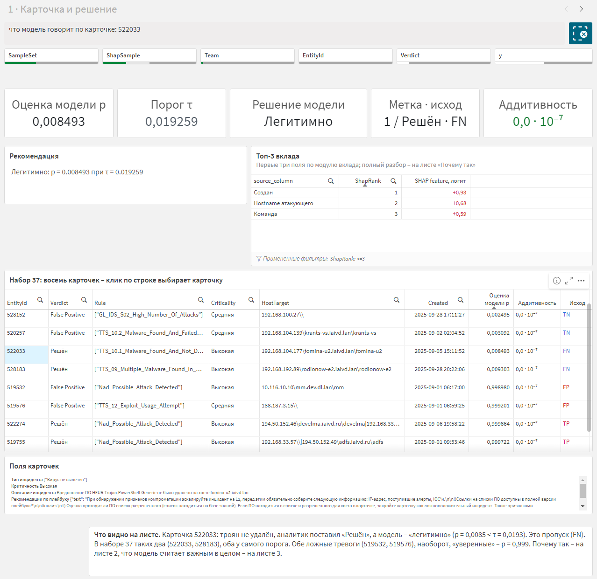
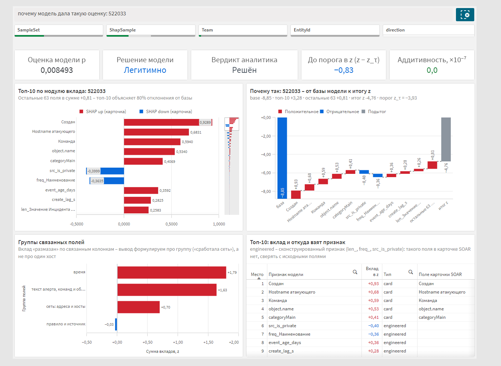
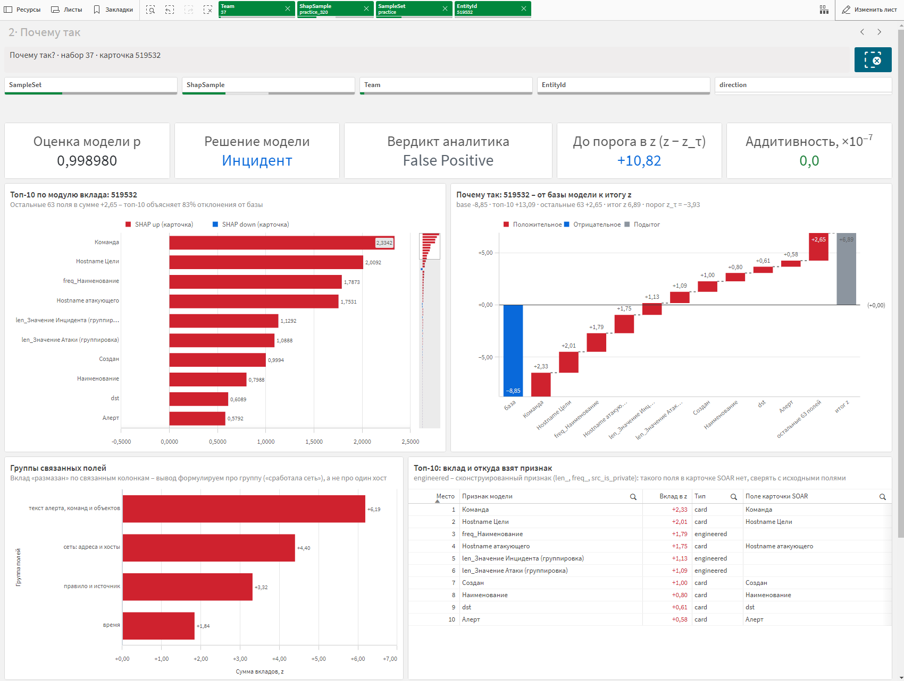
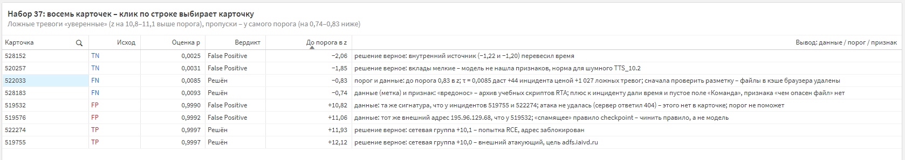
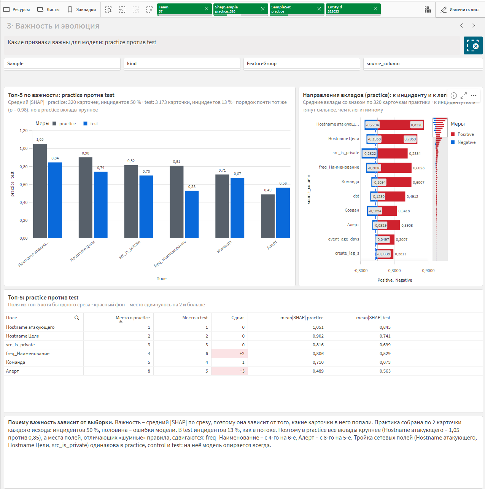
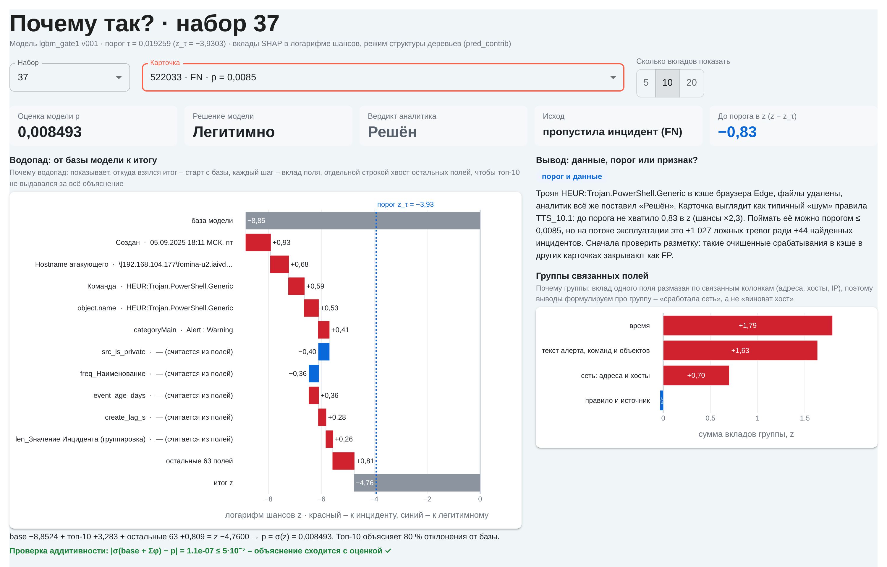
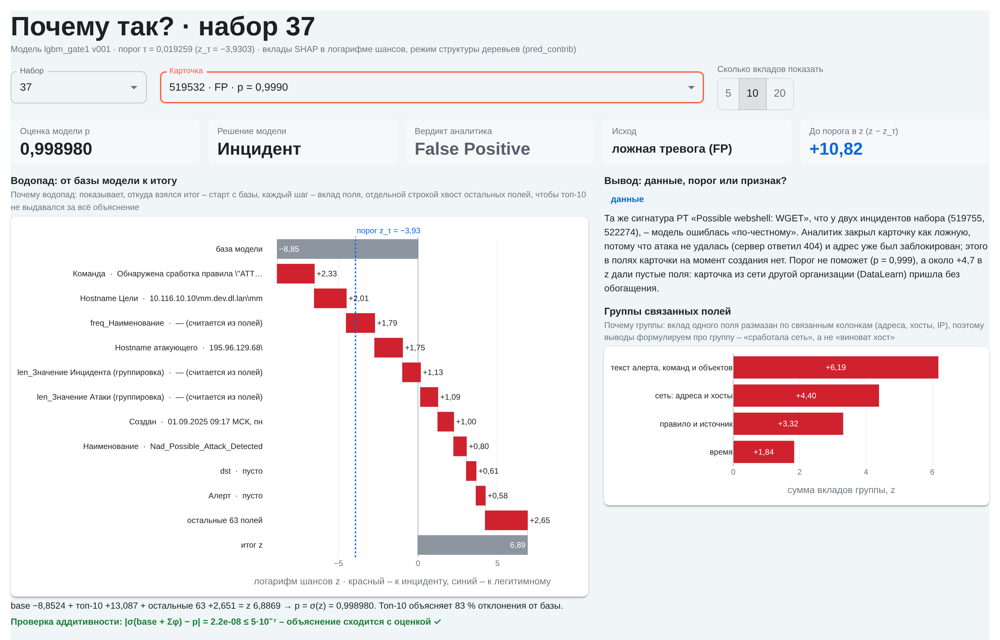

# Практика 3.7 · «Почему так?» – набор 37

**Курс:** Интеллектуальный анализ и визуализация данных · Модуль 3 «Объяснимый ИИ (XAI) и оценка моделей» · Практика 3.7
**Команда:** Бабич Д.С., Синикова Д.Д., Сычева А.К. · группа 5130201/40101
**Набор карточек:** № 37 (8 карточек, по 2 каждого исхода TP / FP / FN / TN)
**Модель:** `lgbm_gate1` v001 – модель курса, 73 признака, порог τ = 0,019259; вклады SHAP предрассчитаны преподавателями

## О чём практика

Модель курса решает по каждой карточке SOC: «инцидент» или «легитимно». На практике 3.7 команда берёт свой набор из 8 карточек и отвечает на три вопроса:
1. **Что решила модель** и совпало ли это с вердиктом аналитика?
2. **Почему модель так решила?** Какие поля карточки подтолкнули её к инциденту, а какие – к легитимному. Вклады SHAP в логарифме шансов, p = σ(base + Σφ).
3. **На что модель смотрит в целом** и почему эта картина зависит от выборки?

По каждой карточке нужен вывод по шаблону «что видит модель → почему так → что делать», где «что делать» – это **данные, порог или признак**.

Работа сделана в двух треках:
- **BI** – три листа в приложении Qlik курса;
- **ML** – вкладка «Почему так?» в Taipy.

## Что сдаётся

| Файл | Что внутри |
|---|---|
| [`note.md`](note.md) | одна страница: таблица выводов по 8 карточкам, два SHAP-кейса по шаблону (FN 522033 и FP 519532), сконструированные признаки, глобальная картина и общий вывод |
| [`checks.md`](checks.md) | контрольные числа: порог, база, z и score каждой карточки, аддитивность, водопад 522033, важность practice / test, цена сдвига порога – и как каждое число проверено |
| `screenshots/` | листы приложения по цепочке «проблема → разбор карточки → важность и вывод» и вкладка Taipy |
| `qlik/load_script_add.qvs` | добавка к скрипту приложения: группы полей и переменные |
| `python/` | вкладка Taipy |
| `IAVD_Assessment_v05.qvf` | приложение Qlik с тремя листами – в [Release v3.7](https://github.com/Dasha-9/Intelligent-data-analysis-and-visualization/releases/tag/v3.7) (файл 192 МБ, в git не помещается) |

## Как выполнены восемь шагов методички

| Шаг | Что требуется | Где сделано |
|---|---|---|
| 1. Найти свой набор | `Team = 37`, 8 карточек | выбирается сам при открытии листа; таблица набора на листах 1 и 2 |
| 2. Начать с FN | карточка, где модель промолчала | лист 2 открывается на FN 522033 |
| 3. Показать решение | `score`, `threshold`, `decision`; согласуется ли с `y` | лист 1: KPI и «Метка · исход»; столбец «Исход» в таблице набора |
| 4. Построить объяснение | `ShapRank ≤ 10`, направление, величина, `base` | лист 2: водопад и топ-10 |
| 5. Проверить аддитивность | \|σ(base + Σφ) − score\| ≤ 5·10⁻⁷, максимум по `EntityId` | лист 1: KPI – максимум по 8 карточкам; лист 2 – по выбранной |
| 6. Связать вклад с карточкой | отметить `kind = engineered` | лист 2: таблица топ-10 с типом признака и полем карточки; `note.md` |
| 7. Глобальная картина | `FACT_Importance` по срезам practice и test, топ-5, почему различаются | лист 3 |
| 8. Вывод по шаблону | «что видит → почему → что делать» | `note.md`; столбец «Вывод» в таблице набора на листе 2 |

## Набор 37 и главные выводы

| Карточка | Исход | p | z − z_τ | Что это |
|---|---|---|---|---|
| 528152 | TN | 0,0025 | −2,06 | верно |
| 520257 | TN | 0,0031 | −1,85 | верно |
| **522033** | **FN** | 0,0085 | −0,83 | порог и данные |
| **528183** | **FN** | 0,0093 | −0,74 | данные (метка) и признак |
| **519532** | **FP** | 0,9990 | +10,82 | данные |
| **519576** | **FP** | 0,9992 | +11,06 | данные (правило) |
| 522274 | TP | 0,9997 | +11,93 | верно |
| 519755 | TP | 0,9997 | +12,12 | верно |

- **Пропуски лежат у самого порога, ложные тревоги – «уверенные».** Между −0,74 и +10,82 в z нет ни одной карточки.
- **Обе FN – вредоносное ПО на хостах.** Вклад сети и правила почти нулевой. Главный «плюс» к инциденту – время создания (`Создан`), а в 528183 ещё и *пустое* поле «Команда». У самих меток есть вопросы:
  - 522033 – файлы в кэше браузера удалены, «действия не требуются»;
  - 528183 – архив учебных скриптов RTA.
- **Обе FP – вопрос данных, а не модели.**
  - 519532 по полям карточки неотличима от двух настоящих инцидентов набора (та же сигнатура wget-webshell). Аналитик закрыл её как ложную, потому что атака не удалась (ответ 404) – в карточке этого нет.
  - 519576 – «спамящее» правило checkpoint.
- **Порог не решение.** Чтобы поймать 522033, нужен τ ≤ 0,0085, а это +1 027 ложных тревог на потоке ради +44 инцидентов.
- **Глобально** модель опирается на тройку сетевых полей (Hostname атакующего, Hostname Цели, src_is_private), одинаковую в practice, control и test.

## BI-трек: три листа в Qlik Sense

Основа – листы-прототипы преподавателей из `IAVD_Assessment_v05.qvf`, доработанные под набор 37 и требования лекции 3.4. Цвета везде одни и те же: красный `#CF222E` – «к инциденту», синий `#0969DA` – «к легитимному», серый – база и итог.

### Лист 1 · Карточка и решение – «проблема»



| Объект | Что показывает |
|---|---|
| KPI «Оценка модели p», «Порог τ», «Решение модели» | что решила модель: 0,008493 < 0,019259 → «Легитимно» |
| KPI «Метка · исход» | вердикт аналитика и исход: «1 / Решён · FN» – решение не совпало с меткой |
| KPI «Аддитивность, макс. по набору» | худшее расхождение \|σ(base + Σφ) − score\| среди 8 карточек; 0,0 · 10⁻⁷ при допуске 5 · 10⁻⁷ |
| «Рекомендация» и «Топ-3 вклада» | рекомендация из лога и три крупнейших вклада: Создан +0,93, Hostname атакующего +0,68, Команда +0,59 |
| «Набор 37: восемь карточек» | все карточки набора: правило, критичность, хост, оценка, аддитивность, исход; клик по строке выбирает карточку для всего приложения |
| «Поля карточек» | тип и описание инцидента, рекомендации плейбука – то, что видит аналитик |
| Текст «Что видно на листе» | проблема в двух фразах: FN 522033 у порога, ложные тревоги «уверенные» |

### Лист 2 · Почему так – «разбор карточки»



| Объект | Что показывает | Почему так |
|---|---|---|
| KPI: оценка, решение, вердикт, «до порога в z», аддитивность | где карточка относительно порога: −0,83 у 522033, +10,82 у 519532 | одно число отвечает «поможет ли сдвиг порога» |
| Водопад «от базы модели к итогу z» | база −8,85 → 10 крупнейших вкладов → **остальные 63 поля** → итог z −4,76 | видно, как получается итог; хвост – отдельной ступенью, иначе итог не совпадёт с оценкой (−5,57 вместо −4,76) |
| «Топ-10 по модулю вклада» | те же 10 полей столбцами; в подзаголовке – сколько дают остальные 63 и какую долю объясняет топ-10 (80 %) | удобно сравнивать величины вкладов |
| «Группы связанных полей» | время / сеть / правило и источник / текст алерта и команд | вклад «размазан» по связанным колонкам, вывод формулируем про группу |
| «Топ-10: вклад и откуда взят признак» | место, признак, вклад, `card` / `engineered`, поле карточки SOAR | шаг 6: у 522033 пять из десяти признаков сконструированы, в карточке их нет |
| «Набор 37: восемь карточек» | исход, оценка, вердикт, до порога, **вывод «данные / порог / признак»** по каждой карточке | весь набор и выводы на одном листе; клик переключает разбор |

При открытии лист сам выбирает срез `practice` / `practice_320`, набор 37 и карточку 522033. Второй SHAP-кейс, FP 519532:



Выводы по всем восьми карточкам:



### Лист 3 · Важность и эволюция – «важность и вывод»



| Объект | Что показывает |
|---|---|
| «Топ-5 по важности: practice против test» | средний \|SHAP\| шести полей, входящих в топ-5 хотя бы одного среза; practice – серый, test – синий |
| «Направления вкладов (practice)» | средний вклад к инциденту и к легитимному по каждому полю: к инциденту поля тянут сильнее |
| «Топ-5: practice против test» | места в двух срезах и сдвиг; красный фон – сдвиг на 2 места и больше (freq_Наименование 4 → 6, Алерт 8 → 5) |
| Текст «Почему важность зависит от выборки» | практика собрана по 2 карточки каждого исхода (инцидентов 50 %), в test их 13 %; поэтому в practice вклады крупнее и места «шумовых» полей сдвигаются |

### Как открыть

1. Скачайте `IAVD_Assessment_v05.qvf` из [Release v3.7](https://github.com/Dasha-9/Intelligent-data-analysis-and-visualization/releases/tag/v3.7) и положите в `Документы\Qlik\Sense\Apps`.
2. Приложение откроется с сохранёнными данными. Перезагружать нужно только при обновлении данных. Тогда:
   - подключение `RootIAVD` → папка комплекта `IAVD_3.7_BI_team`, где лежит `data`;
   - в скрипте пути `lib://RootIAVD/data/5/Parquet/Gen/` и `lib://RootIAVD/data/2_5/Parquet/Gen/`;
   - последняя вкладка скрипта – [`qlik/load_script_add.qvs`](qlik/load_script_add.qvs) (группы полей, `vShapSample`, `vZTau`).

Формулы всех объектов листа 2 – в [инструкции СРС 3.4](../srs-3.4-lokalnye-obyasneniya/qlik/README.md).

## ML-трек: вкладка «Почему так?» в Taipy

То же объяснение для любого набора 1–40, без запуска модели – на готовых вкладах из комплекта:
- выбор набора и карточки;
- KPI: оценка, решение, вердикт, исход, расстояние до порога в z;
- водопад от базы через топ-5 / 10 / 20 и хвост к итогу, пунктиром – порог;
- строка проверки аддитивности;
- вывод «данные / порог / признак» – для набора 37 наш, для остальных – по шаблону;
- группы связанных полей;
- таблица вкладов со значениями полей из карточки.

| FN 522033 | FP 519532 |
|---|---|
|  |  |

```bash
pip install -r requirements.txt
# положите в data/ из IAVD_3.7_ML_team/course_pack/: cards_practice.csv, shap_cards.csv, cards_raw.parquet
python python/why_taipy.py        # откроется http://127.0.0.1:5082
```

Прогон самой модели и проверка base + Σφ = raw_score на всех 320 карточках (max 6,9 · 10⁻¹¹) – в [СРС 3.4](../srs-3.4-lokalnye-obyasneniya/), `python/local_shap.py`.

## Связь с другими работами

- [СРС 3.3](../srs-3.3-globalnye-metody/) – глобальные методы. Карточка 528183 отложена там как «непонятная».
- [СРС 3.4](../srs-3.4-lokalnye-obyasneniya/) – водопады, аддитивность и разбор 528183. Лист 2 этой практики – тот же лист.
- Проект, часть 3 – дашборд SHAP для аналитиков SOC: лист 2 станет его уровнем «карточка».

## Структура

```
README.md, note.md, checks.md
screenshots/   01–05 – листы Qlik по цепочке; taipy_* – вкладка Taipy
python/        shap_data.py – данные; why_taipy.py (+ .css) – вкладка Taipy
qlik/          load_script_add.qvs – добавка к скрипту приложения курса
data/          сюда кладутся файлы комплекта (в git не попадают)
```
