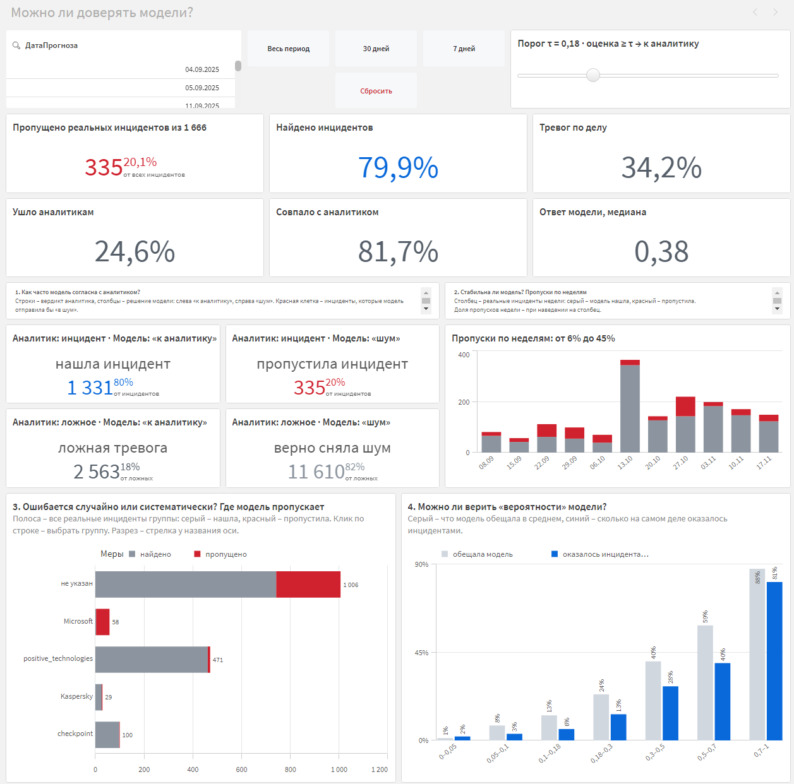
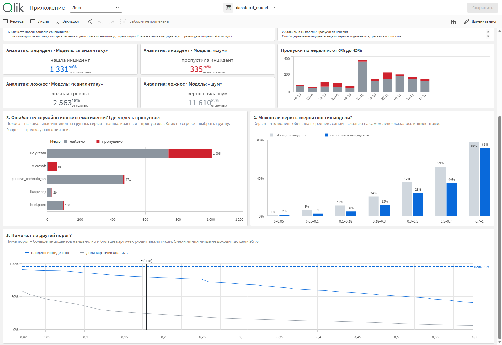

# Проект · Дашборд «Можно ли доверять модели?» (датасет 2 – лог инференса)

**Курс:** Интеллектуальный анализ и визуализация данных · проект, часть 2 (датасет «инференс модели»)
**Команда:** Бабич Д.С., Синикова Д.Д., Сычева А.К. · группа 5130201/40101
**Данные:** `MODEL_PREDICTIONS_target.parquet` из комплекта практики 3.6 (BI-трек) – лог модели-советчика `wlarf-dec-jun-v3`, 19 393 прогноза за 04.09–29.11.2025. Прогнозы сделаны по карточкам `iavd_ml_dataset`: 16 419 из них есть в датасете, вердикты совпадают. Метрики считаются по **15 839 размеченным** прогнозам (`Flag_ValidLabel = 1`). Порог приложения курса τ = 0,18.

## Для кого и зачем

Зритель – **руководство SOC**, не специалисты по машинному обучению. Задача дашборда – честно ответить, можно ли доверять модели. Главная цифра для SOC – **доля пропущенных реальных инцидентов**: она стоит первой и это единственная красная плитка в ряду KPI. Подписи – словами («нашла / пропустила инцидент»), без кодов TP / FN и терминов вроде recall.

## Вопросы руководителя и почему выбран именно этот график

| # | Вопрос | Ответ на данных | График | Почему именно он |
|---|---|---|---|---|
| KPI | Сколько реальных инцидентов модель пропускает? | **335 из 1 666 – 20,1 %**; найдено 79,9 %, тревог по делу 34,2 %, аналитикам уходит 24,6 % карточек, совпадение с аналитиком 81,7 %, ответ модели – 0,38 с | ряд KPI, первая плитка красная | одно число отвечает на главный вопрос быстрее любого графика; дробь «335 из 1 666» понятнее процента; скорость ответа – общая характеристика модели в эксплуатации |
| 1 | Как часто модель согласна с аналитиком? | в 81,7 % случаев – но согласие держится на 11 610 верно снятых «ложных», а из инцидентов 20 % уходят «в шум» | матрица 2 × 2 в карточках | руководителю нужны сами количества и подписи словами; цветом выделена только опасная клетка |
| 2 | Стабильна ли модель? | нет: с 22.09 по 12.10 модель пропускала около 44 % инцидентов, в неделю 13.10 – 6 %, в неделю 27.10 – снова 35 % | столбцы по неделям: найдено + пропущено, подпись – доля пропусков | неделя – естественный период отчёта; сложенный столбец показывает и объём, и долю пропусков сразу |
| 3 | Ошибается случайно или систематически? | **систематически**: `Microsoft` – пропущено 55 из 58 (95 %), «Управление УЗ» – 47 из 50 (94 %), карточки без конвейера SIEM – 89 из 95 (94 %), правило `GSOC_Kaspersky_Endpoint_Security_stopped` – 27 из 28; сетевые инциденты `positive_technologies` – только 10 из 471 (2 %) | горизонтальные столбцы «все инциденты группы / пропущенные», 5 разрезов, клик – фильтр всего дашборда | доля пропусков без размера группы обманчива: серый столбец – размер, красный – пропуски, подпись «N из M · %»; сортировка по числу пропусков показывает, где теряется больше всего |
| 4 | Можно ли верить «вероятности» модели? | как рейтингу – да (чем выше оценка, тем больше инцидентов: 2 % → 81 %), как вероятности – нет: модель завышает, при оценке 0,3–0,5 обещает в среднем 40 %, а инцидентами оказываются 28 % | парные столбцы «обещала модель / оказалось инцидентами» по корзинам оценки | сравнение двух столбцов рядом читается без термина «калибровка»; подпись – сколько карточек в корзине |
| 5 | Поможет ли другой порог? | нет: даже при τ = 0,02 найдено только 91 %, а аналитикам уходит 58 % карточек; цель «≥ 95 %» из СРС 3.1 порогом не достигается | линии «найдено» и «доля карточек аналитику» по порогу, синяя полоса – цель 95 %; ползунок порога пересчитывает весь дашборд | обмен «пропуски ↔ нагрузка» виден на одной оси; ползунок даёт руководителю попробовать самому |

Фильтр периода и кнопки «30 дней / 7 дней» показывают ещё одну деталь: у прогнозов последней недели (23–29.11) вердиктов аналитиков ещё нет, поэтому проверить модель на них пока нельзя.

**Вывод для руководства.** Модели можно доверять снятие шума по **сетевым** срабатываниям (`positive_technologies`, NAD): пропущено 2 %. **Нельзя доверять** карточки Windows-хостов (`Microsoft`), учётных записей («Управление УЗ») и карточки без обогащения (конвейер SIEM не указан): там модель пропускает почти все инциденты. При этом по `Microsoft` она «совпадает с аналитиком» в 95 % случаев – просто потому, что почти все такие карточки ложные. Порогом это не исправить: нужно восстанавливать обогащение карточек или переобучать модель на этих типах. Пока – отправлять такие карточки аналитику в обход модели.

## Сценарии пользователя

**1. Можно ли отдать модели карточки Windows-хостов?** Руководитель выбирает разрез «Вендор из SIEM» и кликает `Microsoft`. Весь дашборд фильтруется: пропущено **55 из 58** инцидентов (95 %), модель нашла только 3. При этом «совпало с аналитиком» – 95 %: модель почти всегда говорит «шум», а почти все такие карточки и правда ложные. Среди пропущенных чаще всего правило `GSOC_Kaspersky_Endpoint_Security_stopped` (13) – остановка антивируса.
*Вывод:* высокое «совпадение» здесь обманчиво. Карточки `Microsoft` нельзя доверять модели – их нужно отправлять аналитику в обход неё.

**2. Почему в неделю 27.10 пропусков стало 35 %?** На графике «Пропуски по неделям» неделя 27.10 выделяется: пропущено 77 из 220. Руководитель выбирает разрез «Конвейер SIEM» и кликает «не указан»: у карточек без конвейера пропущено **89 из 95**, и 52 из них пришлись именно на неделю 27.10 (пропущено 49).
*Вывод:* всплеск – не «плохая неделя модели», а партия карточек без обогащения. Модель слепнет, когда у карточки нет данных конвейера; чинить нужно сбор данных, а не модель.

**3. А если просто снизить порог?** Руководитель сдвигает ползунок с 0,18 до 0,09. Пропусков становится **208 вместо 335** (найдено 87,5 %), но аналитикам уходит уже **38,9 %** карточек вместо 24,6 %, а тревог по делу – 23,6 % вместо 34,2 %. На графике 5 видно, что даже при 0,02 найдено только 91 % – цель 95 % недостижима.
*Вывод:* снижение порога даёт 127 найденных инцидентов ценой 2 144 лишних ложных тревог (4 707 вместо 2 563) и всё равно не закрывает слепые зоны из сценариев 1–2. Порог – не решение.

**4. Проверить модель на свежих прогнозах.** Руководитель нажимает «7 дней» (23–29.11): прогнозов 2 229, но ни у одного ещё нет вердикта аналитика – все метрики пустые, подсказка под KPI объясняет почему.
*Вывод:* качество модели видно только с задержкой, пока аналитики не разберут карточки. Отчёт о доверии к модели имеет смысл строить по закрытым неделям, а свежие прогнозы – помечать как непроверенные.

**5. Можно ли сортировать очередь по оценке модели?** График 4 «Можно ли верить вероятности»: чем выше оценка, тем больше среди карточек инцидентов – от 2 % в группе 0–0,05 до 81 % в группе 0,7–1. Но сами числа завышены: при оценке 0,3–0,5 модель обещает 40 %, а инцидентов 28 %.
*Вывод:* оценкой можно пользоваться как рейтингом – ставить карточки с высокой оценкой в начало очереди, но нельзя читать её как вероятность и обещать руководству «90 % уверенности».

## Qlik Sense

Тот же дашборд собран в Qlik: шесть KPI, пять вопросов, ползунок порога через переменную `vTauM`. Как собрать – [`qlik/README.md`](qlik/README.md).

| Шапка, KPI, вопросы 1–4 | Вопрос 5 |
|---|---|
|  |  |

## Структура

```
python/   model_data.py – метрики и разрезы (pandas); app.py – приложение Taipy; app.css – стили
qlik/     load_script.qvs – скрипт загрузки; dashbord_model.qvf – приложение; README.md – как собрать лист
images/   скриншоты
data/     сюда кладётся MODEL_PREDICTIONS_target.parquet (в git не попадает)
```

## Как запустить

Taipy 4.1 работает на Python 3.10–3.12.

```bash
pip install -r requirements.txt
# положите MODEL_PREDICTIONS_target.parquet в data/, затем из этой папки:
python python/app.py          # откроется http://127.0.0.1:5081
```

Проверка чисел без интерфейса: `python python/model_data.py`.

Qlik Sense Desktop: скопируйте `qlik/dashbord_model.qvf` в `Документы\Qlik\Sense\Apps`, создайте подключение `MyParquetFolder` к папке с parquet и перезагрузите данные.
