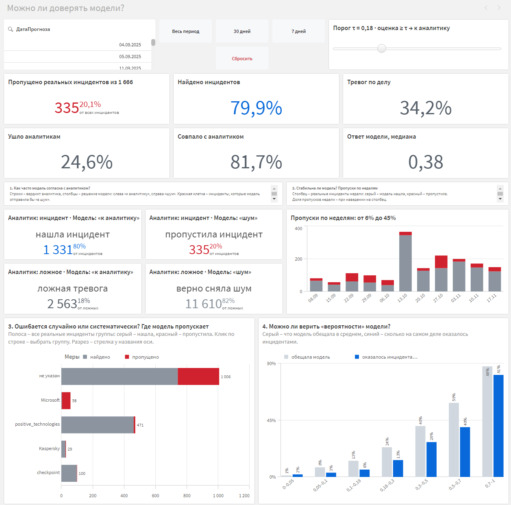
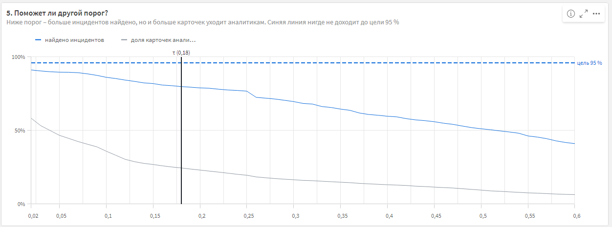

# Дашборд «Можно ли доверять модели?» в Qlik Sense Desktop

Тот же набор, что в Taipy-версии: шапка с периодом и порогом, шесть KPI и пять вопросов руководителя SOC. Клик по столбцу любой диаграммы выбирает значение и пересчитывает весь лист. Порог τ – переменная `vTauM`, её меняет ползунок.

| Шапка, KPI, вопросы 1–4 | Вопрос 5 |
|---|---|
|  |  |

## 0. Загрузка

1. Положите `MODEL_PREDICTIONS_target.parquet` в папку подключения `MyParquetFolder`.
2. Создайте **отдельное** приложение `dashbord_model`: поле `y` в других приложениях курса связало бы таблицы.
3. После строк `SET` вставьте [`load_script.qvs`](load_script.qvs) и нажмите «Загрузить данные».

Дата в parquet может прийти и как дата, и как текст `YYYY-MM-DD`, поэтому в скрипте стоит `Alt(Date#(Text([Дата]), …), [Дата])`. С одним `Date#()` поля `ДатаПрогноза` и `Неделя` получаются пустыми.

**Проверка:** `Count(Прогноз)` = 19 393 · `Sum(Размечено)` = 15 839 · `Sum(Факт)` = 1 666 · `Count({<Факт={1}>} If(Оценка < vTauM, Прогноз))` = 335.

Цвета: пропуск – `#CF222E` (единственный красный), найдено – `#0969DA`, остальное – `#57606A` / `#8C959F`, «обещала модель» – `#D0D7DE`.

## 1. Шапка

| Объект | Настройки |
|---|---|
| Панель фильтров | `ДатаПрогноза` |
| «Весь период» | действие «Очистить от выборок в поле» → `ДатаПрогноза` |
| «30 дней» / «7 дней» | «Выберите значения, соответствующие условию поиска» → `ДатаПрогноза` → `='>=' & Date(Max({1} ДатаПрогноза) - 29)` (для 7 дней: `- 6`) |
| Ползунок порога | «Ввод переменной» → `vTauM`, 0,02…0,6, шаг 0,01; заголовок `='Порог τ = ' & Num(vTauM, '0,00') & ' · оценка ≥ τ → к аналитику'` |
| «Сбросить» | «Очистить от всех выборок» + «Задать значение переменной» `vTauM` = `0.18` |

У кнопок – фиксированный размер шрифта: с автоподбором лист подвисает при перетаскивании.

## 2. KPI

У всех KPI подпись меры скрыта: «Представление» → «Показать заголовок» выкл, или метка `=' '`. Иначе Qlik пишет над числом формулу.

| Плитка | Мера | Контроль |
|---|---|---|
| `='Пропущено реальных инцидентов из ' & Num(Sum(Факт), '# ##0', ',', ' ')` | `Count({<Факт={1}>} If(Оценка < vTauM, Прогноз))` + вторая мера `… / Sum(Факт)` | 335 · 20,1 % |
| Найдено инцидентов | `Count({<Факт={1}>} If(Оценка >= vTauM, Прогноз)) / Sum(Факт)` | 79,9 % |
| Тревог по делу | `Count({<Факт={1}>} If(Оценка >= vTauM, Прогноз)) / Count({<Размечено={1}>} If(Оценка >= vTauM, Прогноз))` | 34,2 % |
| Ушло аналитикам | `Count({<Размечено={1}>} If(Оценка >= vTauM, Прогноз)) / Sum(Размечено)` | 24,6 % |
| Совпало с аналитиком | `(Count({<Факт={1}>} If(Оценка >= vTauM, Прогноз)) + Count({<Факт={0}>} If(Оценка < vTauM, Прогноз))) / Sum(Размечено)` | 81,7 % |
| Ответ модели, медиана | `Median(Задержка)` | 0,38 с |

## 3. Вопрос 1 – матрица согласия

Четыре KPI квадратом 2 × 2. Основная мера – количество, вторая – доля внутри строки.

| Клетка | Мера | Доля | Контроль |
|---|---|---|---|
| нашла инцидент | `Count({<Факт={1}>} If(Оценка >= vTauM, Прогноз))` | `… / Sum(Факт)` | 1 331 · 80 % |
| пропустила инцидент | `Count({<Факт={1}>} If(Оценка < vTauM, Прогноз))` | `… / Sum(Факт)` | 335 · 20 % |
| ложная тревога | `Count({<Факт={0}>} If(Оценка >= vTauM, Прогноз))` | `… / (Sum(Размечено) - Sum(Факт))` | 2 563 · 18 % |
| верно сняла шум | `Count({<Факт={0}>} If(Оценка < vTauM, Прогноз))` | `… / (Sum(Размечено) - Sum(Факт))` | 11 610 · 82 % |

## 4. Вопрос 2 – пропуски по неделям

Линейчатая, вертикальная, «Стопкой». Измерение `Неделя`, нулевые значения выключены (у последней недели нет вердиктов).

- Меры: `найдено` – `Count({<Факт={1}>} If(Оценка >= vTauM, Прогноз))`, `пропущено` – `Count({<Факт={1}>} If(Оценка < vTauM, Прогноз))`, цвета из библиотеки. «Найдено» – первой, чтобы серое было основанием.
- Доля пропусков недели – во всплывающей подсказке.
- Заголовок: `='Пропуски по неделям: от ' & Num(Min(Aggr(Count({<Факт={1}>} If(Оценка < vTauM, Прогноз)) / Sum(Факт), Неделя)), '0%') & ' до ' & Num(Max(Aggr(…, Неделя)), '0%')` → «от 6 % до 45 %».

Комбинированную диаграмму здесь использовать не получилось: в этой версии Qlik она допускает только одну меру-столбец.

## 5. Вопрос 3 – где модель пропускает

Линейчатая, горизонтальная, «Стопкой». Измерение `Вендор` с альтернативными `Пиктограмма`, `Правило`, `Конвейер`, `КритичностьМ`: разрез меняется стрелкой у названия оси. Ограничение «8 лучших» с двумя мерами недоступно, поэтому условие стоит внутри мер:

```
If(Sum(Факт) >= 5 and Rank(Count({<Факт={1}>} If(Оценка < vTauM, Прогноз)), 4) <= 8, Count({<Факт={1}>} If(Оценка >= vTauM, Прогноз)))   // найдено
If(Sum(Факт) >= 5 and Rank(Count({<Факт={1}>} If(Оценка < vTauM, Прогноз)), 4) <= 8, Count({<Факт={1}>} If(Оценка < vTauM, Прогноз)))    // пропущено
```

Сортировка: измерение первым, по выражению `Count({<Факт={1}>} If(Оценка < vTauM, Прогноз))`, по убыванию. Нулевые значения выключены.

Контроль (вендор): не указан 742 + 264 · `Microsoft` 3 + **55** · `positive_technologies` 461 + 10 · Kaspersky 26 + 3 · checkpoint 98 + 2.

## 6. Вопрос 4 – можно ли верить «вероятности»

Линейчатая, вертикальная, «Сгруппированные». Измерение `КорзинаОценки` (из скрипта). Меры с форматом `0%`: `обещала модель` – `Avg({<Размечено={1}>} Оценка)`, `оказалось инцидентами` – `Avg(Факт)`.

Контроль: 1/2 · 8/3 · 13/6 · 24/13 · **40/28** · 59/40 · 88/81 %.

## 7. Вопрос 5 – поможет ли другой порог

Линейный график, измерение `ПорогМ` (непрерывная ось). Меры с форматом `0%`:
- `найдено инцидентов` – `Count({<Факт={1}>} If(Оценка >= ПорогМ, Прогноз)) / Sum(Факт)`;
- `доля карточек аналитику` – `Count({<Размечено={1}>} If(Оценка >= ПорогМ, Прогноз)) / Sum(Размечено)`.

Опорная линия по Y – `0.95` («цель 95 %»), опорная линия **измерения** – `=vTauM` («τ»): она сдвигается вместе с ползунком. Обычная опорная линия с `vTauM` легла бы горизонтально на уровне 18 %.

Контроль: при τ = 0,02 найдено 91 % (аналитику 58 %), при 0,18 – 80 % (25 %), при 0,6 – 41 % (7 %).

## Почему эти графики и сценарии

Обоснование каждого графика и пять пользовательских сценариев – в [README дашборда](../README.md). В Qlik сценарии повторяются теми же действиями: клик по `Microsoft`, разрез «Конвейер» → «не указан», ползунок на 0,09, кнопка «7 дней».
