# Проект · Дашборд «Можно ли верить объяснению модели?» (датасет 3 – SHAP)

**Курс:** Интеллектуальный анализ и визуализация данных · проект, часть 3 (SHAP-датасет)
**Команда:** Бабич Д.С., Синикова Д.Д., Сычева А.К. · группа 5130201/40101
**Данные:** BI-комплект практики 3.7, срез `productive_20584`:
- 20 584 карточки эксплуатации SOC, из них 19 924 с вердиктом;
- вклады SHAP модели курса `lgbm_gate1` v001 по 73 полям;
- оценка модели `score`, метка `y`.

Порог τ = 0,019259: оценка ≥ τ – «инцидент».

## Для кого и зачем

Зритель – **аналитик SOC (L1/L2)**. Модель решает, похожа ли карточка на инцидент, а SHAP раскладывает это решение по полям карточки: сколько каждое поле добавило «к инциденту» (красный) или «к легитимному» (синий). По заданию объяснение должно быть **понятным и проверяемым**. Поэтому дашборд не просто показывает вклады, а сверяет доводы модели с вердиктами аналитиков на трёх уровнях:
- **поток** – вопросы 1–3;
- **группа** – вопрос 4;
- **карточка** – вопрос 5.

Главный вопрос – **когда объяснению модели можно верить, а когда нет**.

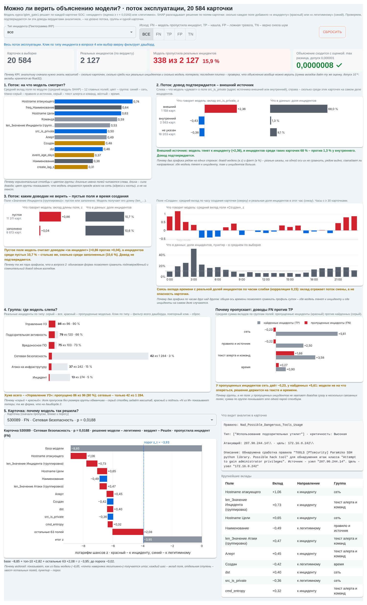

## Вопросы аналитика и почему выбран именно этот график

| # | Уровень | Вопрос | Ответ на данных | График | Почему именно он |
|---|---|---|---|---|---|
| KPI | поток | Какой масштаб и можно ли верить объяснению вообще? | 20 584 карточки, 2 127 реальных инцидентов, **модель пропустила 338 (15,9 %)**; сумма вкладов даёт ту же оценку с точностью 0,0000008 | ряд KPI, плитка пропусков красная | одно число отвечает быстрее графика; последняя плитка – проверка аддитивности: без неё объяснение нельзя принимать |
| 1 | поток | На что модель смотрит? | на **сеть**: Hostname атакующего (0,74), Hostname Цели (0,63), src_is_private (0,50); затем частота правила (0,64) и текст «Команды» (0,59) | горизонтальные столбцы среднего модуля вклада, цвет – группа полей | длинные имена полей читаются слева, длина – сила довода; цвет группы сразу показывает, что ведущая группа – сеть |
| 2 | поток | Довод подтверждается данными? – **подтверждённый случай** | **внешний адрес источника**: модель тянет к инциденту (+2,36), и инцидентов среди таких карточек **68 %** – против 1,3 % у внутреннего и 8,1 % у неуказанного | два графика на одних строках: слева средний вклад поля, справа доля инцидентов | довод (в z) и факт (в %) – разные шкалы, на одной оси их не сравнить; рядом видно, совпадает ли направление |
| 3 | поток | Каким доводам не верить? – **сомнительный случай** | **пустое поле «Значение Инцидента (группировка)»**: модель даёт +0,86 к инциденту, а инцидентов среди пустых 10,7 % – столько же, сколько среди заполненных (10,6 %). **Время создания**: связь вклада с реальной долей инцидентов по часам слабая (корреляция 0,15): в 0:00 вклад +0,85 при 9,7 % инцидентов, в 3:00 – +0,34 при 51 % | та же пара графиков, что в вопросе 2; для времени – два графика по часам друг над другом | одинаковая форма с вопросом 2 позволяет сравнить подтверждённый и сомнительный довод одним взглядом; общая ось часов показывает, где профиль модели и профиль инцидентов расходятся |
| 4 | группа | Где модель слепа и почему? | «Управление УЗ» – пропущено **86 из 96** (90 %), «Вредоносное ПО» – 75 из 103, «Подозрительная активность» – 79 из 120; сетевые – только 42 из 1 284 (3 %). У пропущенных инцидентов группа «сеть» даёт −0,23, у найденных +5,61 | серый столбец – все инциденты типа, красный – пропущенные, подпись «N из M · %»; рядом – суммы вкладов по группам полей, FN против TP | доля пропусков без размера группы обманчива – серый задаёт масштаб (та же форма, что на дашборде 2); группы полей показывают причину: у пропущенных не хватает доводов сразу в нескольких связанных полях |
| 5 | карточка | Почему модель так решила по этой карточке? | водопад для любой карточки выборки; сначала – пропуски ближе к порогу | водопад «база → 10 вкладов → остальные 63 полей → итог z», пунктир – порог; рядом поля карточки и таблица вкладов | видно, как из базы −8,85 получается итог; хвост – отдельной ступенью, иначе итог не совпадёт с оценкой; поля карточки рядом – чтобы сверить довод с тем, что видит аналитик |

Под каждым графиком в дашборде есть серая строка «Почему …». Под вопросами 2–4 – вывод цветом: зелёный, если довод подтверждается, жёлтый – если нет. Выводы пересчитываются при выборе типа инцидента.

**Фильтры:**
- **тип инцидента** (`Пиктограмма IRP`) – выпадающий список или клик по столбцу в вопросе 4;
- **исход** (FN / TP / FP / TN) – переключатель.

Исход фильтрует KPI, вопрос 1 и список карточек в вопросе 5. Вопросы 2–4 сравнивают доли инцидентов, поэтому фильтр по исходу на них не действует, иначе доля инцидентов теряет смысл.

## Сценарии пользователя

**1. Можно ли доверить модели карточки «Управление УЗ»?** Аналитик кликает «Управление УЗ» в вопросе 4. Пропущено **86 из 96** реальных инцидентов (89,6 %). Вопрос 1 меняется: главными доводами становятся задержки (`create_lag_s`, `event_age_days`) и текст «Команды», а сеть уходит вниз. У пропущенных инцидентов группа «сеть» даёт −0,04, у найденных +0,92; «правило и источник» – −0,24 против +0,99.
*Вывод:* для учётных записей модели не на что опереться: сети в таких карточках почти нет, а правило она «не узнаёт». Карточки «Управление УЗ» разбирать вручную, не доверяя оценке модели.

**2. А сетевым карточкам доверять можно?** Аналитик выбирает «Сетевая безопасность». Пропущено только **42 из 1 284** (3 %). Довод «внешний источник» здесь ещё сильнее: вклад +2,48, а инцидентов среди 786 карточек с внешним источником **77,7 %**, с внутренним – 0,4 %. Зато пустое поле группировки и здесь даёт +0,88, хотя инцидентов среди пустых *меньше* (21,1 %), чем среди заполненных (32,5 %).
*Вывод:* на сетевых карточках объяснение модели можно читать как есть: её главный довод подтверждается данными. Плюс от пустого поля надо мысленно вычитать.

**3. Откуда берутся ложные тревоги?** Аналитик нажимает «FP». 2 819 ложных тревог:
- 1 773 – «Сетевая безопасность», из них 1 582 – одно правило `Nad_Possible_Attack_Detected`;
- среди главных доводов – частота правила (+0,95 в среднем), хост атакующего (+0,89) и пустое поле группировки (+0,82);
- у 83 % ложных тревог это поле пустое, а по всему потоку – у 57 %.

*Вывод:* сомнительный довод из вопроса 3 – не мелочь: он заметно подталкивает к ложным тревогам. Обогащение поля «Значение Инцидента (группировка)» уберёт часть шума. Остальное – одно «шумное» правило NAD, его стоит донастроить.

**4. Стоит ли верить доводу «время создания»?** Без фильтров, вопрос 3 справа:
- модель сильнее всего тянет к инциденту в 0–1 ч и 22–23 ч (+0,8…+1,2), а реальная доля инцидентов там 10–19 %;
- пик инцидентов – 3:00 (51 %), а вклад всего +0,34;
- в 4–6 ч инцидентов 16–22 % (выше среднего), но вклад отрицательный.

*Вывод:* вклад времени отражает поток и смены, а не опасность карточки. Аналитику не стоит считать «ночное время» доводом в пользу инцидента или против него.

**5. Почему пропущена 536708?** Аналитик выбирает «Управление УЗ» и «FN» – первой в списке идёт 536708 («Kaspersky Endpoint Security отключён», критичность высокая):
- p = 0,0179, до порога не хватило 0,07 в z;
- самый большой «плюс» (+1,14) дало *пустое* поле группировки;
- категория и текст алерта добавили +0,78…+0,59;
- частота правила тянет к легитимному (−0,56): `GSOC_Kaspersky_Endpoint_Security_stopped` обычно оказывается шумом.

*Вывод:* модель почти поймала карточку, но на сомнительных доводах. Отключение антивируса на хосте – повод разобрать карточку вручную независимо от оценки. Это же правило – главный источник пропусков «Управление УЗ» (25 из 86) и одна из слепых зон дашборда 2.

| 1. Клик по «Управление УЗ» | 2. «Сетевая безопасность» |
|---|---|
| 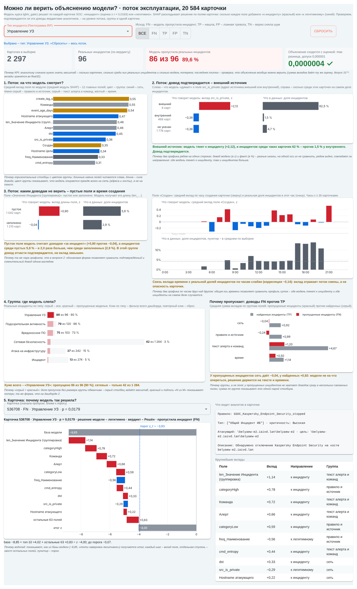 | 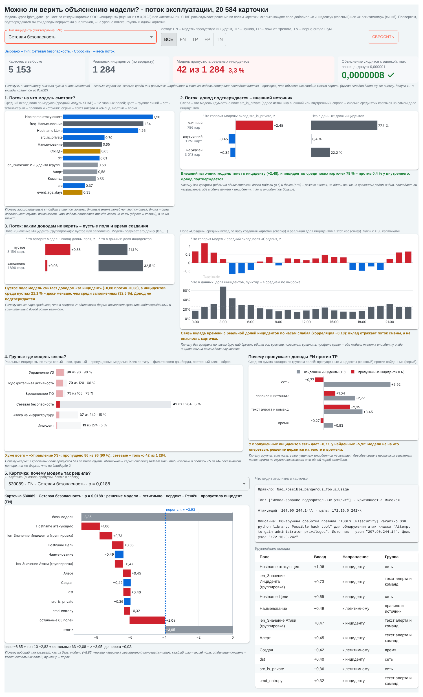 |
| **3. Исход «FP»** | **4–5. Время создания и карточка 536708** |
| 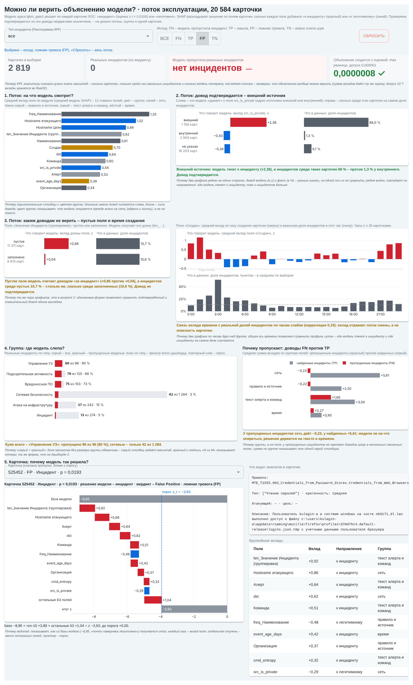 | 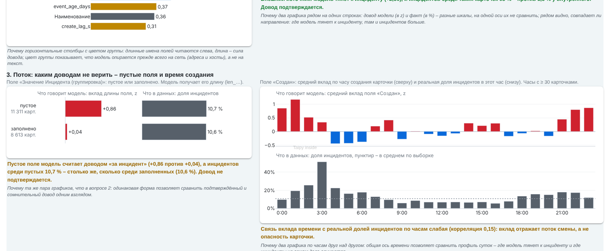 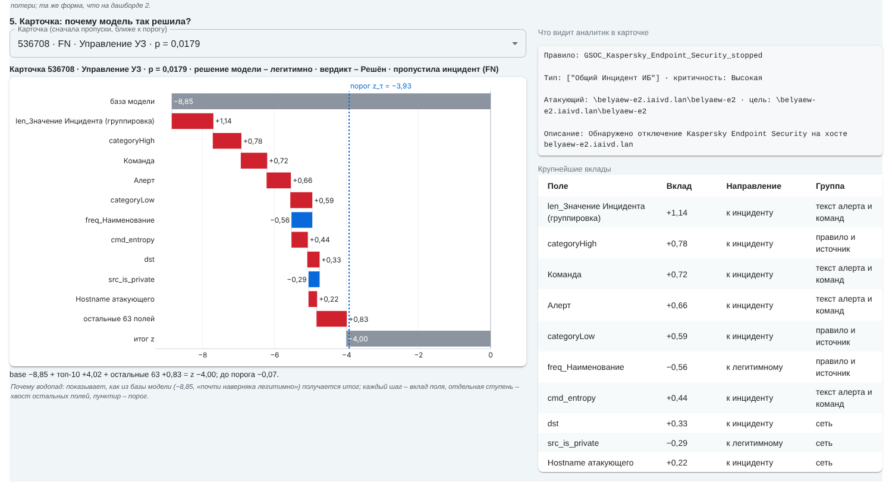 |

## Вывод для аналитиков SOC

**Можно верить:**
- доводам модели о **сети** – внешний источник, хост атакующего;
- её решениям по **сетевым карточкам**: там пропущено 3 % инцидентов, и главный довод подтверждается вердиктами.

**Нельзя верить:**
- **пустым полям** – пустая группировка даёт «плюс» к инциденту, а реальная доля инцидентов от неё не растёт и подталкивает к ложным тревогам;
- **времени создания** – отражает смену, а не угрозу;
- решениям модели по **учётным записям, вредоносному ПО и подозрительной активности**: там она пропускает 66–90 % инцидентов, потому что сетевых доводов в таких карточках нет.

Такие карточки разбирать вручную. Улучшать – обогащение полей и признаки содержания, а не порог.

## Qlik Sense

Тот же дашборд собран в Qlik – отдельное приложение `dashboard_shap.qvf` (192 МБ, в [Release v3.8](https://github.com/Dasha-9/Intelligent-data-analysis-and-visualization/releases/tag/v3.8)) на данных практики 3.7: KPI, пять вопросов и таблица карточек; клик по типу или по карточке фильтрует лист. Числа совпадают с Taipy. Как собрать – [`qlik/README.md`](qlik/README.md).

| Шапка, KPI, вопросы 1–2 | Вопрос 3 |
|---|---|
| 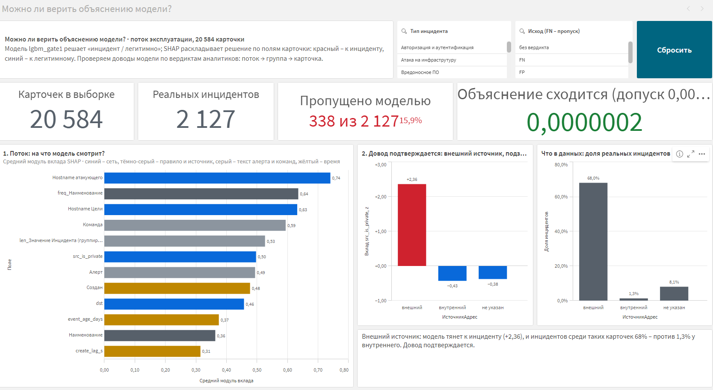 | 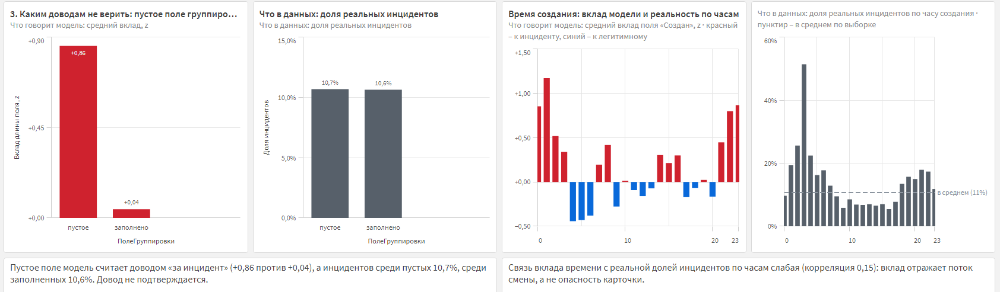 |
| **Вопрос 4** | **Вопрос 5: пропущенная карточка 539713** |
| 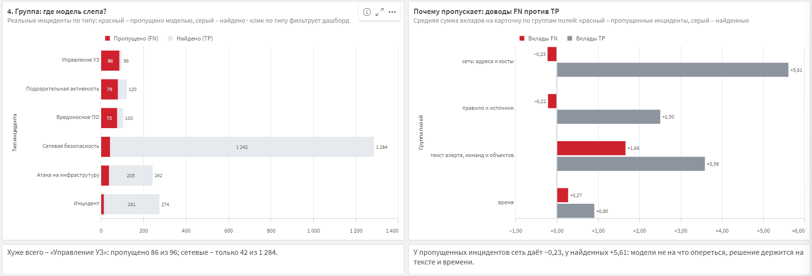 | 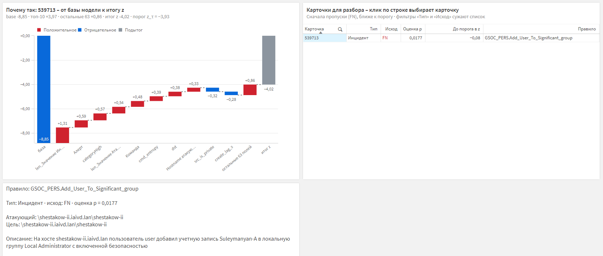 |

Сценарий 2 в Qlik – фильтр «Сетевая безопасность»: внешний источник 77,7 % инцидентов при вкладе +2,48; пустое поле группировки +0,88 при 21,1 % против 32,5 % у заполненного.

| Сетевая безопасность: вопросы 1–2 | Сетевая безопасность: вопрос 3 |
|---|---|
| 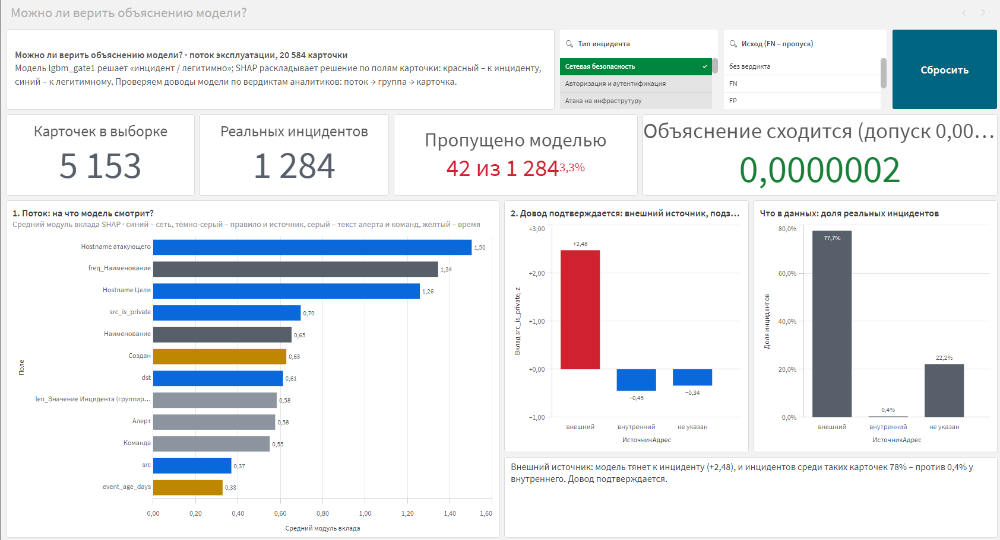 | 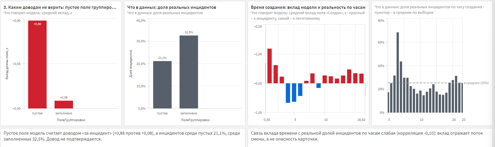 |

В Qlik для вопроса 5 показана карточка 539713 («пользователь добавил учётную запись в локальные администраторы», FN, до порога 0,08): главный «плюс» к инциденту снова даёт пустое поле группировки (+1,31) – та же картина, что у 536708.

## Структура

```
qlik/     load_script_add.qvs – добавка к скрипту; shap_values.csv – поля для вопросов 2–4; README.md – как собрать лист
python/   prep_shap_flow.py – подготовка data/shap_flow.parquet из комплектов курса; shap_flow.py – расчёты; app.py – приложение Taipy; app.css – стили
images/   скриншоты
data/     сюда кладётся shap_flow.parquet (в git не попадает)
```

## Как запустить

Taipy 4.1 работает на Python 3.10–3.12.

```bash
pip install -r requirements.txt
# 1) данные – один раз; нужны оба комплекта практики 3.7 и окружение ML-комплекта (lightgbm 4.7, scikit-learn 1.7.2):
python python/prep_shap_flow.py путь/к/IAVD_3.7_ML_team путь/к/IAVD_3.7_BI_team
# 2) дашборд:
python python/app.py              # откроется http://127.0.0.1:5083
```

Проверка чисел без интерфейса: `python python/shap_flow.py`.

ML-комплект нужен только для того, чтобы посчитать значения сконструированных полей (`src_is_private`, длины текстов, время) тем же кодом, что при обучении модели: так довод модели сравнивается с реальным значением поля.
