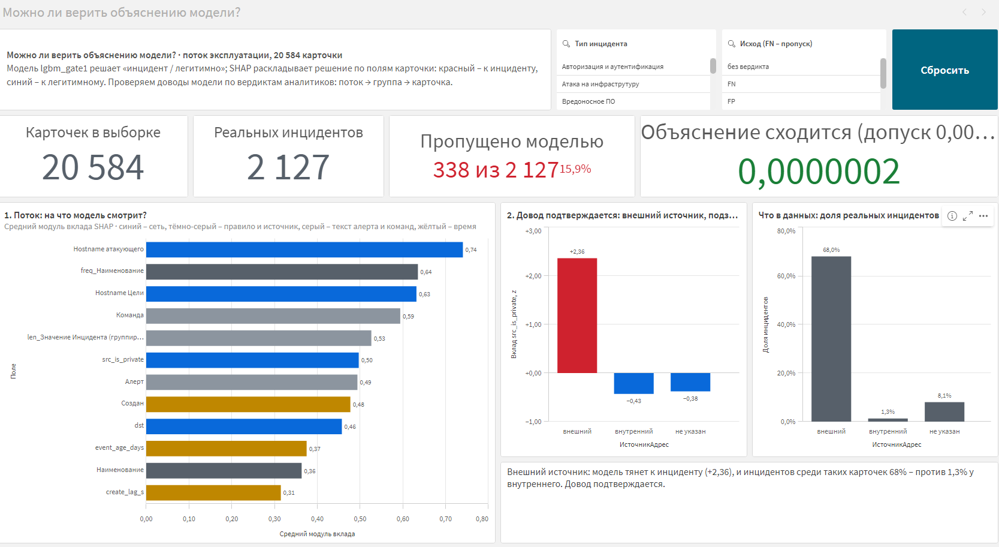
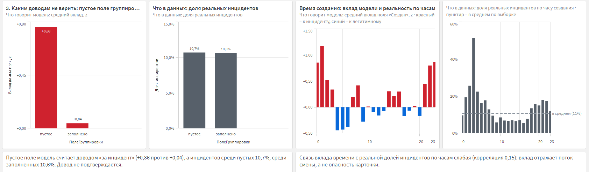
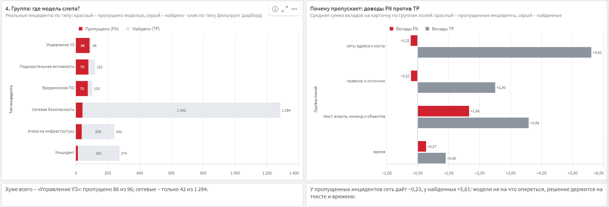
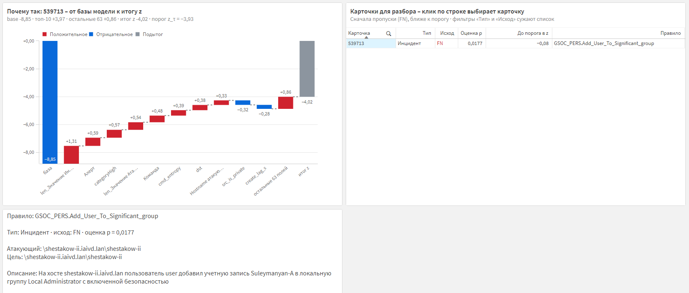

# Дашборд «Можно ли верить объяснению модели?» в Qlik Sense Desktop

Готовое приложение – `dashboard_shap.qvf` в [Release v3.8](https://github.com/Dasha-9/Intelligent-data-analysis-and-visualization/releases/tag/v3.8) (192 МБ, в git не помещается): положите его в `Документы\Qlik\Sense\Apps` и откройте. Ниже – как оно собрано.

Лист собран в копии приложения практики 3.7 (`IAVD_Assessment_v05.qvf` → `dashbord_shap`). Вклады SHAP по потоку эксплуатации (`FACT_Shap`, срез `productive_20584`) в нём уже загружены. К скрипту добавлен только файл `shap_values.csv` с полями для вопросов 2–4.

| Шапка, KPI, вопросы 1–2 | Вопрос 3 |
|---|---|
|  |  |
| **Вопрос 4** | **Вопрос 5: карточка 539713** |
|  |  |

## 0. Загрузка

1. Скопируйте `IAVD_Assessment_v05.qvf` (Release v3.7) в `Документы\Qlik\Sense\Apps` под именем `dashbord_shap.qvf`. Название внутри приложения поменяйте на `dashbord_shap`: «Сведения о приложении» → карандаш.
2. `shap_values.csv` из этой папки положите в папку подключения `RootIAVD` – ту, где лежит `data` комплекта `IAVD_3.7_BI_team`.
3. В конец раздела Main вставьте [`load_script_add.qvs`](load_script_add.qvs). В раздел End добавьте строку `SET vShapSample = productive_20584;`: листы-прототипы и скопированный водопад берут срез из этой переменной.
4. «Загрузить данные».

**Проверка:** `Count(DISTINCT {<ShapSample={'$(vFlow)'}>} EntityId)` = 20 584 · `Count({<Исход={'FN'}>} DISTINCT EntityId)` = 338.

Поле `ТипИнцидента` (без пробела) – это «Пиктограмма IRP» карточки: «Управление УЗ», «Сетевая безопасность»… Не путать с исходным полем «Тип инцидента» (с пробелом): в нём JSON-списки.

Цвета: к инциденту `#CF222E`, к легитимному `#0969DA`, найдено `#E6E9ED`, данные `#57606A`, вывод «подтверждается» `#1A7F37`, «не подтверждается» `#9A6700`. Группы полей: сеть `#0969DA`, правило `#57606A`, текст `#8C959F`, время `#BF8700`.

## 1. Шапка и KPI

- Панель фильтров: `ТипИнцидента`, `Исход`. Кнопка «Сбросить» – «Очистить все выборки».
- «Свойства листа» → «Расширить лист» вкл.

| KPI | Мера | Контроль |
|---|---|---|
| Карточек в выборке | `Count({<Исход={"*"}>} DISTINCT EntityId)` | 20 584 |
| Реальных инцидентов | `Count({<Исход={'TP','FN'}>} DISTINCT EntityId)` | 2 127 |
| Пропущено моделью | `=Num(Count({<Исход={'FN'}>} DISTINCT EntityId), '# ##0', ',', ' ') & ' из ' & Num(Count({<Исход={'TP','FN'}>} DISTINCT EntityId), '# ##0', ',', ' ')` + доля `0,0%` | 338 из 2 127 · 15,9 % |
| Объяснение сходится | `Max({<Исход={"*"}>} Aggr(Fabs(1/(1+Exp(-(Only(base) + Sum({<ShapSample={'$(vFlow)'}>} shap)))) - Only(score)), EntityId))`, формат `0,0000000` | 0,0000002 |

## 2. Вопрос 1 – на что модель смотрит

- Линейчатая, измерение `source_column`.
- Мера `If(Rank(Avg({<ShapSample={'$(vFlow)'}>} Fabs(shap)), 4) <= 12, Avg({<ShapSample={'$(vFlow)'}>} Fabs(shap)))`, нулевые значения выкл.
- Цвет по выражению: `Pick(Match(Only(ГруппаПоля), 'сеть: адреса и хосты', 'правило и источник', 'текст алерта, команд и объектов', 'время'), '#0969DA', '#57606A', '#8C959F', '#BF8700')` (таблица `ГруппаПоля` – из СРС 3.4).

Контроль: Hostname атакующего 0,74 · freq_Наименование 0,64 · Hostname Цели 0,63.

## 3. Вопросы 2–3 – довод против реальности

Пары графиков с одним измерением:
- **слева:** средний вклад поля – `Avg({<ShapSample={'$(vFlow)'}, source_column={'<поле>'}, Исход={'TP','FN','FP','TN'}>} shap)`, цвет по знаку;
- **справа:** доля инцидентов – `Count({<Исход={'TP','FN'}>} DISTINCT EntityId) / Count({<Исход={'TP','FN','FP','TN'}>} DISTINCT EntityId)`.

| Вопрос | Измерение | Поле SHAP | Контроль (весь поток) |
|---|---|---|---|
| 2 | `ИсточникАдрес` | `src_is_private` | внешний +2,36 / 68,0 % · внутренний −0,43 / 1,3 % · не указан −0,38 / 8,1 % |
| 3 | `ПолеГруппировки` | `len_Значение Инцидента (группировка)` | пустое +0,86 / 10,7 % · заполнено +0,04 / 10,6 % |
| 3 | `ЧасСоздания` | `Создан` | 1:00 – вклад +1,17 при 19 %; 3:00 – +0,34 при 51 %; корреляция `Correl(Aggr(…), Aggr(…))` = 0,15 |

Выводы под графиками – объекты «Текст и изображение» с мерой: зелёный текст, если довод подтверждается, жёлто-коричневый – если нет.

## 4. Вопрос 4 – где модель слепа

Основные меры – в них `ТипИнцидента=, EntityId=`, чтобы график не исчезал при выборе типа или карточки:

| Мера | Выражение | Цвет |
|---|---|---|
| Пропущено (FN) | `If(Count({<Исход={'TP','FN'}, ТипИнцидента=, EntityId=>} DISTINCT EntityId) >= 15, Count({<Исход={'FN'}, ТипИнцидента=, EntityId=>} DISTINCT EntityId))` | `#CF222E` |
| Найдено (TP) | то же с `Исход={'TP'}` | `#E6E9ED` |
| Вклады FN | `Sum({<ShapSample={'$(vFlow)'}, Исход={'FN'}, EntityId=>} shap) / Count({<Исход={'FN'}, EntityId=>} DISTINCT EntityId)` | `#CF222E` |
| Вклады TP | то же с `Исход={'TP'}` | `#8C959F` |

- **4а:** линейчатая «стопкой», измерение `ТипИнцидента`, сортировка по числу пропусков; цвета – «Автоматически» (из основных мер).
- **4б:** «сгруппированные», измерение `ГруппаПоля`.

Контроль: УЗ 86 из 96 · подозрительная активность 79 из 120 · вредоносное ПО 75 из 103 · сетевая 42 из 1 284. FN против TP: сеть −0,23 / +5,61 · правило −0,22 / +2,50.

## 5. Вопрос 5 – карточка

- **Таблица «Карточки для разбора»:** измерение `EntityId`. Меры – тип, исход, оценка, до порога в z (`Only(base) + Sum({<ShapSample={'$(vFlow)'}>} shap) - vZTau`), правило; во всех `{<Исход={"*"}, EntityId=>}`. Сортировка – сначала FN, ближе к порогу. Клик по строке выбирает карточку.
- **Водопад:** скопирован с листа «Почему так» практики 3.7 – база → `ShapRank` 1…10 → `ShapRank > 10` → итог z. «Условие вычисления» `=Count(DISTINCT EntityId) = 1`.
- **Текст «Что видит аналитик»:** правило, тип, исход, хосты, описание (`ОписаниеКратко`).

Контроль: 536708 (Управление УЗ, FN) – база −8,85, len_Значение Инцидента +1,14 … итог −4,00. 539713 (Инцидент, FN) – len_Значение Инцидента +1,31 … итог −4,02.
