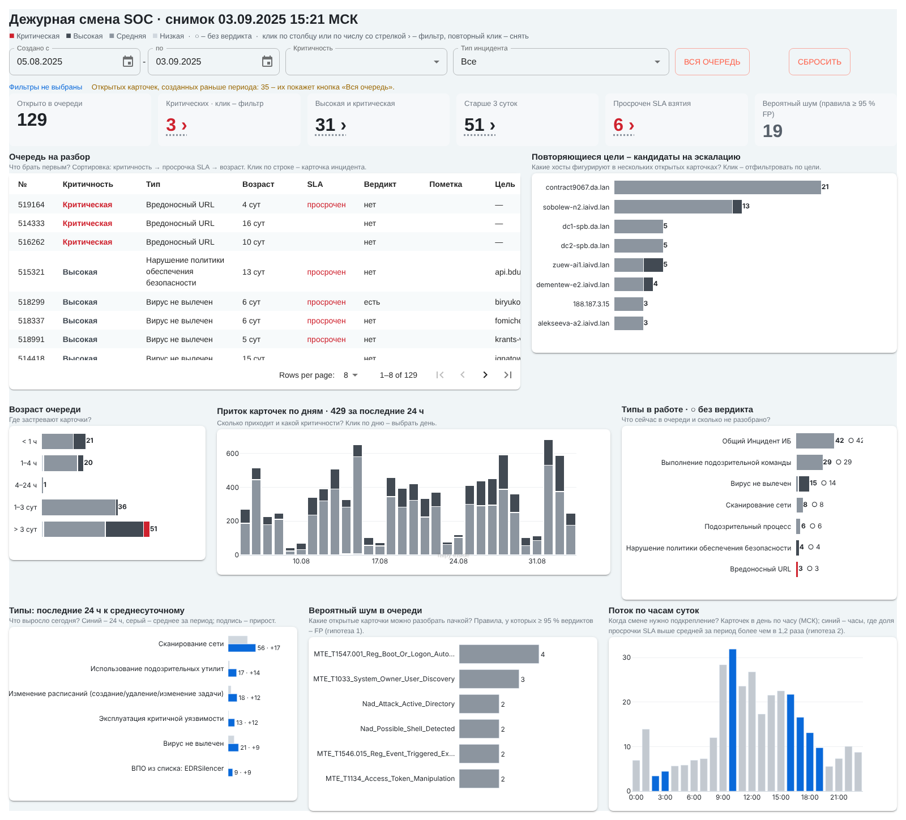
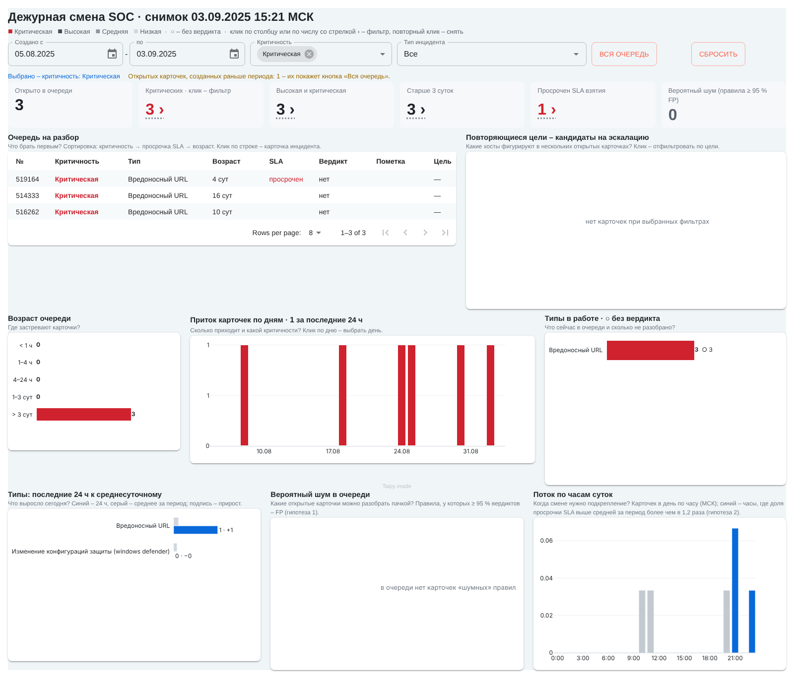
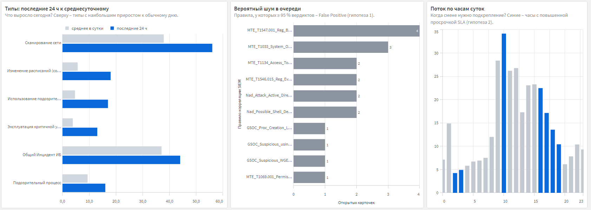

# Проект · Дашборд дежурной смены SOC (датасет 1 – карточки)

**Курс:** Интеллектуальный анализ и визуализация данных · итоговый проект, часть 1 (датасет «карточки SOC»)
**Команда:** Бабич Д.С., Синикова Д.Д., Сычева А.К. · группа 5130201/40101
**Данные:** `iavd_incidents_raw`, полный датасет (240 295 карточек), снимок – последнее время создания карточки: **03.09.2025 15:21 МСК**

## Для кого и зачем

Пользователь – **дежурный аналитик SOC (L1) или старший смены**. Дашборд отвечает на операционные вопросы смены, а не на аналитику «за год»:

| Вопрос пользователя | Тип вопроса | Блок дашборда | Кодировка |
|---|---|---|---|
| Сколько открыто и что горит? | статус | ряд KPI | крупное число; красный – только критические и просрочка SLA |
| Что брать первым? | ранжирование | очередь на разбор | таблица, сортировка: критичность → просрочка SLA → возраст |
| Какие хосты атакуют повторно? | ранжирование + состав | повторяющиеся цели | горизонтальные столбцы, стек по критичности |
| Где застревают карточки? | распределение | возраст очереди | столбцы по корзинам возраста |
| Сколько приходит и какой критичности? | динамика + состав | приток по дням | столбцы по дням, стек по критичности |
| Что в работе и сколько не разобрано? | состав | типы в работе | столбцы; в Taipy – с числом ○ без вердикта, в Qlik – стек по критичности (вердикта почти ни у кого нет) |
| Что выросло сегодня? | сравнение | 24 ч к среднесуточному | парные столбцы, сортировка по приросту |
| Что можно разобрать пачкой? | ранжирование | вероятный шум (гипотеза 1 СРС 2.4) | столбцы по «шумным» правилам (≥ 300 вердиктов, ≥ 95 % FP) |
| Когда смене нужно подкрепление? | распределение | поток по часам (гипотеза 2 СРС 2.4) | столбцы по часам; синий – часы с повышенной просрочкой SLA |

## Что учтено из разборов на практиках 2.5 и 2.6

| Замечание преподавателей | Как сделано |
|---|---|
| Палитра: критическая – красным, остальные – одной шкалой насыщенности (2.5) | красный `#CF222E` только у критической; высокая / средняя / низкая – три оттенка серого. Синий – отдельный акцент для сравнения «24 ч» и часов с просрочкой |
| Легенда сразу под заголовком (2.5) | общая легенда в первой строке под заголовком |
| На графике «за N дней» столько столбцов, сколько дней (2.5) | один столбец = одни сутки, подписи дат |
| Небольшой зазор между частями столбца (2.5) | белая граница 1,5 px между сегментами стека |
| Не прятать важный блок «повторяющиеся цели» в правый нижний угол (2.5) | блок стоит в первом ряду рядом с очередью |
| «Сколько карточек без вердикта» (2.5) | в «Типах в работе» – число ○ без вердикта у каждого типа |
| Упорядочить «24 ч к среднесуточному» по приросту (2.5) | сортировка по разнице «последние 24 ч − среднее», подпись `+N` |
| Фильтр по дате (2.6) | диапазон дат «Создано с … по …», по умолчанию последние 30 дней; кнопка «Вся очередь» |
| Связать графики между собой (2.6) | клик по столбцу целей / возраста / типов / дня фильтрует весь дашборд, повторный клик снимает выбор; строка «Выбрано – …» показывает активные фильтры |
| Критические теряются на графиках – сделать KPI кликабельным (2.6) | KPI «Критических ›», «Высокая и критическая ›», «Старше 3 суток ›», «Просрочен SLA ›» – кнопки, клик фильтрует весь дашборд |
| Карточка инцидента и переход в исходную систему (2.6) | клик по строке очереди открывает карточку; кнопка «Открыть в источнике» ведёт по ссылке NAD из карточки |
| На какой вопрос отвечает каждая визуализация (2.5, итог) | под каждым заголовком – строка-вопрос («Что брать первым?», «Где застревают карточки?» …) |

## Скриншоты (Taipy + Plotly)

| По умолчанию – последние 30 дней | Клик по «Критических ›» |
|---|---|
|  |  |
| **Клик по цели contract9067.da.lan** | **Клик по строке очереди – карточка инцидента** |
|  |  |

## Скриншоты (Qlik Sense)

| Первый и второй ряд (последние 30 дней) | Третий ряд |
|---|---|
|  |  |

Как собрать лист – [`qlik/README.md`](qlik/README.md); там же выводы, которые видны на листе.

Контрольные цифры по всей очереди (кнопка «Вся очередь»): открыто 164 · критических 4 · высокая и критическая 49 · старше 3 суток 86 · просрочен SLA взятия 30 · вероятный шум 27.

## Определения

- **Открытая карточка** – в поле «Фаза реагирования» нет слова «Закрыт».
- **Возраст** – время от создания карточки до снимка.
- **Просрочка SLA** – флаг «SLA просрочен (взятие в работу)» из выгрузки.
- **Цель** – значения из «Hostname Цели»: берём FQDN, а если его нет – IP; 0.0.0.0 отбрасываем. Одна карточка может относиться к нескольким целям.
- **«Шумное» правило** – правило корреляции SIEM, у которого не меньше 300 карточек с вердиктом и не меньше 95 % из них – False Positive (гипотеза 1 СРС 2.4). Это подсказка аналитику, а не автоматическое закрытие.

## Структура

```
python/   soc_data.py – подготовка данных (pandas); app.py – приложение Taipy; app.css – стили
qlik/     load_script.qvs – скрипт загрузки; dashbord_soc.qvf – приложение; README.md – как собрать лист
images/   скриншоты
data/     сюда кладётся parquet (в git не попадает)
```

## Как запустить

Taipy 4.1 работает на Python 3.10–3.12.

```bash
pip install -r requirements.txt
# положите iavd_incidents_raw_target.parquet в data/, затем из этой папки:
python python/app.py          # откроется http://127.0.0.1:5080
```

Qlik Sense Desktop: скопируйте `qlik/dashbord_soc.qvf` в `Документы\Qlik\Sense\Apps`, создайте подключение `MyParquetFolder` к папке с parquet и перезагрузите данные. Сборка с нуля – [`qlik/README.md`](qlik/README.md).
