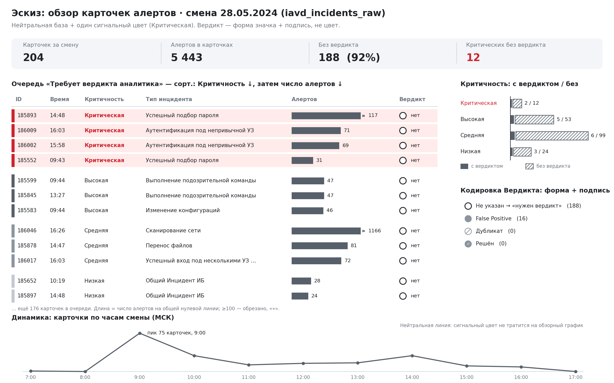
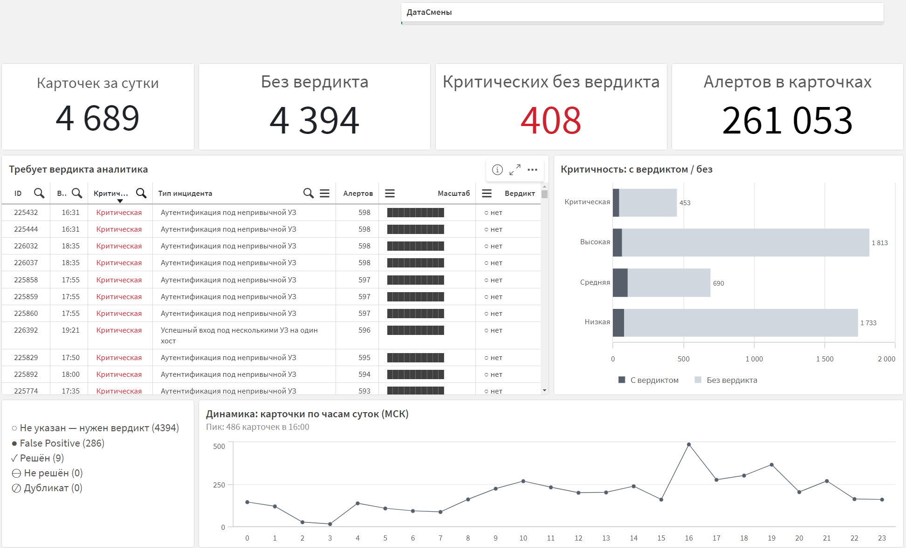
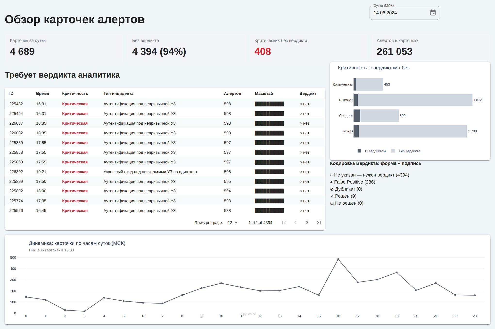

# СРС 2.1 · Кодировки и эскиз обзора алертов

**Курс:** Интеллектуальный анализ и визуализация данных · Модуль 2 · Самостоятельная работа к занятию 2.2 (по лекции 2.1 «Когнитивные основы восприятия информации»)
**Команда:** Бабич Д.С., Синикова Д.Д., Сычева А.К. · группа 5130201/40101
**Данные:** `iavd_incidents_raw` — выборка 1000 карточек (эскиз) и полный датасет 240 295 карточек (реализация)

## Что сделано

1. DIKW-проекция кейса и 5 ключевых полей: Критичность, Вердикт, Количество инцидентов, Тип инцидента, Создан.
2. Кодировки по иерархии Кливленда–МакГилла: Критичность — положение + один сигнальный красный; Вердикт — форма значка + подпись; число алертов — длина от нулевой линии.
3. Эскиз обзора карточек (matplotlib, выборка 1000, смена 28.05.2024).
4. Реализация того же обзора на полном датасете за 14.06.2024 в **Qlik Sense** (трек BI) и в **Taipy + Plotly** (трек ML). Числа совпадают: 4 689 карточек, 4 394 без вердикта, 408 критических без вердикта.

Отчёт: [`report/srs-2.1_report.pdf`](report/srs-2.1_report.pdf) (исходник — `.docx`).

| Эскиз (matplotlib) | Qlik Sense | Taipy + Plotly |
|---|---|---|
|  |  |  |

## Структура

```
report/   отчёт (docx, pdf)
python/   sketch_matplotlib.py — эскиз; dashboard_taipy.py + style.css — веб-панель
qlik/     obzor_kartochek.qvf — приложение Qlik Sense Desktop; load_script.qvs — его скрипт загрузки
images/   скриншоты
data/     сюда кладутся parquet-файлы (в git не попадают)
```

## Как запустить Python-часть

```bash
pip install -r requirements.txt
# положите parquet-файлы в data/ (см. data/README.md), затем из корня репозитория:
python python/sketch_matplotlib.py      # перерисует images/sketch_1000.png
python python/dashboard_taipy.py        # откроет панель в браузере, дату можно менять
```

## Как открыть в Qlik Sense Desktop

Готовое приложение — `qlik/obzor_kartochek.qvf`.

1. Скопируйте `obzor_kartochek.qvf` в `Документы\Qlik\Sense\Apps` и перезапустите Qlik Sense Desktop — приложение появится в хабе.
2. Скрипт читает данные из подключения `lib://MyParquetFolder`. Если у вас такого подключения нет: «Редактор загрузки данных» → **«Создать новое подключение» → «Папка»** → выберите папку, где лежит `iavd_incidents_raw_target.parquet`, имя подключения — `MyParquetFolder`.
3. Нажмите **«Загрузить данные»**. В фильтре `ДатаСмены` выберите **14.06.2024** — должно быть 408 · 4 394 · 4 689 · «Пик часа 16:00 — 486».

Скрипт загрузки отдельно — `qlik/load_script.qvs` (вставляется после строк `SET`).

