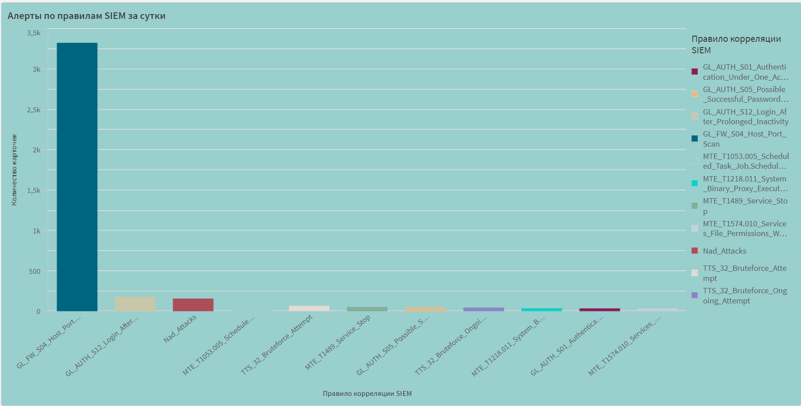
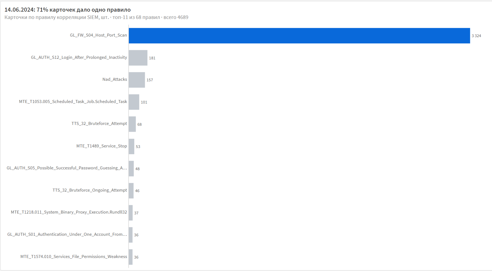
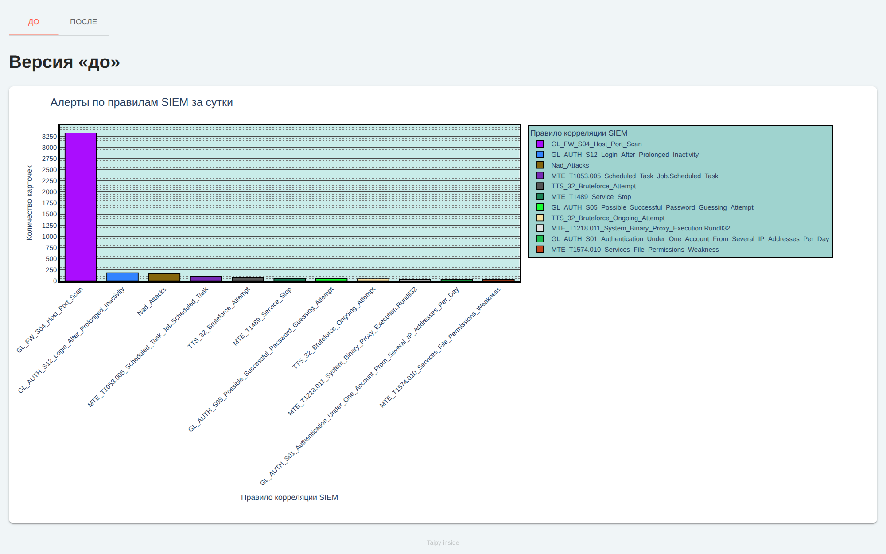
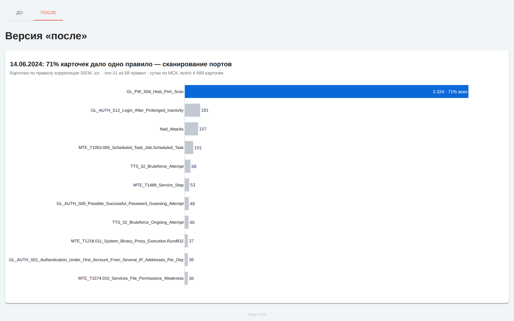
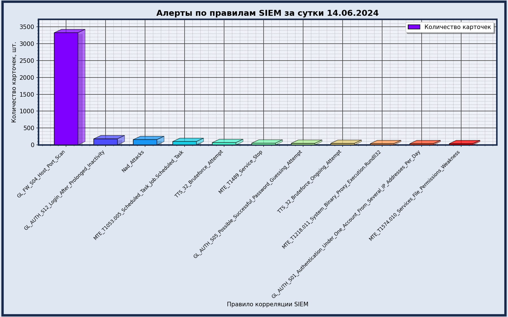
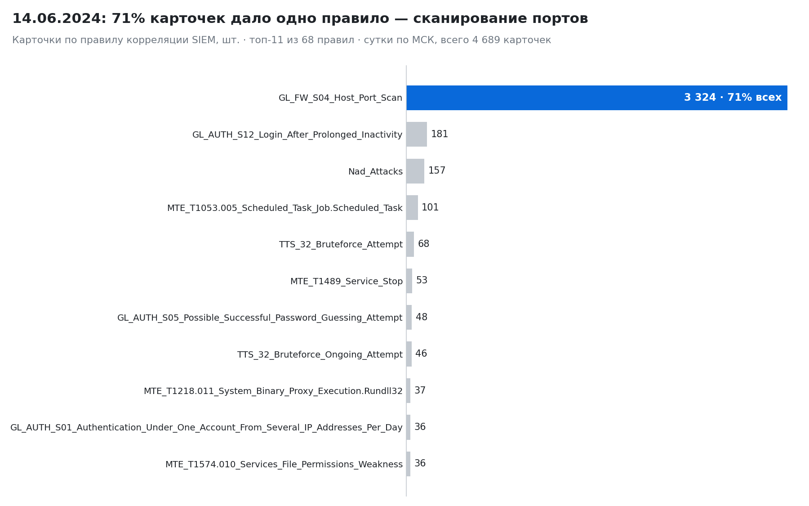
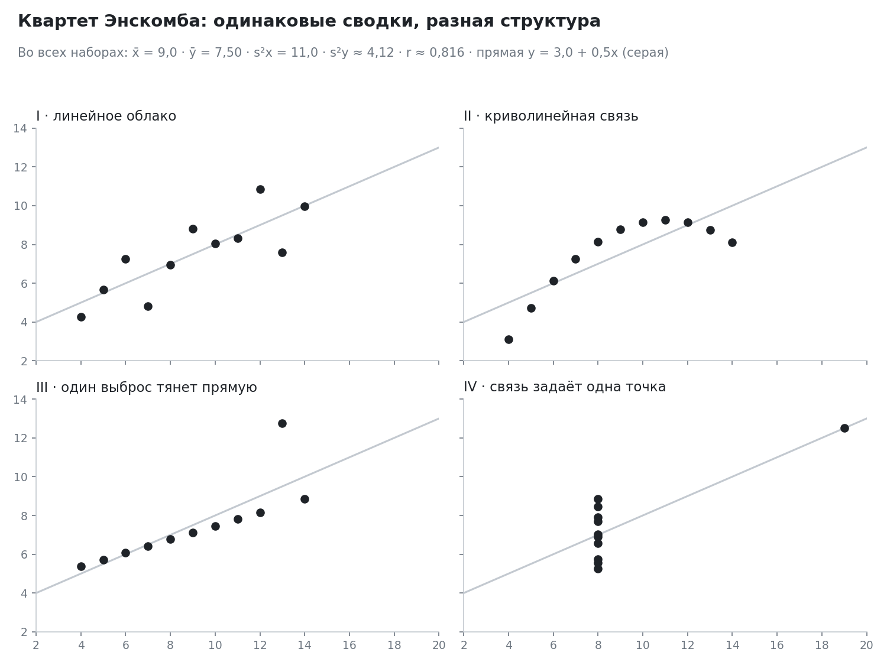

# СРС 2.2 · Квартет Энскомба и артефакт «до → после»

**Курс:** Интеллектуальный анализ и визуализация данных · Модуль 2 · Самостоятельная работа к занятию 2.3 (по лекции 2.2 «Принципы информационного дизайна»)
**Команда:** Бабич Д.С., Синикова Д.Д., Сычева А.К. · группа 5130201/40101
**Данные:** `iavd_incidents_raw`, полный датасет (240 295 карточек), сутки 14.06.2024 (МСК)

## Что сделано

1. **Задание 1.** Три тезиса о том, почему совпадение сводных показателей не гарантирует одинаковую структуру данных; показатели квартета Энскомба пересчитаны (x̄ = 9,0 · ȳ = 7,50 · s²x = 11,0 · s²y ≈ 4,12 · r ≈ 0,816 · y = 3,0 + 0,5x).
2. **Задание 2.** График «Алерты по правилам SIEM за сутки» переработан по шестишаговому алгоритму: 7 удалённых/заменённых элементов с обоснованием и условиями, контроль чтения, качественная оценка доли не-данных элементов. Главный вывод «после»: **71 % карточек 14.06.2024 дало одно правило — `GL_FW_S04_Host_Port_Scan` (3 324 из 4 689)**.
3. Основная версия — **Qlik Sense**, для сравнения та же переработка в **Taipy + Plotly** и в **matplotlib**.

Отчёт: [`report/srs-2.2_report.pdf`](report/srs-2.2_report.pdf) (исходник — `.docx`).

| | До | После |
|---|---|---|
| Qlik Sense |  |  |
| Taipy + Plotly |  |  |
| matplotlib |  |  |



## Структура

```
report/   отчёт (docx, pdf)
python/   do_posle_taipy.py — веб-приложение Taipy + Plotly со страницами «До» и «После»
          charts_matplotlib.py — версии «до/после» в matplotlib и рисунок квартета Энскомба
qlik/     obzor_kartochek.qvf — приложение Qlik Sense Desktop (лист «2.2 до → после»); load_script.qvs — скрипт загрузки
images/   скриншоты и рисунки
data/     сюда кладётся parquet (в git не попадает)
```

## Как запустить Python-часть

```bash
pip install -r requirements.txt
# положите iavd_incidents_raw_target.parquet в data/, затем из корня репозитория:
python python/do_posle_taipy.py        # откроет браузер, вкладки «До» и «После»
python python/charts_matplotlib.py     # перерисует картинки matplotlib и квартет Энскомба
```

## Как открыть в Qlik Sense Desktop

1. Скопируйте `qlik/obzor_kartochek.qvf` в `Документы\Qlik\Sense\Apps` и перезапустите Qlik Sense Desktop.
2. Скрипт читает данные из подключения `lib://MyParquetFolder`. Если его нет: «Редактор загрузки данных» → **«Создать новое подключение» → «Папка»** → папка с `iavd_incidents_raw_target.parquet`, имя — `MyParquetFolder`.
3. «Загрузить данные» → лист **«2.2 до → после»** → в фильтре `ДатаСмены` выберите **14.06.2024**. Проверка: синяя полоса `GL_FW_S04_Host_Port_Scan` — 3 324, заголовок «71 % карточек дало одно правило».

В обоих графиках стоит ограничение «топ-11»: 10-е и 11-е места делят два правила с 36 карточками, поэтому показаны оба.
