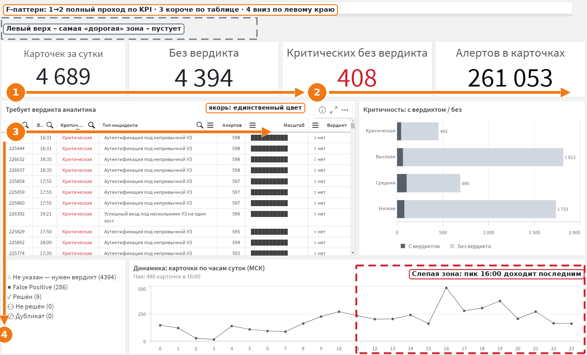
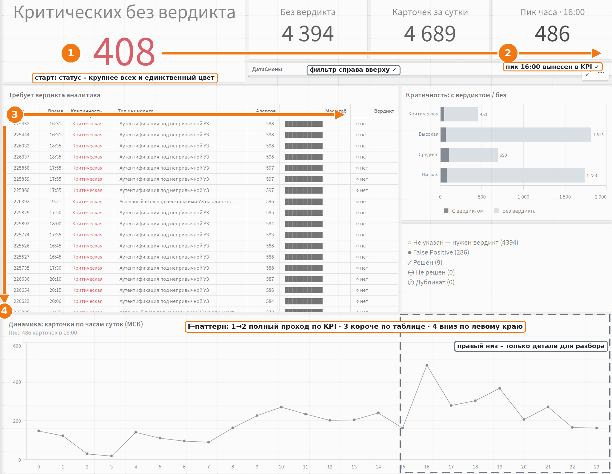
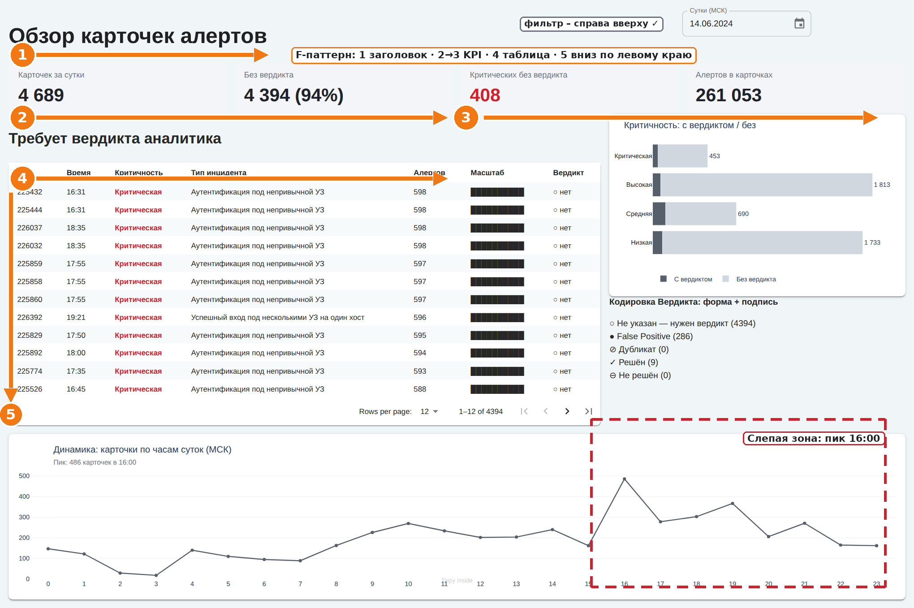
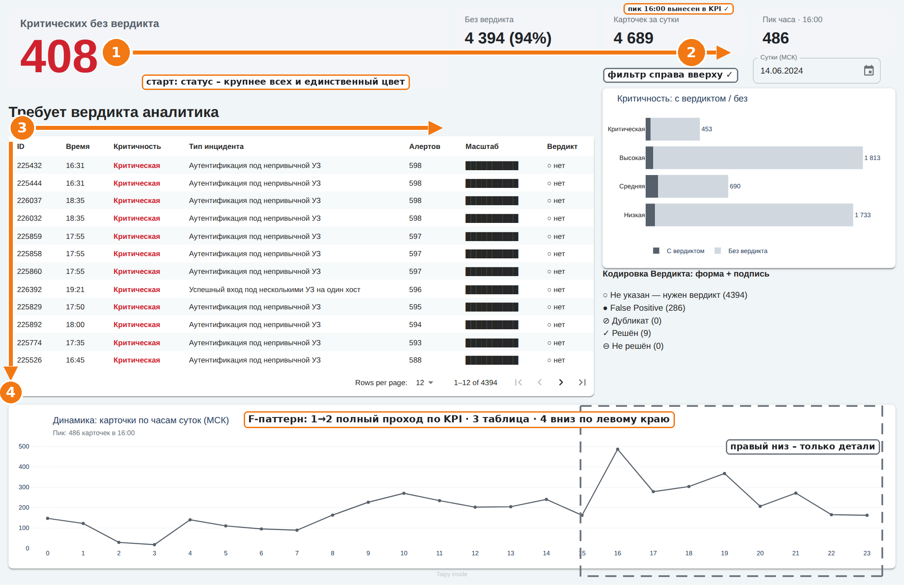
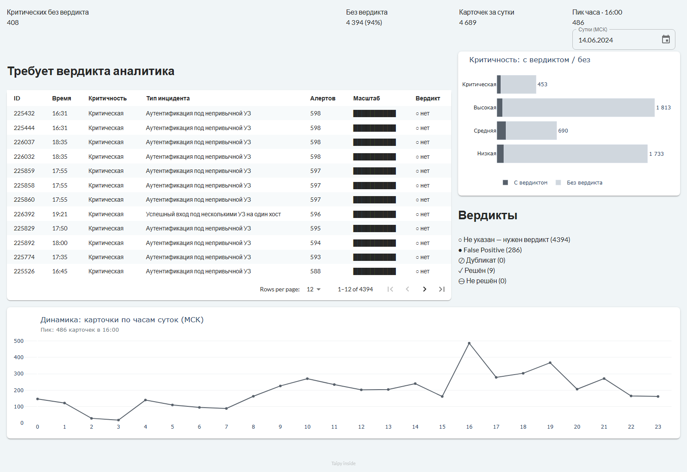

# СРС 2.3 · Траектория взгляда и правило 8 секунд

**Курс:** Интеллектуальный анализ и визуализация данных · Модуль 2 · Самостоятельная работа к занятию 2.4 (по лекции 2.3 «Систематизация визуализаций и анатомия дашборда»)
**Команда:** Бабич Д.С., Синикова Д.Д., Сычева А.К. · группа 5130201/40101
**Данные:** `iavd_incidents_raw`, полный датасет (240 295 карточек), сутки 14.06.2024 (МСК)

## Что сделано

1. Взят собственный дашборд «обзор карточек» (из СРС 2.1) в **Qlik Sense** (трек BI) и в **Taipy + Plotly** (трек ML).
2. Поверх скриншотов стрелками наложена траектория взгляда – **F-паттерн**: полный проход по ряду KPI, более короткий по таблице, затем вниз по левому краю.
3. Обоснование: в исходной раскладке правило 8 секунд выполнялось частично – KPI одного размера, левый верхний угол пустовал, а пик 16:00 (486 карточек) попал в «слепую зону» справа внизу.
4. Дашборд переставлен в обоих инструментах: крупный красный статус «Критических без вердикта: 408» в левом верхнем углу, новый KPI «Пик часа · 16:00 – 486», фильтр даты справа вверху. Теперь статус и аномалия считываются за первый горизонтальный проход.

Отчёт: [`report/srs-2.3_report.pdf`](report/srs-2.3_report.pdf) (исходник – `.docx`).

| | Исходная раскладка | После перестановки |
|---|---|---|
| Qlik Sense |  |  |
| Taipy + Plotly |  |  |



## Структура

```
report/        отчёт (docx, pdf)
images/        скриншоты со стрелками (*_F.png); images/raw/ – исходные скриншоты без разметки
python/        dashboard_taipy_posle.py + style.css – переставленная панель Taipy + Plotly
               draw_gaze.py – рисует стрелки траектории поверх скриншотов из images/raw/
qlik/          obzor_kartochek.qvf – приложение Qlik Sense Desktop; load_script.qvs – скрипт загрузки
data/          сюда кладётся parquet (в git не попадает)
```

Исходная (до перестановки) панель Taipy – в папке СРС 2.1: `srs-2.1-obzor-kartochek/python/dashboard_taipy.py`.

## Как запустить Python-часть

```bash
pip install -r requirements.txt
# положите iavd_incidents_raw_target.parquet в data/, затем из корня репозитория:
python python/dashboard_taipy_posle.py   # переставленная панель, дату можно менять
python python/draw_gaze.py               # перерисует стрелки на картинках в images/
```

## Как открыть в Qlik Sense Desktop

1. Скопируйте `qlik/obzor_kartochek.qvf` в `Документы\Qlik\Sense\Apps` и перезапустите Qlik Sense Desktop.
2. Скрипт читает данные из подключения `lib://MyParquetFolder`. Если его нет: «Редактор загрузки данных» → **«Создать новое подключение» → «Папка»** → папка с `iavd_incidents_raw_target.parquet`, имя – `MyParquetFolder`.
3. «Загрузить данные» → лист «обзор карточек» → в фильтре `ДатаСмены` выберите **14.06.2024**. Проверка: 408 · 4 394 · 4 689 · «Пик часа · 16:00 – 486».
