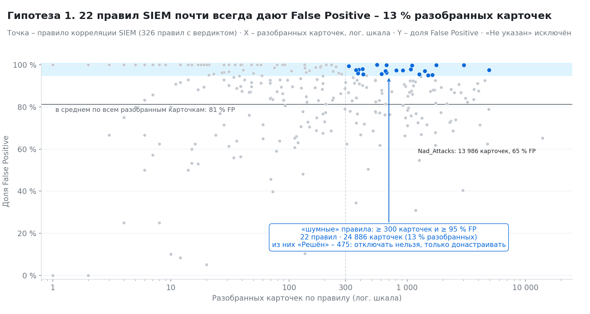
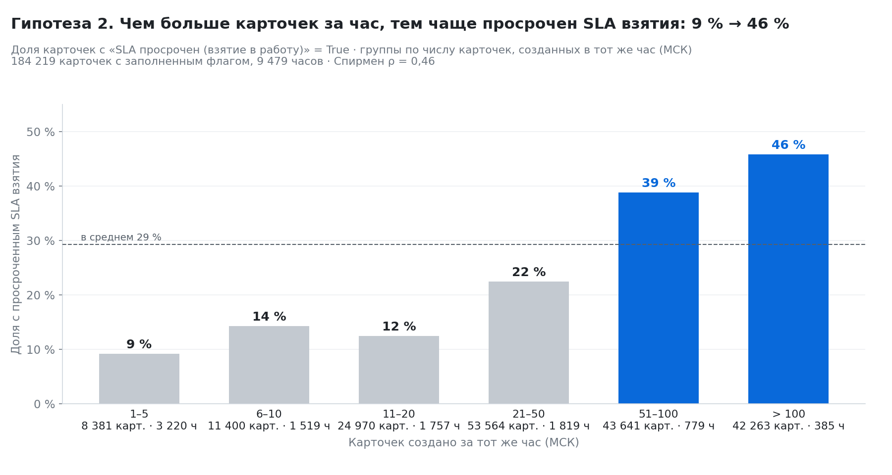
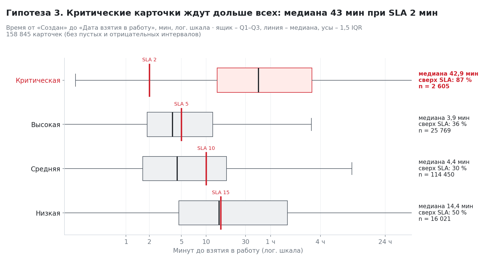
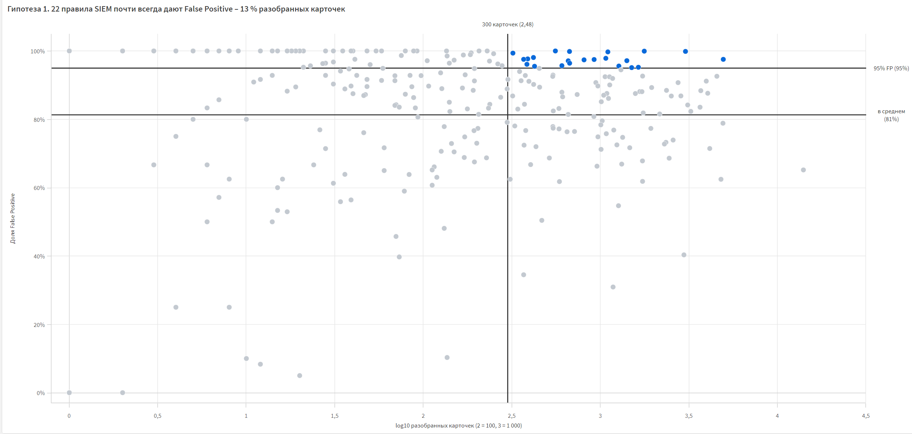
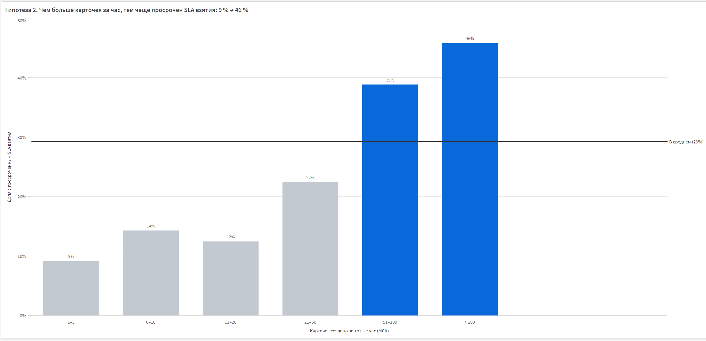
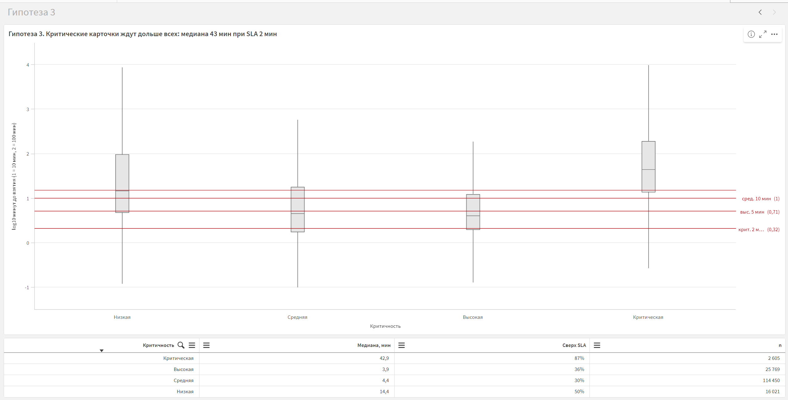

# СРС 2.4 · EDA-гипотезы по данным SOC

**Курс:** Интеллектуальный анализ и визуализация данных · Модуль 2 · Самостоятельная работа к лекции модуля 3 (24.10.2026), по лекции 2.4 «Визуализация для разведочного анализа данных (EDA)»
**Команда:** Бабич Д.С., Синикова Д.Д., Сычева А.К. · группа 5130201/40101
**Данные:** `iavd_incidents_raw`, полный датасет (240 295 карточек, 12.04.2024 – 03.09.2025)

## Задание

Сформулировать 2–3 бизнес-гипотезы по полям `iavd_incidents_raw` по шаблону «гипотеза → поле → график для проверки». Гипотезы станут входом практик 3.6–3.7.

## Гипотезы

| № | Гипотеза | Поля | График | Что показал график |
|---|---|---|---|---|
| 1 | Небольшая группа правил SIEM даёт почти одни False Positive; их донастройка снимет ≥ 10 % нагрузки L1 | Правило корреляции SIEM, Вердикт | Точечная: правило × доля FP | 22 правила (≥ 300 карточек, ≥ 95 % FP) – 24 886 карточек, 13,4 % разобранных |
| 2 | Чем больше карточек приходит за час, тем чаще просрочен SLA взятия в работу | Создан (час МСК), SLA просрочен (взятие в работу) | Столбчатая: доля просрочки по нагрузке часа | 9 % → 46 %, Спирмен ρ = 0,46 |
| 3 | Критические карточки (SLA 2 мин) берут в работу медленнее остальных | Критичность, Создан, Дата взятия в работу, SLA по взятию в работу Атаки | Диаграмма размаха, лог. шкала | Медиана 42,9 мин, 87 % сверх SLA (у остальных 3,9–14,4 мин) |

Отчёт: [`report/srs-2.4_report.pdf`](report/srs-2.4_report.pdf) (исходник – `.docx`).

| | Гипотеза 1 | Гипотеза 2 | Гипотеза 3 |
|---|---|---|---|
| Python (matplotlib) |  |  |  |
| Qlik Sense |  |  |  |

[Дополнение к отчёту по гипотезе 1](report/taipy-addendum.md).

## Структура

```
report/        отчёт (docx, pdf)
images/        h1_rules.png, h2_load.png, h3_take.png – графики matplotlib для отчёта
               taipy_h1.png … taipy_h3.png – скриншоты интерактивной версии
               qlik_h1.png … qlik_h3.png – те же графики в Qlik Sense Desktop
python/        eda_common.py – общие расчёты трёх гипотез
               charts_matplotlib.py – строит картинки в images/
               hypotheses_taipy.py – интерактивная версия Taipy + Plotly (порт 5058)
qlik/          gipotezy_eda.qvf – приложение Qlik Sense Desktop (листы «Гипотеза 1–3» + листы прошлых работ)
               load_script.qvs – скрипт загрузки; README.md – как собрать три графика с нуля
data/          сюда кладётся parquet (в git не попадает)
```

## Как запустить Python-часть

```bash
pip install -r requirements.txt
# положите iavd_incidents_raw_target.parquet в data/, затем из этой папки:
python python/eda_common.py            # цифры по трём гипотезам в консоль
python python/charts_matplotlib.py     # перерисует картинки в images/
python python/hypotheses_taipy.py      # откроет браузер: /h1, /h2, /h3
```

## Qlik Sense Desktop

1. Скопируйте `qlik/gipotezy_eda.qvf` в `Документы\Qlik\Sense\Apps` и перезапустите Qlik Sense Desktop.
2. Скрипт читает данные из подключения `lib://MyParquetFolder` (папка с `iavd_incidents_raw_target.parquet`), как в прошлых работах. Если подключения нет – «Редактор загрузки данных» → «Создать новое подключение» → «Папка», имя `MyParquetFolder`.
3. «Загрузить данные» → листы **«Гипотеза 1»**, **«Гипотеза 2»**, **«Гипотеза 3»**. Проверка: 22 синие точки; 9 % … 46 %; медиана критических 42,9 мин.

Скрипт в приложении включает и поля прошлых работ, поэтому листы СРС 2.1–2.3 в нём тоже работают. Как собрать три графика с нуля – в [`qlik/README.md`](qlik/README.md).
