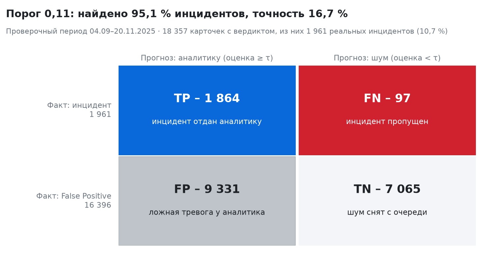
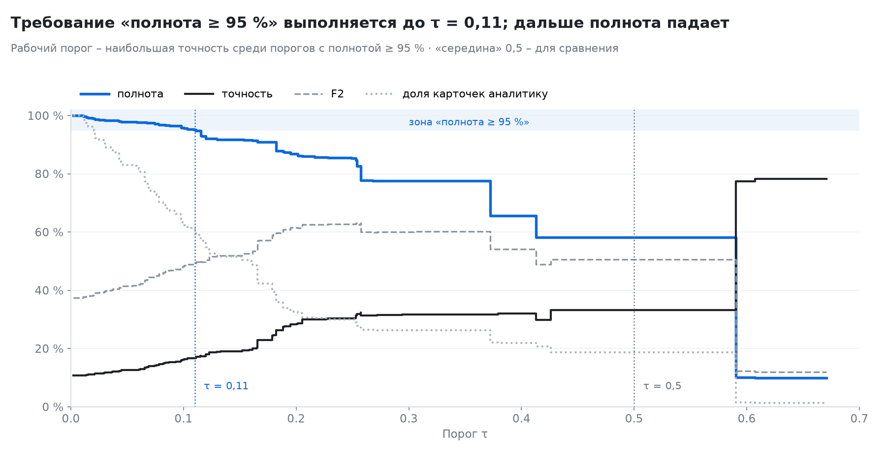
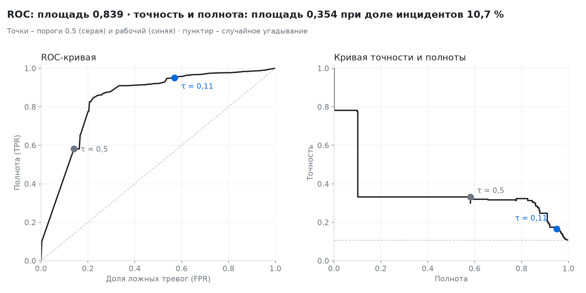
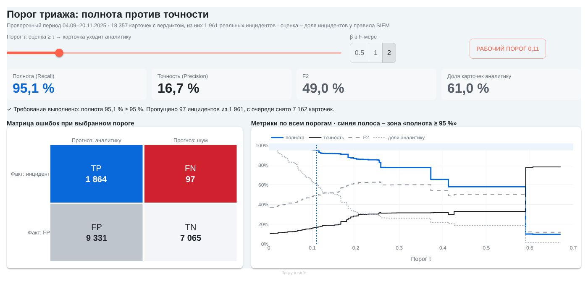
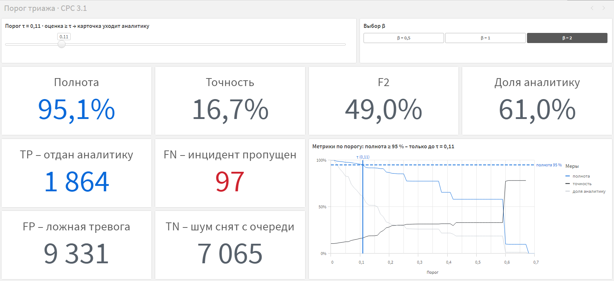

# СРС 3.1 · Метрики проекта

**Курс:** Интеллектуальный анализ и визуализация данных · Модуль 3 · Самостоятельная работа к занятию 3.2, по лекции 3.1
**Команда:** Бабич Д.С., Синикова Д.Д., Сычева А.К. · группа 5130201/40101
**Данные:** `iavd_ml_dataset` (259 218 карточек, 12.04.2024 – 20.11.2025)

## Задание

1. Мини-расчёт своего проекта: положительный класс + две главные метрики + 2–3 предложения обоснования.
2. По опорному конспекту: как β смещает баланс точности и полноты в F-мере; уметь разобрать пример устно.

## Ответ

> **Положительный класс (1) – реальный инцидент** (вердикт «Решён» / «Не решён»), класс 0 – False Positive.
> **Главные метрики – полнота (не ниже 95 %) и точность.** Пропущенный инцидент – самая дорогая ошибка SOC, поэтому полнота задаёт границу, ниже которой режим недопустим. Внутри этой границы выбираем порог с наибольшей точностью: каждая ложная тревога – потерянное время аналитика L1. Доля правильных ответов не подходит: правило «всегда False Positive» набирает 89,3 %, но не находит ни одного инцидента.

## Расчёт

В роли модели – базовая эвристика: доля реальных инцидентов у правила корреляции SIEM в обучающем периоде. Модель преподавателей будет сравниваться с ней на том же периоде.

Разбиение по времени:

- обучение – до 04.09.2025: 179 706 карточек, 16,1 % инцидентов;
- проверка – 04.09–20.11.2025: 18 357 карточек, 1 961 инцидент (10,7 %). Это тот же период, что у лога инференса модели преподавателей.

| Метрика | τ = 0,11 (рабочий) | τ = 0,5 |
|---|---|---|
| Полнота | **95,1 %** (пропущено 97 из 1 961) | 58,1 % (пропущен 821) |
| Точность | **16,7 %** | 33,1 % |
| F1 | 28,3 % | 42,2 % |
| F2 | 49,0 % | 50,5 % |
| Доля правильных ответов | 48,6 % | 83,0 % |
| Отдано аналитику | 61,0 % (очередь меньше на 7 162 карточки) | 18,8 % |

Площадь под ROC-кривой – 0,839, под кривой точности и полноты – 0,354 (при доле класса 1 в 10,7 %).

**β в F-мере.** Чем больше β, тем меньше разрыв в пользу порога 0,5: с 16 п. п. при F0,5 до 1,5 п. п. при F2. Но даже F2 выбирает режим 0,5 с полнотой 58 %. Поэтому одна F-мера не заменяет пару «полнота + точность» с явным требованием к полноте.

Связь с СРС 3.2: по стоимости ошибок требование 95 % выполняется только при соотношении цен k ≈ 48 и выше.

Отчёт: [`report/srs-3.1_report.pdf`](report/srs-3.1_report.pdf).

| Матрица ошибок при τ = 0,11 | Метрики по порогу |
|---|---|
|  |  |
| **ROC и кривая точности и полноты** | **Taipy: ползунок порога и β** |
|  |  |

### Qlik Sense – лист «Порог триажа»



Сборка листа и контрольные числа – в [`qlik/README.md`](qlik/README.md); приложение – `qlik/srs31_metriki.qvf`.

## Как запустить

Taipy 4.1 работает на Python 3.10–3.12.

```bash
pip install -r requirements.txt
# положите iavd_ml_dataset.parquet в data/, затем из этой папки:
python python/metrics.py            # числа в консоль + графики в images/
python python/threshold_taipy.py    # http://127.0.0.1:5059
```

Qlik Sense Desktop: скопируйте `qlik/srs31_metriki.qvf` в `Документы\Qlik\Sense\Apps`, создайте подключение `MyParquetFolder` к папке с parquet и перезагрузите данные.

Когда будет `MODEL_PREDICTIONS_target.parquet`, тот же расчёт можно сделать для модели преподавателей, подставив `y_pred_proba` вместо нашей оценки.
