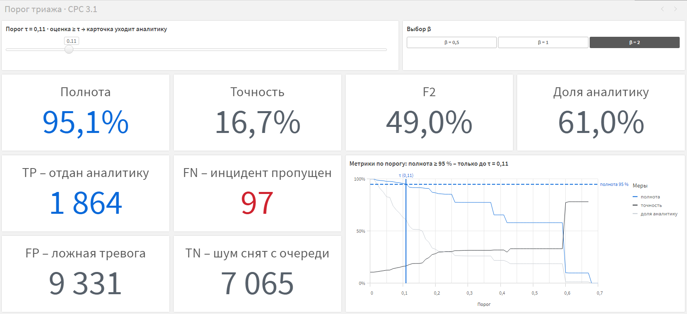

# СРС 3.1 в Qlik Sense Desktop – лист «Порог триажа»

Тот же расчёт, что в `python/metrics.py` и `python/threshold_taipy.py`: ползунок порога τ и кнопки β пересчитывают матрицу ошибок, полноту, точность, Fβ и долю карточек аналитику.

## Загрузка

1. Новое приложение, отдельное от дашборда: у карточек те же `EntityId`, и в одном приложении таблицы связались бы.
2. Создайте подключение «Папка» с именем `MyParquetFolder` к папке, где лежит `iavd_ml_dataset.parquet`.
3. После строк `SET` вставьте [`load_script.qvs`](load_script.qvs) и нажмите «Загрузить данные».
4. Проверка: `Count(EntityId)` = 18 357, `Sum(y)` = 1 961 – это проверочный период 04.09–20.11.2025.

Можно открыть готовое `srs31_metriki.qvf`, скопировав его в `Документы\Qlik\Sense\Apps`.

## Объекты листа

**Ползунок τ** – «Ввод переменной» (Dashboard bundle), переменная `vTau`, от 0 до 0,7, шаг 0,01.
Заголовок (fx): `='Порог τ = ' & Num(vTau, '0,00') & ' · оценка ≥ τ → карточка уходит аналитику'`.

**Выбор β** – «Ввод переменной», переменная `vBeta`, кнопки со значениями `0.5`, `1`, `2` и метками `β = 0,5`, `β = 1`, `β = 2`.

**Метрики** – четыре KPI, формат `0,0%`:

| Метка | Мера |
|---|---|
| Полнота (цвет `#0969DA`) | `Sum(If(Оценка >= vTau, y)) / Sum(y)` |
| Точность | `Sum(If(Оценка >= vTau, y)) / Count(If(Оценка >= vTau, EntityId))` |
| `='F' & vBeta` | `(1 + vBeta*vBeta) * Sum(If(Оценка >= vTau, y)) / ((1 + vBeta*vBeta) * Sum(If(Оценка >= vTau, y)) + vBeta*vBeta * Sum(If(Оценка < vTau, y)) + Sum(If(Оценка >= vTau, 1 - y)))` |
| Доля аналитику | `Count(If(Оценка >= vTau, EntityId)) / Count(EntityId)` |

**Матрица ошибок** – четыре KPI 2 × 2, формат `# ##0`:

| Клетка | Мера | Цвет |
|---|---|---|
| TP – отдан аналитику | `Sum(If(Оценка >= vTau, y))` | `#0969DA` |
| FN – инцидент пропущен | `Sum(If(Оценка < vTau, y))` | `#CF222E` |
| FP – ложная тревога | `Sum(If(Оценка >= vTau, 1 - y))` | `#57606A` |
| TN – шум снят с очереди | `Sum(If(Оценка < vTau, 1 - y))` | `#57606A` |

**Метрики по порогу** – линейный график, измерение `Порог` (ось «Непрерывный»). Меры – основные элементы с цветом из библиотеки:

| Мера | Выражение | Цвет |
|---|---|---|
| полнота | `Sum(If(Оценка >= Порог, y)) / Sum(y)` | `#0969DA` |
| точность | `Sum(If(Оценка >= Порог, y)) / Count(If(Оценка >= Порог, EntityId))` | `#1F2328` |
| доля аналитику | `Count(If(Оценка >= Порог, EntityId)) / Count(EntityId)` | `#C3C9D0` |

Опорная линия по оси Y – `0.95` («полнота 95 %»). Опорная линия измерения – `=vTau` («τ»): двигается вместе с ползунком.

## Контроль

| | τ = 0,11 | τ = 0,5 |
|---|---|---|
| TP · FN · FP · TN | 1 864 · 97 · 9 331 · 7 065 | 1 140 · 821 · 2 302 · 14 094 |
| Полнота · точность | 95,1 % · 16,7 % | 58,1 % · 33,1 % |
| F0,5 · F1 · F2 | 19,9 % · 28,3 % · 49,0 % | 36,2 % · 42,2 % · 50,5 % |
| Доля аналитику | 61,0 % | 18,8 % |
