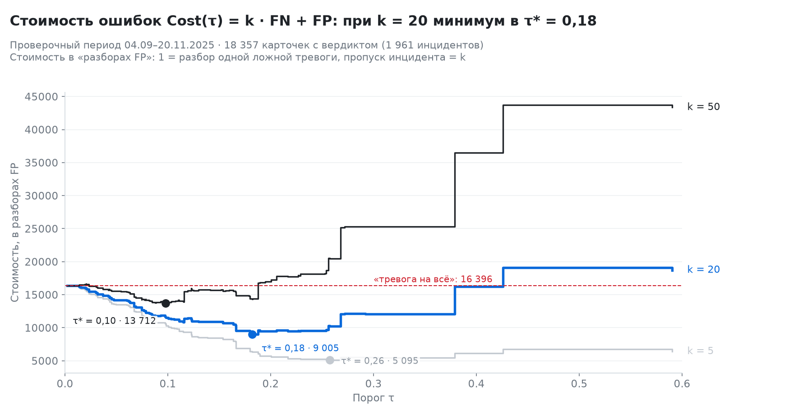
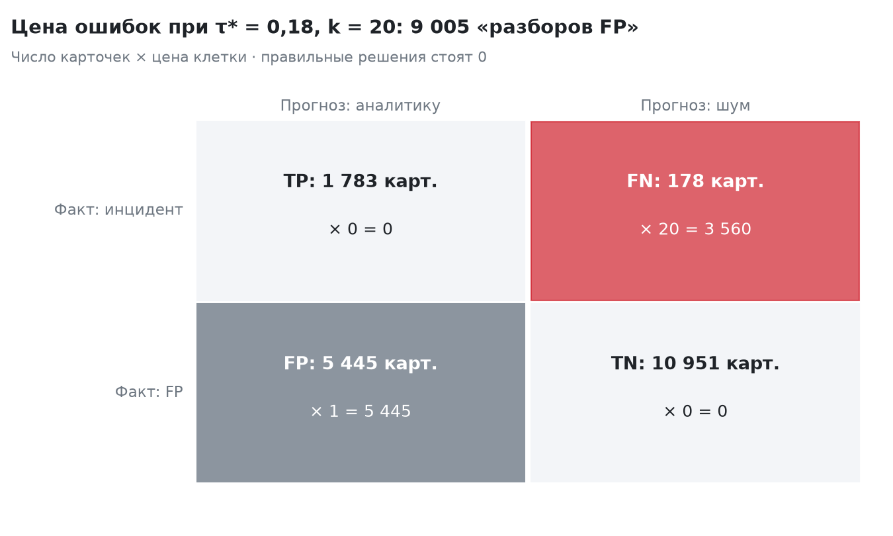
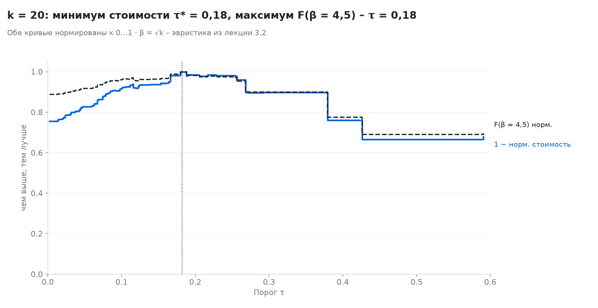
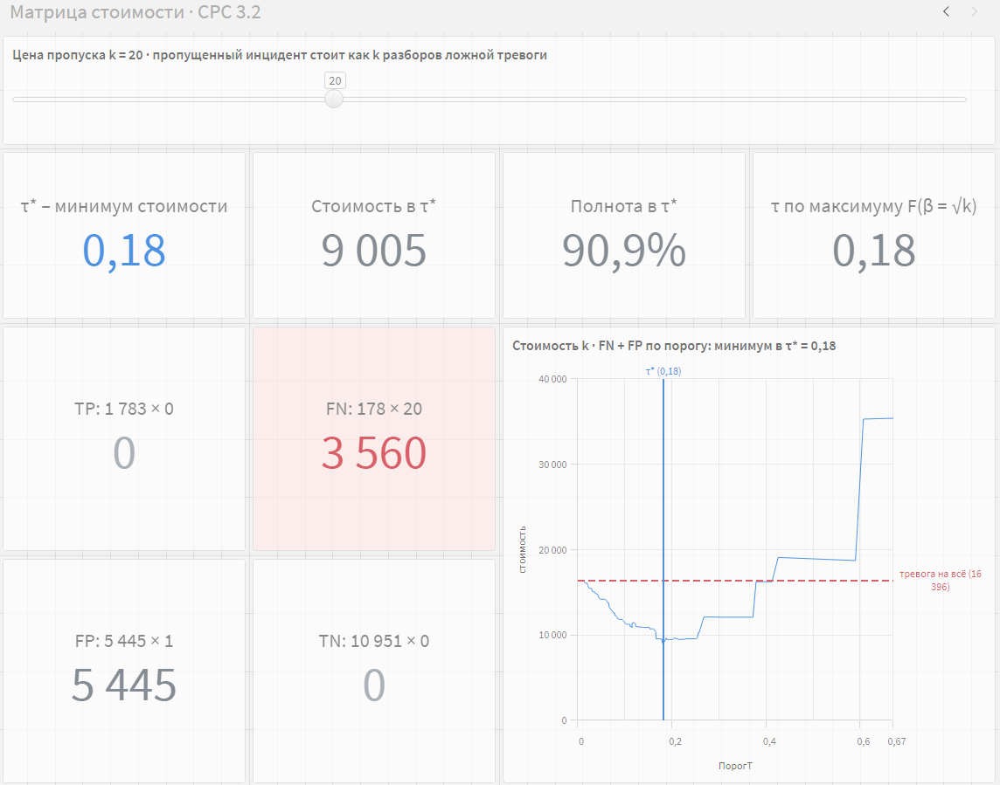

# СРС 3.2 · Матрица стоимости и порог по минимуму стоимости

**Курс:** Интеллектуальный анализ и визуализация данных · Модуль 3 · Самостоятельная работа к занятию 3.6, по лекции 3.2
**Команда:** Бабич Д.С., Синикова Д.Д., Сычева А.К. · группа 5130201/40101
**Данные:** `iavd_ml_dataset` (259 218 карточек, 12.04.2024 – 20.11.2025)

## Задание

1. Черновик матрицы стоимости: порядки C_FN и C_FP и соотношение k.
2. (ML) Для своего k найти порог с минимальной стоимостью и сравнить с максимумом Fβ при β = √k; объяснить расхождение.

## Черновик матрицы стоимости

> Положительный класс – реальный инцидент. **C_FP** – разбор ложной тревоги аналитиком L1: минуты (медиана от взятия до закрытия FP – 2,5 мин, у четверти – дольше 13 мин). **C_FN** – пропущенный инцидент: атака развивается без реагирования, дальше расследование и риск ущерба – часы и выше. **k ≈ 20** – базовый сценарий; 5 – некритичные активы, 50 – критичные. TP и TN – 0.

| | Прогноз: аналитику | Прогноз: шум |
|---|---|---|
| Факт: инцидент | TP – 0 | FN – k |
| Факт: FP | FP – 1 | TN – 0 |

## Порог: минимум стоимости и максимум Fβ

Оценка – доля инцидентов у правила SIEM (как в СРС 3.1); обучение до 04.09.2025, проверка 04.09–20.11.2025: 18 357 карточек, 1 961 инцидент.

| k | τ* мин. стоимости | FN | FP | Стоимость | τ макс. Fβ (β = √k) |
|---|---|---|---|---|---|
| 5 | 0,26 | 341 | 3 390 | 5 095 | 0,25 (+1 % к стоимости) |
| **20** | **0,18** | **178** | **5 445** | **9 005** | 0,18 (совпадает) |
| 50 | 0,10 | 70 | 10 212 | 13 712 | 0,10 (совпадает) |

Почему пороги в общем случае расходятся: стоимость линейна по FN и FP, а Fβ – отношение без TN; для откалиброванной оценки порог Fβ равен F*/(1 + β²), то есть ниже порога стоимости 1/(1 + k). У нас они совпали, потому что оценка ступенчатая (142 значения).

Отчёт: [`report/srs-3.2_report.pdf`](report/srs-3.2_report.pdf).

| Стоимость по порогу | Матрица стоимости при k = 20 | Стоимость против Fβ |
|---|---|---|
|  |  |  |

### Qlik Sense – лист «Матрица стоимости»

Ползунок k пересчитывает τ*, матрицу стоимости и порог по максимуму F(β = √k).



Сборка листа и контрольные числа – в [`qlik/README.md`](qlik/README.md). Приложение `qlik/iavd_ml.qvf` – общее для модуля 3: в нём листы СРС 3.1 и 3.2.

## Как запустить

```bash
pip install -r requirements.txt
# положите iavd_ml_dataset.parquet в data/, затем из этой папки:
python python/cost_threshold.py
```

Qlik Sense Desktop: скопируйте `qlik/iavd_ml.qvf` в `Документы\Qlik\Sense\Apps`, создайте подключение `MyParquetFolder` к папке с parquet и перезагрузите данные.

Когда будет `MODEL_PREDICTIONS_target.parquet`, тот же расчёт можно сделать для модели преподавателей, подставив `y_pred_proba` вместо нашей оценки.
