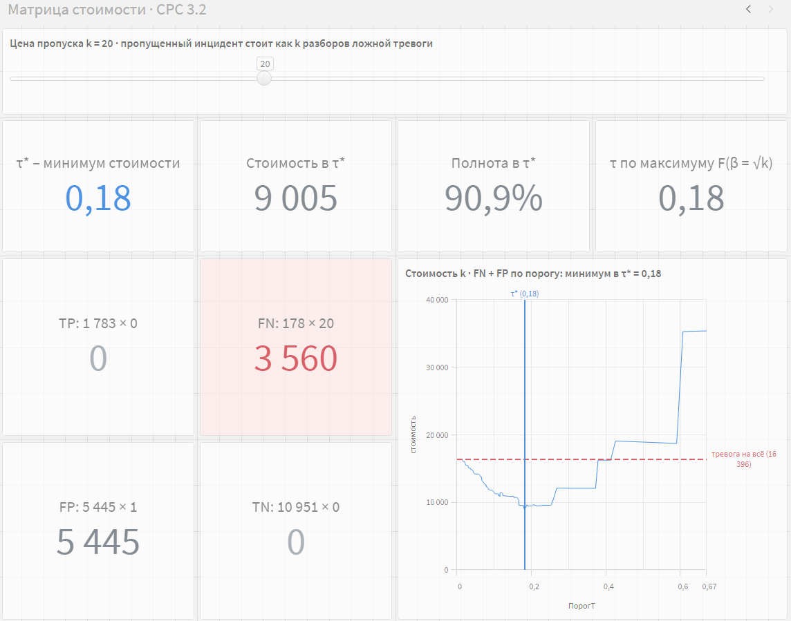

# СРС 3.2 в Qlik Sense Desktop – лист «Матрица стоимости»

Лист в том же приложении `iavd_ml.qvf`, что и лист СРС 3.1 «Порог триажа». Ползунок k пересчитывает порог τ* с минимальной стоимостью k · FN + FP, матрицу стоимости и порог по максимуму F(β = √k).



## Загрузка

1. Скопируйте `iavd_ml.qvf` в `Документы\Qlik\Sense\Apps`.
2. Создайте подключение «Папка» с именем `MyParquetFolder` к папке с `iavd_ml_dataset.parquet`.
3. Перезагрузите данные. Скрипт – [`load_script.qvs`](load_script.qvs): часть 3.1 и в конце три строки для 3.2.

Сетка порогов 0,01 из листа 3.1 для стоимости не годится: минимум получится 9 061 вместо 9 005. Поэтому для 3.2 пороги берутся по всем значениям оценки (`ПорогТ`), плюс порог 0 – режим «всё аналитику».

## Переменная

`vTauStar` – порог с минимальной стоимостью:

```
=FirstSortedValue(ПорогТ, Aggr(vK * Sum(If(Оценка < ПорогТ, y)) + Sum(If(Оценка >= ПорогТ, 1 - y)), ПорогТ))
```

## Объекты листа

**Ползунок k** – «Ввод переменной», `vK`, от 5 до 50, шаг 1.
Заголовок (fx): `='Цена пропуска k = ' & vK & ' · пропущенный инцидент стоит как k разборов ложной тревоги'`.

**KPI:**

| Метка | Мера | Формат |
|---|---|---|
| τ* – минимум стоимости | `=vTauStar` | `0,00` |
| Стоимость в τ* | `Min(Aggr(vK * Sum(If(Оценка < ПорогТ, y)) + Sum(If(Оценка >= ПорогТ, 1 - y)), ПорогТ))` | `# ##0` |
| Полнота в τ* | `Sum(If(Оценка >= vTauStar, y)) / Sum(y)` | `0,0%` |
| τ по максимуму F(β = √k) | `FirstSortedValue(ПорогТ, -Aggr((1 + vK) * Sum(If(Оценка >= ПорогТ, y)) / ((1 + vK) * Sum(If(Оценка >= ПорогТ, y)) + vK * Sum(If(Оценка < ПорогТ, y)) + Sum(If(Оценка >= ПорогТ, 1 - y))), ПорогТ))` | `0,00` |

Fβ при β² = k записана через клетки матрицы: (1 + k)·TP / ((1 + k)·TP + k·FN + FP).

**Матрица стоимости** – четыре KPI 2 × 2: число карточек × цена клетки. Формат меры `# ##0`.

| Клетка | Метка (fx) | Мера |
|---|---|---|
| TP | `='TP: ' & Num(Sum(If(Оценка >= vTauStar, y)), '# ##0', ',', ' ') & ' × 0'` | `0` |
| FN (фон `#FFEBE9`, число `#CF222E`) | `='FN: ' & Num(Sum(If(Оценка < vTauStar, y)), '# ##0', ',', ' ') & ' × ' & vK` | `vK * Sum(If(Оценка < vTauStar, y))` |
| FP | `='FP: ' & Num(Sum(If(Оценка >= vTauStar, 1 - y)), '# ##0', ',', ' ') & ' × 1'` | `Sum(If(Оценка >= vTauStar, 1 - y))` |
| TN | `='TN: ' & Num(Sum(If(Оценка < vTauStar, 1 - y)), '# ##0', ',', ' ') & ' × 0'` | `0` |

В формате `Num` разделители указаны явно: без них Qlik не понимает шаблон `'# ##0'` и выводит его как текст.

**Стоимость по порогу** – линейный график:

- измерение `ПорогТ`, ось «Непрерывный»;
- мера `vK * Sum(If(Оценка < ПорогТ, y)) + Sum(If(Оценка >= ПорогТ, 1 - y))`, цвет `#0969DA`;
- опорная линия измерения `=vTauStar` («τ*»);
- опорная линия по оси Y `16396` – «тревога на всё», пунктир `#CF222E`;
- заголовок (fx): `='Стоимость k · FN + FP по порогу: минимум в τ* = ' & Num(vTauStar, '0,00')`.

## Контроль

| k | τ* | Стоимость | Полнота | τ по F(√k) | FN · FP |
|---|---|---|---|---|---|
| 5 | 0,26 | 5 095 | 82,6 % | 0,25 | 341 · 3 390 |
| 20 | 0,18 | 9 005 | 90,9 % | 0,18 | 178 · 5 445 |
| 50 | 0,10 | 13 712 | 96,4 % | 0,10 | 70 · 10 212 |
