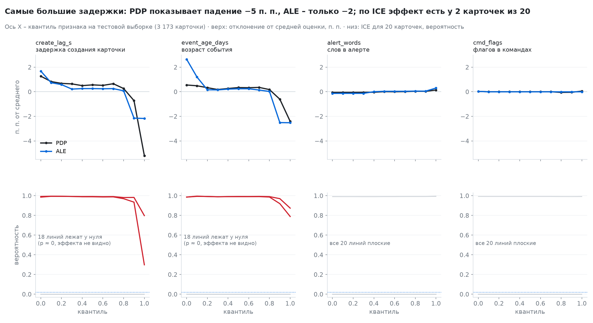
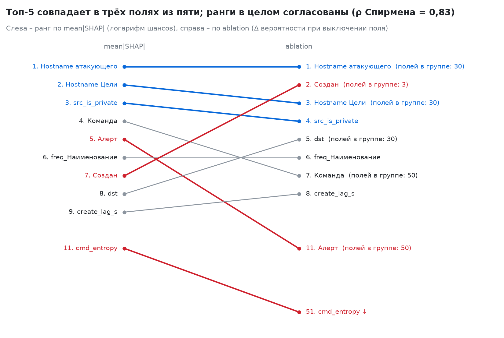
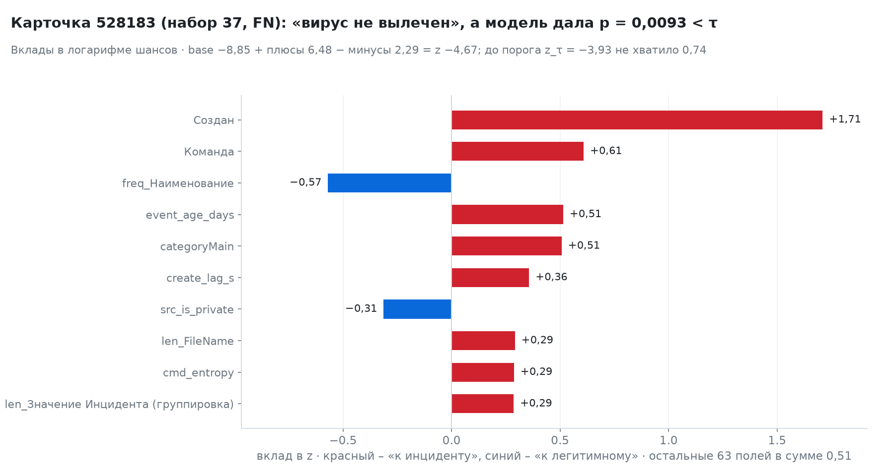
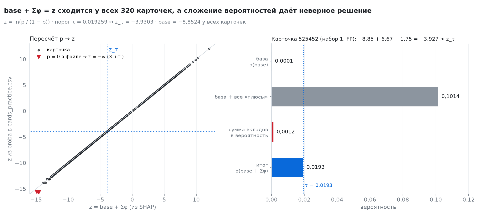
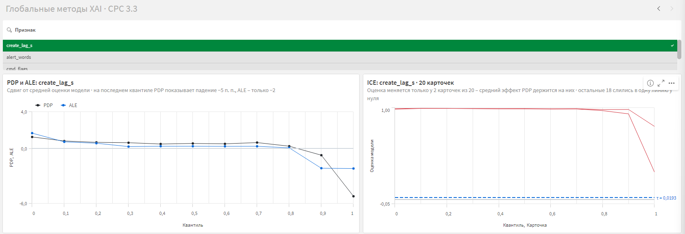
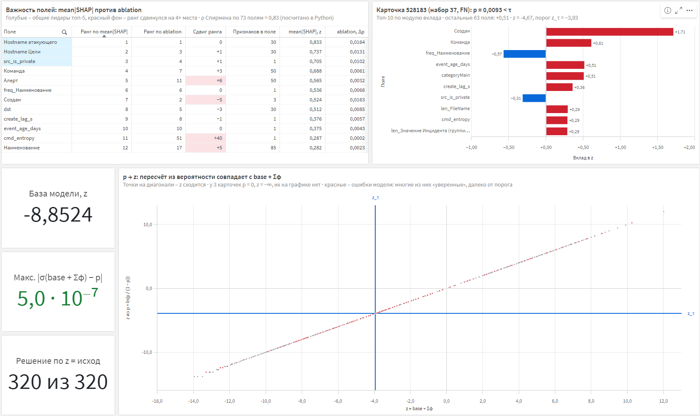

# СРС 3.3 · Глобальные методы интерпретации

**Курс:** Интеллектуальный анализ и визуализация данных · Модуль 3 · Самостоятельная работа к занятию 3.4, по лекции 3.3
**Команда:** Бабич Д.С., Синикова Д.Д., Сычева А.К. · группа 5130201/40101 · набор карточек практики 3.7 – **№ 37**
**Модель:** `lgbm_gate1` v001, порог τ = 0,019259 (z_τ = −3,9303)

## Задание

1. `pdp_numeric.csv`, `ice_numeric.csv`, `ale_numeric.csv`: что показывает PDP, что добавляет ICE, где расходится ALE.
2. `ablation.csv` и `importance.csv`: сравнить топ-5 и объяснить расхождения.
3. К 3.4 – карточка из практики 3.7, решение по которой непонятно.
4. `cards_practice.csv`: p → z, сравнить с z_τ = −3,9303, проверить base + Σφ = z.

## Ответы

**1. PDP, ICE, ALE.** На самых больших задержках (`create_lag_s`, `event_age_days`) PDP показывает падение средней оценки. ICE: падает она только у 2 карточек из 20, остальные 18 лежат у нуля. ALE: на последнем квантиле PDP завышает эффект – −5 п. п. вместо −2. Причина – корреляция: у обоих признаков максимум 203 суток, и PDP подставляет огромную задержку карточкам со «свежим» событием. `alert_words` и `cmd_flags` модель почти не использует.

**2. Важность против ablation.** Топ-5 совпадает в трёх полях: `Hostname атакующего`, `Hostname Цели`, `src_is_private`; ρ Спирмена по всем 73 полям – 0,83. Расходятся `Создан` (7 → 2), `Алерт` (5 → 11), `cmd_entropy` (11 → 51). Причины: mean|SHAP| в логарифме шансов, а ablation в вероятности (у «уверенных» карточек большой вклад в z почти не двигает p); ablation выключает поле целиком вместе с группой признаков (у `Команда` и `Алерт` – по 50).

**3. Карточка 528183 (набор 37, FN).** «Вирус не вылечен», троян HEUR:Trojan-Downloader, вердикт «Решён», а модель дала p = 0,0093 < τ. Главный довод «за инцидент» – время создания (+1,71, поздний вечер воскресенья), имя вредоноса даёт всего +0,13, критичность «Высокая» – −0,11, а «Тип инцидента» среди признаков нет. Против – частое правило TTS_09 (−0,57). Вопрос к 3.4: почему содержательные поля карточки весят так мало.

**4. p → z.** base + Σφ = z сходится у всех 320 карточек (σ(z) = proba с точностью 5·10⁻⁷), решение z ≥ z_τ совпадает с исходом у всех. Пересчёт p → z из файла надёжен только в середине шкалы: у 3 карточек p = 0 и z = −∞. Складывать вклады в вероятностях нельзя: у карточки 525452 такая сумма даёт 0,0012 (ниже порога), а верный итог 0,0193 – выше порога, решение меняется на противоположное.

Отчёт: [`report/srs-3.3_report.pdf`](report/srs-3.3_report.pdf).

| PDP, ICE и ALE | Важность против ablation |
|---|---|
|  |  |
| **Карточка 528183** | **p → z и сложение вкладов** |
|  |  |

## Qlik Sense

Те же четыре ответа – на листе «Глобальные методы XAI» в приложении модуля 3 `iavd_ml.qvf`: PDP и ALE, ICE, ранги важности, вклады карточки 528183 и проверка σ(base + Σφ) = p. Готовое приложение – [`qlik/iavd_ml.qvf`](qlik/iavd_ml.qvf), как собрать – [`qlik/README.md`](qlik/README.md).

| Фильтр, PDP и ALE, ICE | Важность, карточка 528183, p → z |
|---|---|
|  |  |

## Как запустить

```bash
pip install -r requirements.txt
# положите CSV в data/ (см. data/README.md), затем из этой папки:
python python/global_xai.py 37     # 37 – номер набора; числа в консоль, графики в images/
```
