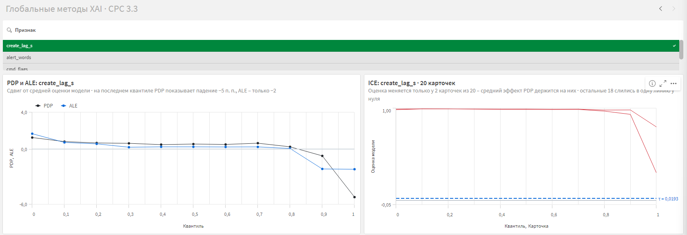
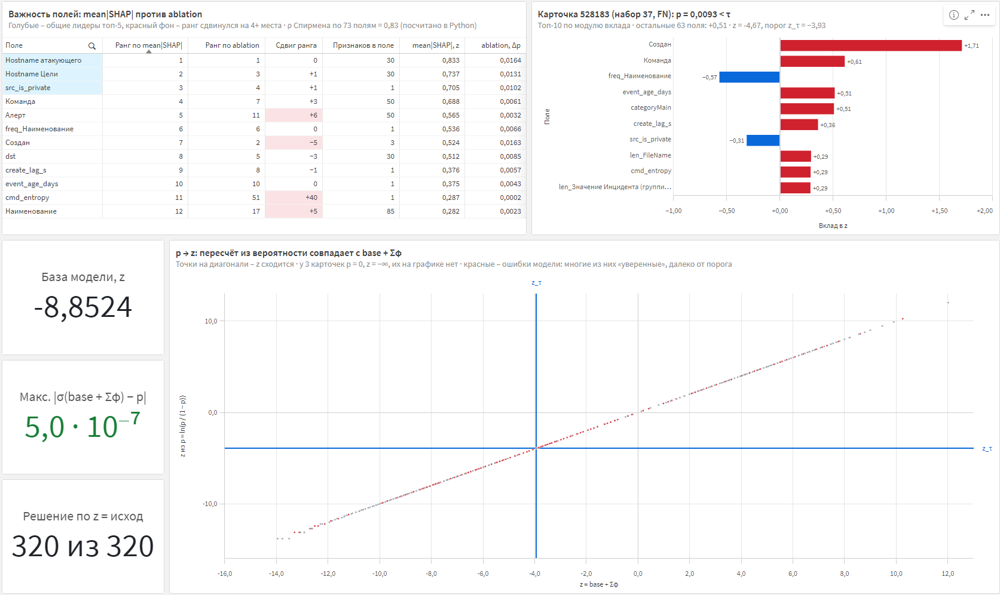

# СРС 3.3 в Qlik Sense: лист «Глобальные методы XAI»

Лист добавляется в приложение модуля 3 `iavd_ml.qvf` (листы СРС 3.1 и 3.2). Готовое приложение со всеми тремя листами – [`iavd_ml.qvf`](iavd_ml.qvf) в этой папке.

| Фильтр, PDP и ALE, ICE | Важность, карточка 528183, p → z |
|---|---|
|  |  |

## 0. Загрузка

1. `python python/qlik_prep.py` готовит из CSV занятия 3.3 и `shap_cards.csv` пять файлов `qlik/data/xai_*.csv` (они уже лежат в папке).
2. Положите `xai_*.csv` в папку подключения `MyParquetFolder`.
3. В конец скрипта `iavd_ml.qvf` (после строк СРС 3.2) вставьте [`load_script_add_3.3.qvs`](load_script_add_3.3.qvs) и нажмите «Загрузить данные».

Таблицы XAI ни с чем из СРС 3.1–3.2 не связаны: у них свои имена полей (`КартаXAI`, `ПолеXAI`, `ПризнакSHAP`).

**Проверка:** `Count(DISTINCT КартаXAI)` = 320 · `Count(DISTINCT ПолеXAI)` = 73 · `Only({<КартаXAI={528183}>} z)` = −4,67.

## 1. Фильтр признака

Панель фильтров по полю `Признак` (create_lag_s, event_age_days, alert_words, cmd_flags). В свойствах поля: «Всегда одно выбранное значение» – графики PDP и ICE показывают один признак.

## 2. PDP и ALE

Линейный график. Измерение `Квантиль`. Меры (формат `0,0`):
- `PDP, п. п.` – `(Sum(PDP) - Avg(TOTAL <Признак> PDP)) * 100`;
- `ALE, п. п.` – `(Sum(ALE) - Avg(TOTAL <Признак> ALE)) * 100`.

Цвета: PDP – `#1F2328`, ALE – `#0969DA`. Опорная линия Y = 0.

Контроль (`create_lag_s`): на последнем квантиле PDP ≈ −5 п. п., ALE ≈ −2.

## 3. ICE

Линейный график. Измерения `ICE_Квантиль` и `Линия` (20 линий), мера `Sum(ICE_p)`. Цвет по выражению: `If(Max(TOTAL <Линия> ICE_p) - Min(TOTAL <Линия> ICE_p) > 0.01, '#CF222E', '#C3C9D0')` – красные те 2 карточки из 20, у которых оценка меняется. Опорная линия Y = `vTauXAI` («τ»). Легенда выкл.

## 4. Важность: mean|SHAP| против ablation

Таблица, измерение `ПолеXAI`, сортировка по `Ранг_SHAP`. Меры: `Ранг_SHAP`, `Ранг_abl`, `Ранг_abl - Ранг_SHAP` (цвет фона `If(Fabs(Ранг_abl - Ранг_SHAP) >= 4, '#FBE3E5')`), `Признаков`, `meanAbsSHAP` (`0,000`), `Дельта_abl` (`0,0000`). Ограничение: `Ранг_SHAP <= 12` – через условие в мере `If(Only(Ранг_SHAP) <= 12, …)`.

KPI «ρ Спирмена» в Qlik считать неудобно – значение 0,83 взято из Python и указано в подзаголовке.

Контроль: Hostname атакующего 1 / 1 · Hostname Цели 2 / 3 · src_is_private 3 / 4 · Создан 7 / 2 · cmd_entropy 11 / 51.

## 5. Карточка 528183: десять крупнейших вкладов

Линейчатая, горизонтальная. Измерение `ПризнакSHAP`. Мера:

```
If(Rank(Fabs(Sum({<КартаXAI={528183}>} phi)), 4) <= 10, Sum({<КартаXAI={528183}>} phi))
```

Сортировка по выражению `Fabs(Sum({<КартаXAI={528183}>} phi))`, по убыванию; нулевые значения выкл. Цвет: `If(Sum({<КартаXAI={528183}>} phi) > 0, '#CF222E', '#0969DA')`.

Подзаголовок с хвостом: `='остальные 63 поля: ' & Num(Sum({<КартаXAI={528183}>} phi) - Sum(Aggr(If(Rank(Fabs(Sum({<КартаXAI={528183}>} phi)), 4) <= 10, Sum({<КартаXAI={528183}>} phi)), ПризнакSHAP)), '+0,00;−0,00')` → «+0,51».

Контроль: Создан +1,71 · Команда +0,61 · freq_Наименование −0,57.

## 6. p → z и аддитивность

| Объект | Настройки | Контроль |
|---|---|---|
| KPI «база модели» | `Only(base)` | −8,85 |
| KPI «σ(base + Σφ) = p» | `Max(Aggr(Fabs(1/(1+Exp(-(Only(base) + Sum(phi)))) - Only(p)), КартаXAI))`, формат `0,0E+0` | ≤ 5·10⁻⁷ |
| Точечная диаграмма | измерение `КартаXAI`; X – `Only(z)`, Y – `If(Only(p) > 0, Log(Only(p) / (1 - Only(p))))`; опорные линии X и Y = `vZtau` | 3 карточки с p = 0 выпадают: z из файла = −∞ |

Проверка идёт в прямом направлении – через σ, а не через Log: у трёх карточек p = 0, и обратный пересчёт невозможен (методичка 3.7, § 4.5).

## Почему эти графики

- **PDP и ALE на одной оси** – расхождение двух линий на последнем квантиле и есть ответ на вопрос «где расходится ALE».
- **ICE с двумя красными линиями** – видно, что средний эффект PDP создают 2 карточки из 20.
- **Таблица рангов** – сравнение двух рейтингов по 73 полям читается быстрее как таблица с подсветкой расхождений, чем как пара столбиковых диаграмм.
- **Десять вкладов карточки** – подготовка к 3.4: что именно двигает решение по непонятной карточке; хвост указан в подзаголовке.
