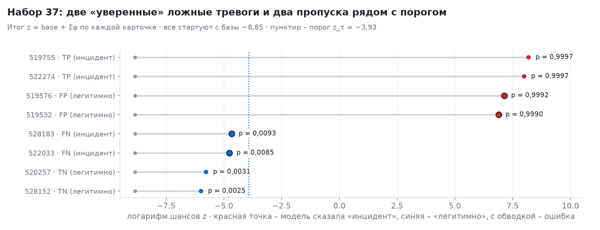
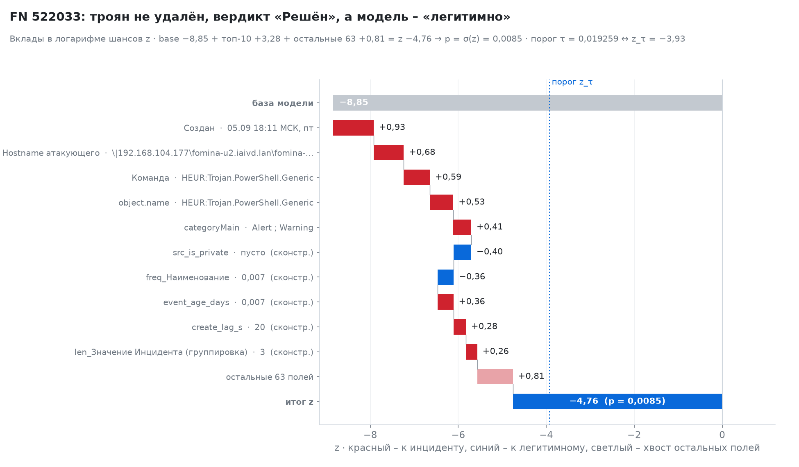
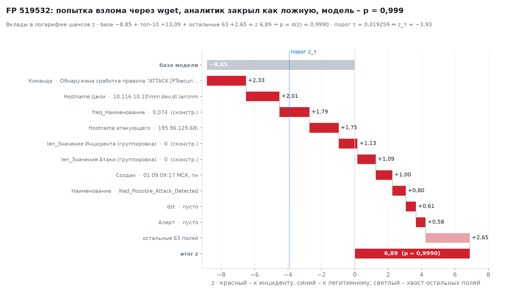
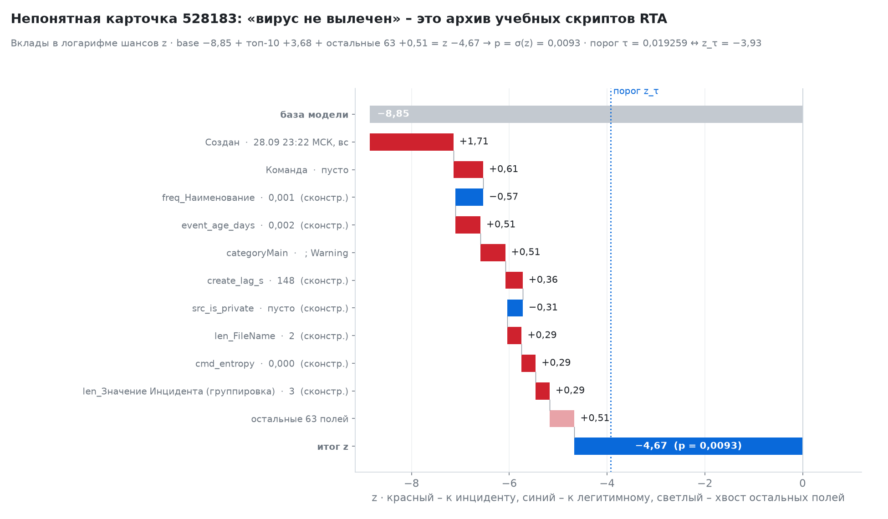
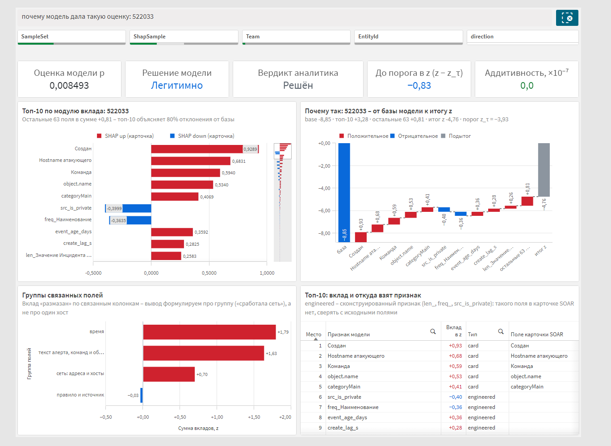
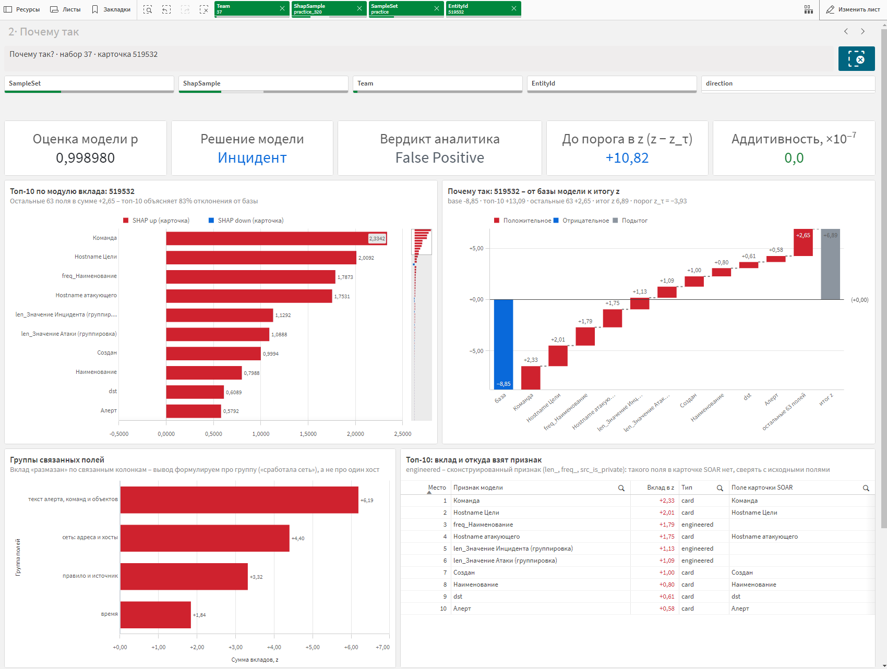
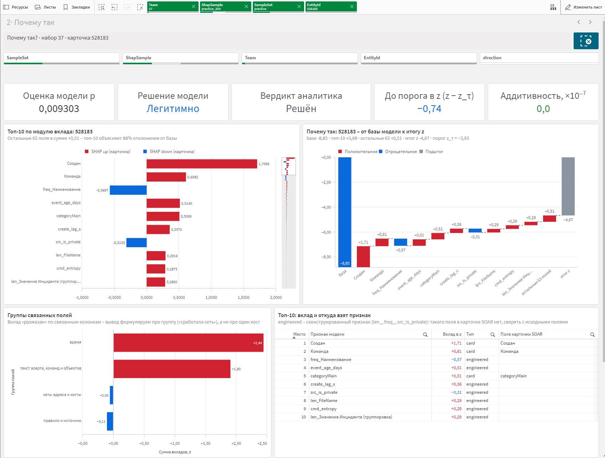
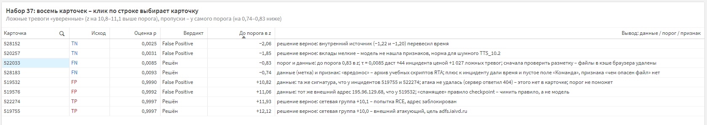

# СРС 3.4 · Локальные объяснения: значения Шепли по своему набору

**Курс:** Интеллектуальный анализ и визуализация данных · Модуль 3 · Самостоятельная работа по лекции 3.4
**Команда:** Бабич Д.С., Синикова Д.Д., Сычева А.К. · группа 5130201/40101 · набор карточек практики 3.7 – **№ 37**
**Модель:** `lgbm_gate1` v001, порог τ = 0,019259 (z_τ = −3,9303), база TreeSHAP base = −8,8524 · вклады в логарифме шансов, режим структуры деревьев (`pred_contrib` LightGBM)

## Задание (слайд 42)

1. Два водопада по своему набору: FN и FP; показать топ-10 и хвост.
2. Проверить аддитивность: base + Σφ против `raw_score`, расхождение не больше 10⁻⁶.
3. Вывод по каждой карточке: данные / порог / признак.
4. Показ карточки из практики, решение по которой непонятно.

## Ответы коротко

1. **FN 522033** (троян не удалён, вердикт «Решён»): топ-10 даёт +3,28, остальные 63 поля – ещё +0,81; итог z = −4,76, до порога не хватило 0,83. **FP 519532** (попытка взлома через wget, закрыта как ложная): топ-10 +13,09, хвост +2,65, итог z = +6,89, p = 0,999.
2. Аддитивность выполняется у всех 320 карточек практики: max |base + Σφ − raw_score| = 6,9·10⁻¹¹ при допуске 10⁻⁶.
3. 522033 – **порог и данные**: карточка у самого порога, но сдвигать его дорого; сначала проверить разметку. 519532 – **данные**: по полям карточки атака неотличима от двух настоящих инцидентов набора, а причина «ложной» (атака не удалась) появляется только после разбора.
4. Непонятная карточка – **528183** из СРС 3.3. Разбор показал: «вредонос» – архив учебных скриптов RTA, эскалированный на L2; модель сказала «легитимно» почти без доводов, а главный «плюс» к инциденту дали время создания и **пустое** поле «Команда».



В наборе по 2 карточки каждого исхода. Ошибки модели устроены по-разному: обе ложные тревоги – «уверенные» (p > 0,998, z на 10,8–11,1 выше порога), оба пропуска – рядом с порогом (z ниже на 0,74–0,83).

## 1. Водопады FN и FP: топ-10 и хвост

Водопад начинается с базы модели (−8,85, p = 0,00014 – «почти наверняка легитимно»), каждый шаг – вклад одного поля, предпоследняя ступень – сумма остальных 63 полей, последняя – итог z. Вероятность получается только на выходе: p = σ(z). Подписи у признаков – значения из карточки; «сконстр.» – сконструированный признак (`len_*`, `freq_*`, `src_is_private` и т. п.), такого поля в карточке SOAR нет.



**FN 522033.** «Вредоносное ПО HEUR:Trojan.PowerShell.Generic не было удалено на хосте fomina-u2», правило `TTS_10.1_Malware_Found_And_Not_Deleted`, Kaspersky, критичность «Высокая». Почти все крупные вклады – «к инциденту»: время создания (пятница 18:11, +0,93), хост (+0,68), имя вредоноса в полях Команда и object.name (+0,59 и +0,53). «К легитимному» – только пустой адрес источника (−0,40) и частота правила (−0,36: TTS_10.1 часто оказывается шумом). Сумма +4,09 не дотягивает до +4,92, которые нужны от базы до порога.

| | топ-10 | остальные 63 | итог z | p | до порога |
|---|---|---|---|---|---|
| 522033 | +3,28 (80 %) | +0,81 (20 %) | −4,76 | 0,0085 | −0,83 |
| 519532 | +13,09 (83 %) | +2,65 (17 %) | +6,89 | 0,9990 | +10,82 |

Хвост не мелочь: у 522033 без него итог был бы −5,57, а не −4,76. Водопад из одного топ-10 с подписью «итог» показал бы не ту оценку, которую выдала модель.



**FP 519532.** Сигнатура PT «ATTACK Possible webshell: WGET command in http uri», правило `Nad_Possible_Attack_Detected`, внешний адрес 195.96.129.68, цель в сети организации DataLearn. Доводы «к инциденту» по всем группам полей: текст сработки (+2,33), хосты цели и атакующего (+2,01 и +1,75), частота правила (+1,79). Ни одного заметного вклада «против».

Около **+4,7** из +15,7 дали **пустые** поля: 20 пустых признаков (dst, Алерт, задержки и др.) дают +2,51, нулевая длина «Значение Инцидента / Атаки (группировка)» – ещё +2,22. Карточка пришла без обогащения. Но и без этих вкладов z ≈ +2,2 – далеко выше порога.

## 2. Аддитивность: base + Σφ = raw_score

`python/local_shap.py` прогоняет модель по всем 320 карточкам практики: `pred_contrib=True` даёт 1 099 вкладов и base, `raw_score=True` – выход модели в логарифме шансов. Вклады суммируются по 73 исходным полям (так же устроены `shap_cards.csv` и `fact_shap` в Qlik).

| Проверка | Результат | Допуск |
|---|---|---|
| base + Σφ = raw_score, 320 карточек | max 6,9·10⁻¹¹, нарушений 0 | 10⁻⁶ |
| σ(raw_score) = predict_proba | max 2,9·10⁻¹² | – |
| σ(base + Σφ) = proba в `cards_practice.csv` | max 5,0·10⁻⁷ | 5·10⁻⁷ (proba в файле округлена до 10⁻⁶) |
| вклады модели = `shap_cards.csv` | max 4,4·10⁻¹⁶ | – |
| вклады модели = `fact_shap` (BI-комплект) | max 6,2·10⁻⁷ | хранится во float32 |

По набору 37:

| Карточка | Исход | base | Σφ | base + Σφ | raw_score | расхождение |
|---|---|---|---|---|---|---|
| 522033 | FN | −8,852417 | +4,092447 | −4,759970 | −4,759970 | 6,6·10⁻¹² |
| 528183 | FN | −8,852417 | +4,184369 | −4,668048 | −4,668048 | 2,8·10⁻¹² |
| 519532 | FP | −8,852417 | +15,739327 | +6,886911 | +6,886911 | 7,0·10⁻¹² |
| 519576 | FP | −8,852417 | +15,984366 | +7,131949 | +7,131949 | 1,2·10⁻¹² |
| 528152 | TN | −8,852417 | +2,861386 | −5,991030 | −5,991030 | 5,5·10⁻¹² |
| 520257 | TN | −8,852417 | +3,076703 | −5,775713 | −5,775713 | 1,4·10⁻¹¹ |
| 522274 | TP | −8,852417 | +16,849613 | +7,997196 | +7,997196 | 1,2·10⁻¹² |
| 519755 | TP | −8,852417 | +17,038786 | +8,186369 | +8,186369 | 2,3·10⁻¹⁴ |

Объяснения сходятся с предсказанием, их можно показывать.

## 3. Вывод по каждой карточке: данные, порог или признак

Шаблон методички 3.7: что видит модель → почему так → что делать. Комментарии аналитиков взяты из полей «Решение» и «Комментарий» карточки (модели они недоступны – это поля категории C).

| Карточка | Исход | p | Главный вклад | Что это | Что делать |
|---|---|---|---|---|---|
| **522033** | FN | 0,0085 | Создан +0,93 | **порог и данные** | До порога 0,83 в z (шансы ×2,3). Порог ≤ 0,0085 поймал бы её, но на потоке эксплуатации это +44 найденных инцидента ценой +1 027 ложных тревог (аналитику 28,5 % карточек вместо 23,1 %). По комментарию файлы лежали в кэше Edge и были удалены, «дополнительные действия не требуются» – разметку стоит проверить раньше порога |
| **519532** | FP | 0,9990 | Команда +2,33 | **данные** | Та же сигнатура, что у инцидентов 519755 и 522274. Аналитик закрыл как ложную: «сервер ответил 404», адрес уже заблокирован. Этих фактов нет в карточке на момент создания. Порог не поможет (нужен τ > 0,999). Проверить обогащение карточек DataLearn: +4,7 дали пустые поля |
| 528183 | FN | 0,0093 | Создан +1,71 | **данные (метка) и признак** | См. п. 4 |
| 519576 | FP | 0,9992 | src_is_private +2,03 | **данные** | Тот же внешний адрес 195.96.129.68, что у 519532; сетевая группа +8,2. Аналитик: «спамящее срабатывание, требует доработки» – чинить правило checkpoint, а не модель |
| 519755 | TP | 0,9997 | Hostname Цели +3,33 | решение верное | сетевая группа +10,0: внешний атакующий, цель adfs.iaivd.ru |
| 522274 | TP | 0,9997 | Hostname атакующего +3,72 | решение верное | сетевая группа +10,1: попытка RCE, адрес заблокирован |
| 520257 | TN | 0,0031 | len_Значение Инцидента +0,53 | решение верное | вклады мелкие (Σφ = +3,08): модель «не нашла» признаков – норма для шумного TTS_10.2 |
| 528152 | TN | 0,0025 | Создан +1,45 | решение верное | внутренний источник (src −1,22, Hostname атакующего −1,20) перевесил время |

**Группы связанных полей.** Адреса, хосты и IP-признаки коррелированы, их вклад «размазан» по колонкам. Поэтому у верных срабатываний вывод формулируется про группу: «сработала сеть» (+10,0 и +10,1), а не «виноват хост».

| Карточка | время | сеть | правило и источник | текст алерта и команд |
|---|---|---|---|---|
| 522033 FN | +1,79 | +0,70 | −0,03 | +1,63 |
| 528183 FN | +2,44 | −0,06 | −0,10 | +1,90 |
| 519532 FP | +1,84 | +4,40 | +3,32 | +6,19 |
| 519576 FP | +2,09 | +8,20 | +2,80 | +2,90 |

У обеих FN почти нет вклада сети и правила. Модель уверенно распознаёт сетевые атаки, а для вредоносного ПО на хостах доводов в признаках мало.

**Проверка лидера на утечку.** Цепочка «данные → порог → признаки»:
- Среди 73 признаков модели нет полей категории C – тех, что заполняет аналитик (Вердикт, Решение, Комментарий, «Ложное срабатывание», «SLA просрочен» и др.).
- Нет и нормативов SLA: поле «SLA по взятию в работу» было лидером важности, пока его не исключили (ADR-002).
- Лидер наших пропусков – `Создан` (час, день недели, выходной). Это не утечка: время известно в момент создания карточки. Но это поведение процесса (вечер и выходные – другая смена и другой поток), а не признак угрозы. Вклад +1,71 у 528183 означает «в воскресенье вечером инциденты чаще», а не «эта карточка опасна».

## 4. Карточка, решение по которой непонятно: 528183



В СРС 3.3 карточку отложили с вопросом: почему у «вируса, который не вылечен», содержательные поля весят так мало. Решение аналитика объясняет, что на самом деле произошло:

> По информации от сотрудника: все копии архива RTA-master.zip удалены. Архив представляет собой набор скриптов, эмулирующих подозрительную деятельность на АРМ Windows… использовался в рамках написания скриптов для эмуляции аномальной активности на АРМ киберполигона.

**Метка.** Карточку эскалировали на L2 и закрыли как «Решён», то есть по политике это инцидент: инструменты атак на рабочем месте недопустимы. Но атаки не было. Для модели, которая учится отличать «Решён» от «False Positive», это пограничный пример: та же картина (антивирус нашёл файл в «Загрузках») в других карточках закрыта как FP.

**Признаки.**
- Модель «не нашла» почти ничего: Σφ = +4,18, примерно как у верных TN набора (+2,86 и +3,08).
- Самый большой «плюс» – время: воскресенье, 23:22 МСК (+1,71).
- Второй – поле «Команда» (+0,61), и оно **пустое**: пустое поле модель читает как довод.
- Против – частота правила TTS_09 (−0,57).
- Признака «чем опасен файл и где он лежит» (имя архива, путь в «Загрузках», отметка VirusTotal из комментария) в модели нет. «Тип инцидента» тоже не входит в 73 признака.

**Почему решение всё ещё непонятно** – и что мы покажем на практике 3.7:
1. Инцидент ли это вообще? Если политика считает учебные инструменты нарушением, модели нужен признак «файл – инструмент атак». Если нет – метку надо исправить, и FN исчезнет.
2. Модель опирается на время и пустые поля, а не на содержание. Так же устроена вторая FN набора, 522033. Для правил вредоносного ПО (TTS_09, TTS_10.x) объяснение «почему легитимно» по сути пустое – вклады близки к нулю, как у шумных TN.
3. Порог тут не решение: z = −4,67, до порога 0,74. Снижение порога до 0,0093 поймало бы карточку, но на потоке эксплуатации добавило бы 925 ложных тревог ради 40 инцидентов.

## Чек-лист приёмки объяснения (слайд 40)

| Пункт | Как выполнено |
|---|---|
| Аддитивность ≤ 10⁻⁶ | 6,9·10⁻¹¹ на 320 карточках (п. 2) |
| Шкала названа | логарифм шансов z; вероятность – только итог σ(z) |
| Режим и база | режим структуры деревьев (`pred_contrib`), base = −8,8524 = средний выход на обучении |
| Топ-10 дополнен хвостом | ступень «остальные 63 полей» на каждом водопаде |
| Коррелированные признаки сгруппированы | 4 смысловые группы (п. 3) |
| Устойчивость | вклады модели совпадают с `shap_cards.csv` и `fact_shap` из двух комплектов; второй метод (LIME) не запускался |

## Вкладка «Почему так?» в Taipy

`python/why_taipy.py` – та же логика в интерфейсе для любого набора 1–40:
- выбор карточки;
- KPI: оценка, решение модели, вердикт, исход, расстояние до порога в z;
- водопад с хвостом и пунктиром порога, переключатель топ-5 / 10 / 20;
- строка проверки аддитивности;
- группы полей и таблица вкладов со значениями из карточки.

Выводы по карточкам набора 37 приведены в [отчёте СРС 3.4](report/srs-3.4_report.pdf). Обоснование выбора графиков и таблиц есть в [дополнении к отчёту](report/taipy-addendum.md).

## Qlik Sense

Лист «Почему так? · набор 37» в приложении практики 3.7 `IAVD_Assessment_v05.qvf`. Это заготовка преподавателей «Почему так», доведённая до требований лекции 3.4:
- KPI: оценка, решение модели, вердикт, расстояние до порога в z, проверка аддитивности;
- топ-10 по модулю вклада, с хвостом в подзаголовке;
- каскадная диаграмма: база → 10 вкладов → «остальные 63 полей» → итог z;
- группы связанных полей и таблица топ-10 с типом признака (поле карточки или сконструированный);
- таблица набора 37 с выводом «данные / порог / признак» по каждой карточке; клик по строке выбирает карточку.

При открытии лист сам выбирает `practice`, `practice_320`, набор 37 и карточку 522033. Готовое приложение `IAVD_Assessment_v05.qvf` – в [Release v3.7](https://github.com/Dasha-9/Intelligent-data-analysis-and-visualization/releases/tag/v3.7) (192 МБ), как собрать – [`qlik/README.md`](qlik/README.md). Там же листы 1 и 3 практики 3.7 – см. [`praktika-3.7-pochemu-tak/`](../praktika-3.7-pochemu-tak/).

| FN 522033 | FP 519532 |
|---|---|
|  |  |
| **Непонятная карточка 528183** | **Набор 37: вывод по каждой карточке** |
|  |  |

## Структура

```
python/   local_shap.py – прогон модели, аддитивность, водопады для отчёта; shap_data.py – данные вкладки; why_taipy.py (+ .css) – вкладка Taipy
qlik/     load_script_add_3.4.qvs – добавка к скрипту приложения 3.7; README.md – как собрать лист
results/  set37_cards.csv – итоги по набору; additivity_320.csv – проверка по 320 карточкам
images/   водопады и скриншоты
report/   отчёт pdf + docx
data/     сюда кладутся файлы комплекта (в git не попадают)
```

## Как запустить

```bash
pip install -r requirements.txt
# 1) расчёт и водопады – нужен комплект IAVD_3.7_ML_team (модель + course_pack) и его окружение (lightgbm 4.7, scikit-learn 1.7.2):
python python/local_shap.py путь/к/IAVD_3.7_ML_team 37
# 2) вкладка Taipy – модель не нужна, только готовые вклады:
#    положите в data/ из IAVD_3.7_ML_team/course_pack/ файлы cards_practice.csv, shap_cards.csv, cards_raw.parquet
python python/why_taipy.py        # откроется http://127.0.0.1:5082
```
