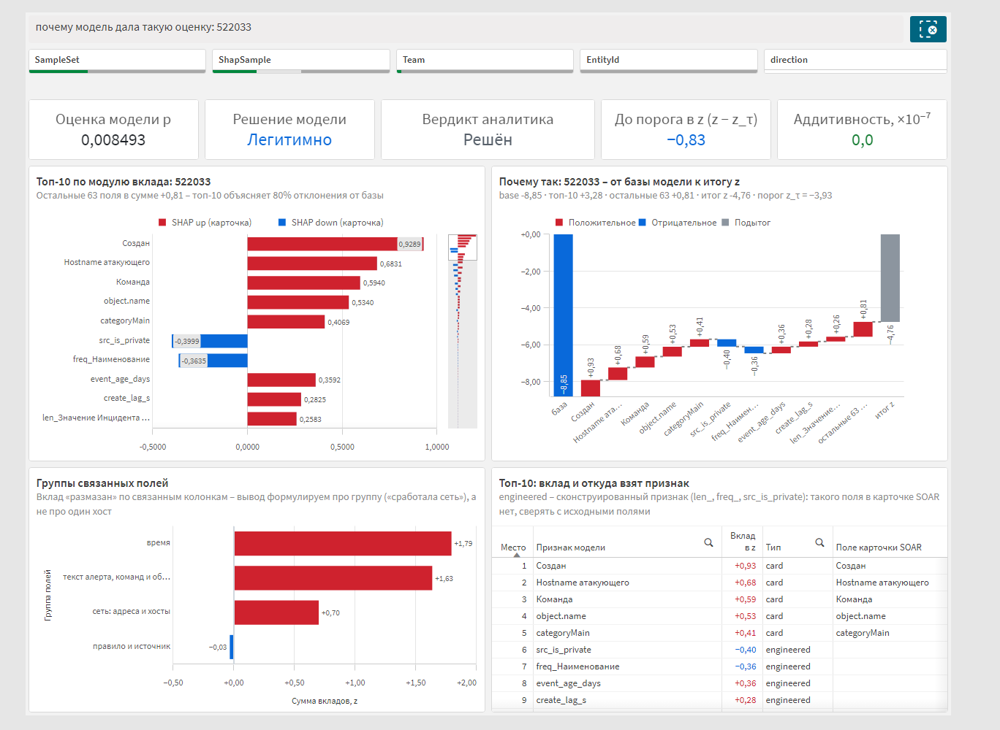
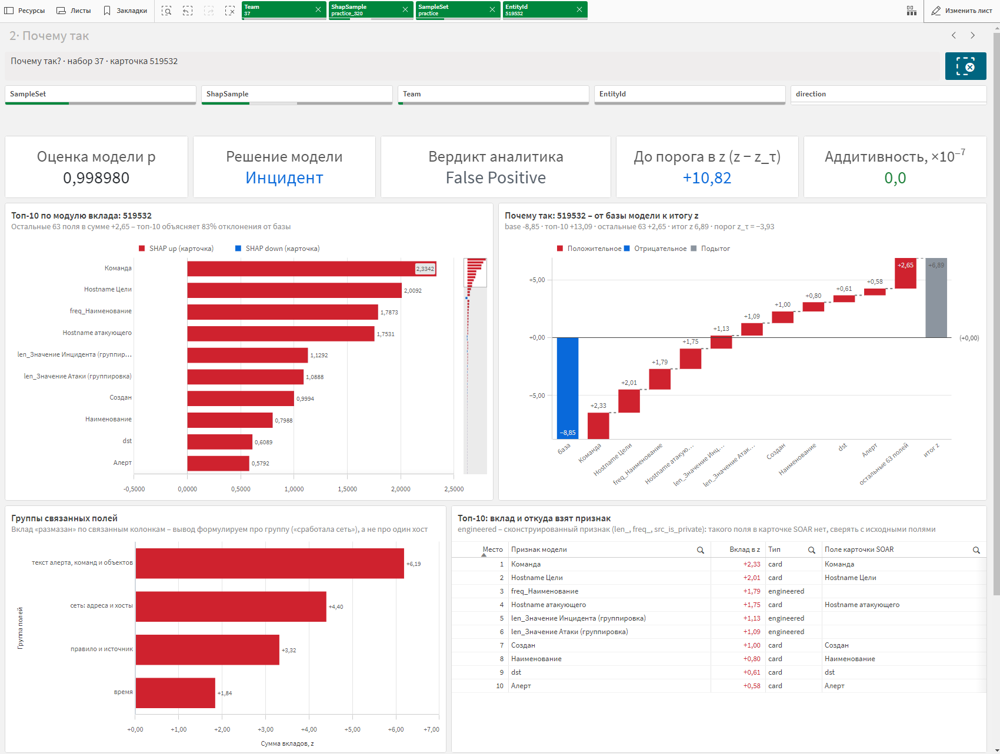
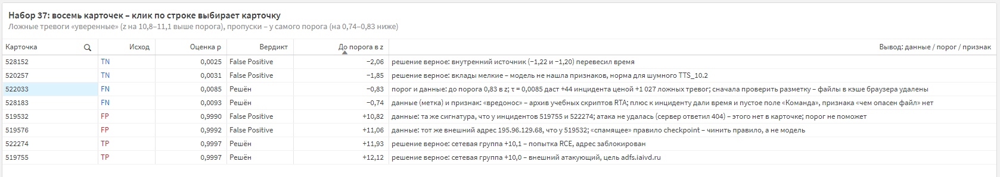

# СРС 3.4 в Qlik Sense: лист «Почему так? · набор 37»

Лист построен в приложении практики 3.7 `IAVD_Assessment_v05.qvf` из BI-комплекта (`IAVD_3.7_BI_team`). Это заготовка преподавателей «Почему так», доведённая до требований лекции 3.4: хвост «остальные 63 полей», проверка аддитивности, группы связанных полей, вывод «данные / порог / признак». Готовое приложение `IAVD_Assessment_v05.qvf` (192 МБ, с данными) – в [Release v3.7](https://github.com/Dasha-9/Intelligent-data-analysis-and-visualization/releases/tag/v3.7): в git файлы больше 100 МБ не помещаются.

| FN 522033 | FP 519532 |
|---|---|
|  |  |

Вклады в приложении совпадают с расчётом модели в Python до 6·10⁻⁷ (`fact_shap` хранится во float32).

## 0. Загрузка

1. Распакуйте `IAVD_3_7_BI_team.zip`, скопируйте `app/IAVD_Assessment_v05.qvf` в `Документы\Qlik\Sense\Apps`.
2. Подключение **`RootIAVD`**. В приложение оно приходит с путём с компьютера преподавателя (`C:\Bolshakov\…`). «Редактор загрузки» → подключение `RootIAVD` → «Изменить» → укажите папку `IAVD_3.7_BI_team`, в которой лежат `app`, `data`, `docs`.
3. В скрипте (раздел «0. Путь и переменные приложения») пути к данным:
   ```
   LET vMarts = 'lib://RootIAVD/data/5/Parquet/Gen/';
   LET vSrcML = 'lib://RootIAVD/data/2_5/Parquet/Gen/';
   ```
   В исходном скрипте стоит `…/Qlik/Data/…`. Так тоже можно, если сложить данные в папки `Qlik\Data`.
4. Последней вкладкой скрипта вставьте [`load_script_add_3.4.qvs`](load_script_add_3.4.qvs): таблица `ГруппыПолей` (73 признака → 4 смысловые группы) и переменные `vShapSample = practice_320`, `vZTau = −3,9303`.
5. «Загрузить данные». Проверка: `Count(DISTINCT {<Team={37}>} EntityId)` = 8, `Count(DISTINCT ГруппаПоля)` = 4.

## 1. Выборки при открытии листа

У карточек практики в `FACT_Shap` две копии вкладов: `practice_320` и `productive_20584`. Без выбранного среза меры заготовки пустые. «Свойства листа» → «Действия» → четыре действия «Выберите значения, соответствующие условию поиска»: `SampleSet` = `practice`, `ShapSample` = `practice_320`, `Team` = `37`, `EntityId` = `522033`.

Во всех новых мерах срез ещё и зашит в формулу – `{<ShapSample={'$(vShapSample)'}>}`. Так лист не удвоит вклады, даже если выборку снимут.

## 2. Ряд KPI

Меры заготовки – ссылки на основные элементы (значок цепи). Перед правкой меру надо отвязать, иначе изменится основной элемент и все объекты, которые его используют.

| Плитка | Мера | Формат / цвет |
|---|---|---|
| Оценка модели p | `Only(score)` | `0,000000`, `#1F2328` |
| Решение модели | `Dual(If(Only(score) >= 0.019259, 'Инцидент', 'Легитимно'), If(Only(score) >= 0.019259, 1, 0))` | формат «Выражение меры»; условные цвета, граница 0,5: ниже `#0969DA`, выше `#CF222E` |
| Вердикт аналитика | `=Only(Verdict)` | `#57606A` |
| До порога в z | `Only(base) + Sum({<ShapSample={'$(vShapSample)'}>} shap) - vZTau` | `+0,00;−0,00`, `#0969DA` |
| Аддитивность, ×10⁻⁷ | `Fabs(1/(1+Exp(-(Only(base) + Sum({<ShapSample={'$(vShapSample)'}>} shap)))) - Only(score)) * 1E7` | `0,0`; условные цвета, граница 5: ниже `#1A7F37`, выше `#CF222E` |

У KPI нет цвета «по выражению», только условные цвета по числу. Поэтому решение – `Dual` (на экране текст, внутри 0/1), а аддитивность показана в единицах 10⁻⁷. В приложении `score` хранится без округления, поэтому расхождение – порядка 10⁻¹⁷, на плитке 0,0.

## 3. Водопад: база → 10 вкладов → остальные 63 → итог

Каскадная диаграмма заготовки («база → все плюсы → все минусы»). В ней 12 мер, у всех операция «Добавить»:

| № | Метка | Мера |
|---|---|---|
| 1 | `база` | `Only(base)` |
| 2–11 | `=Only({<ShapSample={'$(vShapSample)'}, ShapRank={k}>} source_column)`, k = 1…10 | `Sum({<ShapSample={'$(vShapSample)'}, ShapRank={k}>} shap)` |
| 12 | `остальные 63 полей` | `Sum({<ShapSample={'$(vShapSample)'}, ShapRank={">10"}>} shap)`, «Промежуточные итоги» вкл, метка итога `итог z` |

- Формат мер: `+0,00;−0,00`.
- Цвета: положительные `#CF222E`, отрицательные `#0969DA`, итог `#8C959F`.
- Подзаголовок:
  ```
  ='base ' & Num(Only(base), '0,00') & ' · топ-10 ' & Num(Sum({<ShapSample={'$(vShapSample)'}, ShapRank={"<=10"}>} shap), '+0,00;−0,00') & ' · остальные 63 ' & Num(Sum({<ShapSample={'$(vShapSample)'}, ShapRank={">10"}>} shap), '+0,00;−0,00') & ' · итог z ' & Num(Only(base) + Sum({<ShapSample={'$(vShapSample)'}>} shap), '0,00') & ' · порог z_τ = −3,93'
  ```

Промежуточный итог включён только у меры 12. Без хвоста итог водопада – сумма одного топ-10 и не совпадает с оценкой модели: у 522033 было бы −5,57 вместо −4,76. Это «ловушка 2» лекции (слайды 18–19). Опорной линии у каскадной диаграммы нет, поэтому порог стоит в подзаголовке и в KPI.

Контроль 522033: база −8,85 · Создан +0,93 · Hostname атакующего +0,68 · Команда +0,59 · object.name +0,53 · categoryMain +0,41 · src_is_private −0,40 · freq_Наименование −0,36 · event_age_days +0,36 · create_lag_s +0,28 · len_Значение Инцидента +0,26 · остальные 63 +0,81 · итог −4,76.

## 4. Топ-10 по модулю вклада

Линейчатая диаграмма заготовки. Цвета основных мер `SHAP up` / `SHAP down` заменены в библиотеке на `#CF222E` / `#0969DA`. Подзаголовок:
```
='Остальные 63 поля в сумме ' & Num(Sum({<ShapSample={'$(vShapSample)'}, ShapRank={">10"}>} shap), '+0,00;−0,00') & ' – топ-10 объясняет ' & Num(Sum({<ShapSample={'$(vShapSample)'}, ShapRank={"<=10"}>} shap) / Sum({<ShapSample={'$(vShapSample)'}>} shap), '0%') & ' отклонения от базы'
```

## 5. Группы связанных полей (вместо таблицы «Направление»)

Линейчатая, горизонтальная:
- измерение `ГруппаПоля`;
- мера `Sum({<ShapSample={'$(vShapSample)'}>} shap)`, формат `+0,00;−0,00`;
- сортировка по мере;
- цвет по выражению `If(Sum({<ShapSample={'$(vShapSample)'}>} shap) > 0, '#CF222E', '#0969DA')`.

Контроль: 522033 – время +1,79 · текст +1,63 · сеть +0,70 · правило −0,03; 519532 – текст +6,19 · сеть +4,40 · правило +3,32 · время +1,84.

## 6. Топ-10: вклад и откуда взят признак (вместо «Справочника признака»)

Таблица:
- измерения: `source_column`, `kind`, `card_field`;
- меры:
  - `Место` – `Only({<ShapSample={'$(vShapSample)'}, ShapRank={"<=10"}>} ShapRank)`;
  - `Вклад в z` – `Sum({<ShapSample={'$(vShapSample)'}, ShapRank={"<=10"}>} shap)`, цвет текста по знаку;
- «Включить нулевые значения» выкл – остаются 10 строк;
- сортировка по «Месту».

`kind = engineered` – сконструированный признак: такого поля в карточке SOAR нет (методичка 3.7, шаг 6).

## 7. Набор 37: восемь карточек

Таблица:
- измерение `EntityId`;
- во всех мерах `{<EntityId=>}`: таблица показывает все 8 карточек, а клик по строке выбирает карточку для всего листа.

| Столбец | Выражение |
|---|---|
| Исход | `=If(Only({<EntityId=>} y) = 1, If(Only({<EntityId=>} score) >= 0.019259, 'TP', 'FN'), If(Only({<EntityId=>} score) >= 0.019259, 'FP', 'TN'))` |
| Оценка p | `Only({<EntityId=>} score)` |
| Вердикт | `=Only({<EntityId=>} Verdict)` |
| До порога в z | `Only({<EntityId=>} base) + Sum({<EntityId=, ShapSample={'$(vShapSample)'}>} shap) - vZTau` |
| Вывод | `=Pick(Match(Only({<EntityId=>} EntityId), '522033', '528183', …), '…', …)` – текст по каждой карточке, как в [README работы](../README.md) |

Строка выбранной карточки подсвечивается: цвет фона измерения `If(EntityId = GetFieldSelections(EntityId), '#DDF4FF')`. Сортировка – по «До порога в z»: видно, что порог проходит между −0,74 (FN) и +10,82 (FP).



## Почему эти графики

- **Водопад** – единственная форма, где видно, как из базы −8,85 получается итог. Каждый шаг – вклад поля, отдельная ступень – хвост остальных 63 полей, чтобы топ-10 не выдавался за всё объяснение.
- **KPI «до порога в z»** сразу отвечает «близко ли к порогу»: −0,83 у 522033 (сдвиг порога поможет, но дорого) против +10,82 у 519532 (не поможет).
- **Проверка аддитивности** – отдельная плитка: объяснение без неё нельзя принимать (чек-лист приёмки, слайд 40).
- **Группы** – вклад «размазан» по связанным колонкам; вывод формулируем про группу, а не про один хост.
- **Таблица набора** – обзор восьми карточек и вывод «данные / порог / признак» прямо на листе; заодно навигация.
